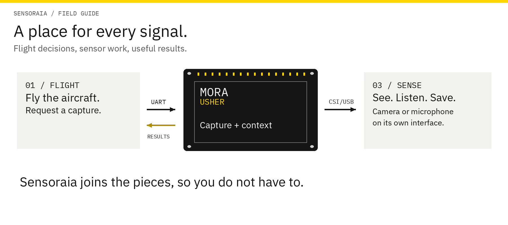

# sensoraia

**Live airborne sensing and AI, with a clear path from PC simulation to onboard use.**

Sensoraia brings camera capture, neural inference, thermal and acoustic sensing
together around **USHER**, its camera-compute service. **MORA** is the onboard
computer: a Raspberry Pi Zero 2 W running 64-bit Raspberry Pi OS Trixie.
The flight controller retains flight control; USHER handles sensor work and
exchanges requests and results through the integration protocol.



## Your Three-Step Path From Laptop To Sky

You do not need a solder iron, a camera, or an airfield to try Sensoraia today:

1. **Simulate locally on your PC** — fly a full mission from takeoff to landing in Paparazzi Center while your real propeller stays safely in its box.
2. **Desk-test with MORA** — plug MORA into your laptop with one FTDI cable so the simulated aircraft talks over real 3.3 V UART wires to real USHER and your physical sensor on the bench ([FTDI Desk Test](docs/desk-test.md)).
3. **Fly onboard** — connect MORA's UART to your Paparazzi flight controller and fly the exact same software and protocol you already proved on your desk.

## Start Here

With Paparazzi already installed at `~/paparazzi`, build the PC suite and link
the simulation configurations in two commands:

```sh
make native
./kickstart.sh
```

Then open **Paparazzi Center** (`cd ~/paparazzi && ./paparazzi`), pick the
camera aircraft you want to fly (for example **`Easystar_3_SPOTTERCAM`** or
**`Bebop_DIPLACAM`**) with target **`nps`**, click **Build**, choose the
matching **`Sensoraia <Camera> NPS`** session, and click **Execute** to fly from
takeoff to landing—even with no MORA board or physical camera attached. With a
MORA FTDI cable connected, the same sessions automatically route UART traffic to
USHER on MORA.

## Choose Your Camera

Selecting which camera Sensoraia runs is one choice in each workflow:

| Camera / Module | MORA (`camera.conf` or `make mora-deploy CAMERA=...`) | Paparazzi Center Aircraft & Session | Module Guide |
| --- | --- | --- | --- |
| **Spottercam** *(default)* | `CAMERA = spottercam` | `Easystar_3_SPOTTERCAM` / **Sensoraia Spottercam NPS** | [modules/spotter_cam/](modules/spotter_cam/README.md) · [Guide](modules/spotter_cam/docs/spottercam.md) |
| **AI Camera** (plain photos) | `CAMERA = aicam` | `Easystar_3_AICAM` / **Sensoraia AIcam NPS** | [modules/ai_cam/](modules/ai_cam/README.md) · [Guide](modules/ai_cam/docs/raspberry-pi-ai-camera.md) |
| **LWIRcam** (thermal) | `CAMERA = lwircam` | `Easystar_3_LWIRCAM` / **Sensoraia LWIRcam NPS** | [modules/lwir_cam/](modules/lwir_cam/README.md) · [Guide](modules/lwir_cam/docs/lwir-cam.md) |
| **CHDKbridge** (Canon USB) | `CAMERA = chdk` | `Easystar_3_CHDKCAM` / **Sensoraia CHDKcam NPS** | [modules/chdkbridge/](modules/chdkbridge/README.md) · [Guide](modules/chdkbridge/docs/chdkbridge.md) |
| **EARcam** (acoustic) | `CAMERA = earcam` | `Easystar_3_EARCAM` / **Sensoraia EARcam NPS** | [modules/ear_cam/](modules/ear_cam/README.md) · [Guide](modules/ear_cam/docs/earcam-loudest-spot-explained.md) |
| **LOOMcam** (visual return) | `CAMERA = loomcam` | `Easystar_3_LOOMCAM` / **Sensoraia LOOMcam NPS** | [modules/loom_cam/](modules/loom_cam/README.md) · [Guide](modules/loom_cam/docs/loom-cam.md) |
| **Diplacam** (8-point planner) | `CAMERA = diplacam` | `Bebop_DIPLACAM` / **Sensoraia Diplacam NPS** | [modules/dipla_cam/](modules/dipla_cam/README.md) · [Guide](modules/dipla_cam/docs/diplacam.md) |
| **PANGEA** (photo mapping) | Offline / live `--pangea` | `Easystar_3_MIMIC` / **Sensoraia MIMIC PANGEA NPS** | [modules/pangea/](modules/pangea/README.md) · [Guide](modules/pangea/docs/pangea.md) |

| Your next step | Guide |
| --- | --- |
| Understand the suite and choose a sensor | [About Sensoraia](docs/index.md) |
| Install, build, choose a camera, or deploy to MORA | [Install And Get Started](docs/README.md) |
| Fly a start-to-landing Paparazzi simulation or add the module to your aircraft | [Autopilot Integration](docs/autopilot-integration.md) · [Simulation Manual](examples/paparazzi/README.md) |
| Run a laptop-to-MORA FTDI hardware-in-the-loop desk test | [FTDI Desk Test](docs/desk-test.md) |
| Calibrate thermal measurements | [LWIR Calibration](modules/lwir_cam/docs/lwir-calibration.md) |
| Reconstruct a map from saved photos | [PANGEA](modules/pangea/docs/pangea.md) |
| Capture, inspect results, or tailor/create a module | [Capture With USHER](docs/usher-camera-pipeline.md) |
| Look up unfamiliar names and abbreviations | [Glossary](docs/glossary.md) |

## What You Can Use

| Application | Role |
| --- | --- |
| Spottercam | IMX500 image capture and image-space vehicle detections |
| LWIRcam | Thermal capture and temperature-processing workflows |
| EARcam | Acoustic sensing and sound-source estimates |
| CHDKbridge | Canon CHDK camera control and photo capture |
| PANGEA | Map reconstruction from saved, positioned photos |
| Diplacam | Experimental neural eight-point planning |
| LOOMcam | Experimental visual-return integration; a trained homing model is not included |

Spottercam's image boxes need projection and the appropriate target integration;
the PC demo includes its waypoint companion. Live follow-up depends on the
installation and flight plan. Sensor calibration, timing and
field accuracy need application-specific validation. Live operation is not a
guaranteed hard real-time deadline.

## Build On Your Linux PC

Install the [PC dependencies](docs/README.md#2-install-pc-dependencies)
first. From the Sensoraia root, build the complete suite (`make` automatically
syncs, initializes, and verifies the pinned OpenCV `4.14.0` submodule in
`ext/opencv` on first run):

```sh
make help
make all
./usher --version
```

The root Makefile owns builds and packaging. Public builds, simulation launchers
and deployment do not require the private developer checkout. Simulation uses
the same application sources with simulated inputs, not identical PC/ARM64
binaries or hardware drivers. Paparazzi examples additionally need a working
Paparazzi aircraft with the required UART/point modules; see the
[preparation recipe](examples/paparazzi/README.md) before launching.

`make all` compiles every Sensoraia application for the PC and ARM64. It
prepares missing SDKs and pinned source dependencies automatically, including
the native camera library; no private libcamera checkout is required. At the
end it lists every executable and reports `27 executables verified`.

For MORA, package the ARM64 binaries built on the PC.
Upload and activation are a separate step in the
[deployment guide](docs/README.md#deploy-to-mora).

`make` and `make all` use the available CPU cores automatically; no `-j` option is
needed. Use `make -j4 all` to limit parallelism or `make -j1 all` for a serial
build. After an intentional `make clean`, run `make all` again; it recreates
the removed dependencies and builds the complete suite. The first build and
a build after cleaning need Internet access for pinned sources and SDK packages.
Build targets do not package or deploy a release.

## Customize A Module Or Contribute (Fork & Pull Request)

Every sensor module lives in its own directory under `modules/<module>/` with
its own `README.md` and `docs/` guide:

1. **Fork & clone:** Fork `sensoraia` on GitHub, then clone with submodules:
   `git clone --recurse-submodules https://github.com/<you>/sensoraia.git`.
2. **Tailor or add a module:** Edit an existing module under `modules/<name>/`
   (or add a new module folder with its `README.md`, `docs/`, and backend
   registration in `src/camera_backend_registry.c`), then verify your build
   with `make all` (`27 executables verified`, or including your new binary).
3. **Open a Pull Request:** Push a topic branch to your fork and open a Pull
   Request describing the module change and how you tested it in simulation or
   on MORA. See [Tailor Or Add A Module](docs/usher-camera-pipeline.md#tailor-or-add-a-module).

See [LICENSE](LICENSE) and the notices supplied with third-party components.
