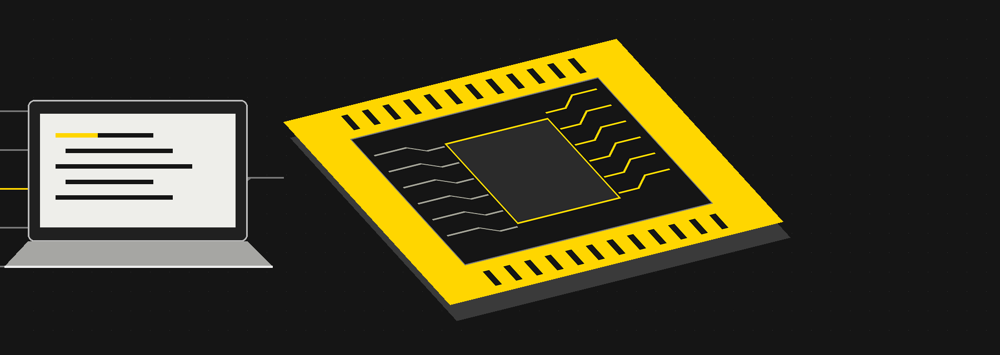
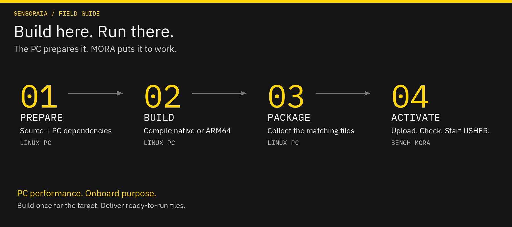
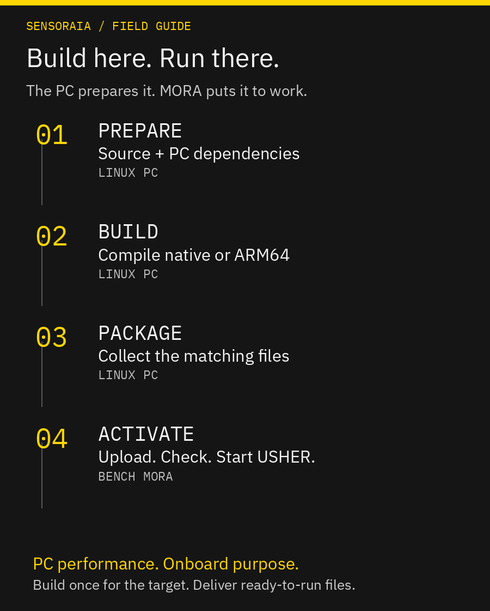

# Install And Get Started

{ .chapter-art }

Welcome to Sensoraia. This guide takes you from a source checkout to a running
camera service, first on your Linux PC and then on MORA. The Pi Zero 2 W is our
initial reference board, not a requirement; you can stop after simulation or
adapt the deployment to another compatible compute board.

The guide keeps PC preparation, local use and onboard deployment as separate
steps, so you can take the route that matches the equipment you have today.

New to MORA, USHER or the abbreviations? Keep the
[Sensoraia glossary](glossary.md) beside this guide. Its
[installation terms](glossary.md#installation-and-operation) explain builds,
packages, paths and deployment without assuming you already know the tools.

## Before You Start

| For this task | You need |
| --- | --- |
| Build PC applications | Linux, a C/C++ toolchain and the dependencies below |
| Run a simulated flight | A working Paparazzi NPS installation and the example aircraft configuration |
| Deploy onboard | A compatible Linux compute board; the current ready-made reference is Raspberry Pi Zero 2 W with 64-bit Raspberry Pi OS Trixie |
| Capture from hardware | Your camera or USB microphone, correct cables and its runtime packages |

The Pi is the deliberately modest starting point for resource planning, not
the definition of MORA. Current ARM64 build and package instructions are for
Raspberry Pi OS Trixie on that board. Other boards need matching binaries,
runtime libraries, sensor drivers and interface configuration; verify their
combined memory and processing capacity with the services you intend to run.

These examples use `~/develop/sensoraia`, SSH user `air`, host
`theatre.local` and install directory `/home/air/sensoraia`. Change them to
match your machine. The packaged service currently runs as `air`; if you
choose another account, review the service template before packaging.

Connect camera ribbon cables only with power off. For UART, use **3.3 V
logic**, crossed TX/RX and a common ground.

## Build On Your PC

{ .field-guide-wide loading=lazy decoding=async }

{ .field-guide-tall loading=lazy decoding=async }

### 1. Prepare The Source Checkout

Clone the repository (`make` automatically syncs and checks out the pinned
OpenCV `4.14.0` submodule into `ext/opencv` on first build, or pass
`--recurse-submodules` to prefetch it during clone):

```sh
git clone https://github.com/OpenUAS/sensoraia.git ~/develop/sensoraia
cd ~/develop/sensoraia
make help
```

All product builds, self-contained Paparazzi demo airframes, flight plans, and
simulation launchers are included directly in this repository. `make help` lists
all supported build, camera-selection, packaging, and deployment commands.

### 2. Install PC Dependencies

On a Debian/Ubuntu development PC, start with:

```sh
sudo apt update
sudo apt install build-essential cmake meson ninja-build pkg-config \
  gcc-aarch64-linux-gnu g++-aarch64-linux-gnu \
  git curl ca-certificates gnupg openssl patch python3 python3-venv python3-jinja2 python3-yaml \
  libasound2-dev \
  rsync openssh-client
```

These are development-PC packages, installed once. The cross-compilers let
the same PC build the ARM64 applications as well as native applications.
No preinstalled `libcamera-dev`, private camera checkout or manual copying of
camera headers is required: the normal build compiles its pinned native
camera library from source into the checkout's private build area.

The first build needs Internet access to fetch checked source archives,
build-tool Python packages and the Raspberry Pi OS Trixie SDK packages.
Those downloads and SDK extraction do not require root access. Later builds
reuse the prepared dependencies unless you clean them.

### 3. Build Native Applications

For the complete suite, run this from the checkout root:

```sh
make all
```

This is also the command to use after `make clean`. It prepares missing
dependencies first, then compiles **every Sensoraia application** for both
PC and ARM64. Parallel jobs are selected automatically; you do not need to
remember `-j` or individual module targets.

The native camera library, YAML support and OpenCV are built from pinned or
bundled sources. OpenCV `4.14.0` lives as a pinned Git submodule at
`ext/opencv` in the checkout and is initialized automatically on first `make`.
Every application's JPEG codec is built directly from OpenCV's bundled IJG
sources; no system JPEG development package or separate JPEG download is
required. OpenCV image-codec modules are not added.
The ARM64 sysroot is prepared from
signed Trixie packages, including camera and ALSA development files. All of
this happens on the PC; no running MORA or SSH connection is needed to build.

**Success looks like:** a final list of every executable followed by:

```text
Complete Sensoraia suite: 27 executables verified.
```

The build exits with an error if a required application is missing. A few
completed compiler commands are not the completion report for the whole suite.

| Built Application | PC Output | ARM64 Output |
| --- | --- | --- |
| USHER | `usher` | `usher-arm64` |
| SODA | `bin/soda` | `bin/soda-arm64` |
| Camera lens tool | `bin/camera_lens` | `bin/camera_lens-arm64` |
| PANGEA | `bin/pangea` | `bin/pangea-arm64` |
| LWIRcam | `bin/lwircam` | `bin/lwircam-arm64` |
| LWIR calibration | `bin/lwir_calibrate` | `bin/lwir_calibrate-arm64` |
| EARcam | `bin/earcam` | `bin/earcam-arm64` |
| Acoustic heatmap replay | `bin/ear_heatmap_replay` | `bin/ear_heatmap_replay-arm64` |
| LOOMcam | `bin/loomcam` | `bin/loomcam-arm64` |
| AIcam native photo worker | `bin/aicam` | `bin/aicam-arm64` |
| Spottercam | `bin/spottercam` | `bin/spottercam-arm64` |
| CHDKbridge | `bin/chdkbridge` | `bin/chdkbridge-arm64` |
| Diplacam | `bin/diplacam` | `bin/diplacam-arm64` |
| Acoustic heatmap overlay | `bin/ear_heatmap_overlay` | PC-only tool |

AIcam and CHDK camera backends are integrated into USHER. The native AIcam
photo worker and CHDKbridge can also be used separately. Building an application does not enable
its sensor, install a model or start a service. Choose its guide below for
the appropriate hardware, configuration and example workflow.

**You should now have:** `usher` at the project root and camera applications
in `bin/`. Check without opening any hardware:

```sh
./usher --version
./bin/lwircam --version
./bin/pangea --version
make suite-check
```

Run `make all` again for normal updates; unchanged files and dependencies
are reused. To cap parallel jobs, use `make -j4 all`; `make -j1 all` is serial.
An intentional full cleanup is:

```sh
make clean
make all
```

`make clean all` is also ordered safely. Cleaning removes generated binaries,
SDKs and build caches, so the next build downloads and prepares them again.
It does not remove your installed PC prerequisite packages or source checkout.
Use `make -B all` when you want to force rebuilding without deleting SDKs.

A build error is not a request to run `make clean`. The useful part is usually
the first compiler or dependency error; the last line just reports that Make
is disappointed too. See [If Something Stops](#if-something-stops).

## Try It Without Hardware

### Fly A Full Simulation In Paparazzi Center

With Paparazzi already installed at `~/paparazzi`, run `./kickstart.sh` once
from the Sensoraia root to link the supplied flight plans, airframes, and
unified control panel into `~/paparazzi/conf/`:

```sh
make native
./kickstart.sh
cd ~/paparazzi && ./paparazzi
```

In **Paparazzi Center**, select your camera aircraft (such as
`Easystar_3_SPOTTERCAM`, `Easystar_3_AICAM`, `Easystar_3_LWIRCAM`,
`Easystar_3_CHDKCAM`, `Easystar_3_EARCAM`, `Easystar_3_LOOMCAM`,
`Easystar_3_MIMIC`, or `Bebop_DIPLACAM`),
pick target **nps**, and click **Build**. Then open the **Session** tab, select
the matching **Sensoraia \<Camera\> NPS** session, and click **Execute**. The
session starts USHER for you—do not start local USHER separately. Follow the
step-by-step [simulation walkthrough](../examples/paparazzi/README.md).

### Start Standalone Local USHER

```sh
bash examples/paparazzi/run_local_demo.sh --camera spottercam
```

Leave the terminal open (or edit `CAMERA = ...` in `camera.conf`). USHER creates
`/tmp/usher-sim` and prints capture diagnostics. Stop it with Ctrl+C when
finished; never run it simultaneously with a Center session that already starts
USHER.

### Connect A Simulated Aircraft

Follow [Paparazzi integration](autopilot-integration.md#start-a-simulated-flight-takeoff-to-landing)
to install the supplied plans and select a matching NPS session. That guide
explains which sessions start USHER for you; use either the session-managed
service or the terminal above, never both.

For simulated photographs of real terrain, use [MIMIC](mimic.md#quick-start).
It reads your existing aerial tile cache, renders camera views and saves
photographs. [PANGEA](../modules/pangea/docs/pangea.md) can then map those
saved photographs. Missing imagery is reported rather than invented.

**Success looks like:** a trigger in the simulator, a newly saved JPEG and
a completion message in USHER. A GCS photo marker alone means a request was
admitted, not necessarily that a file was saved.

### Try The Real Board On Your Desk

Once MORA is prepared and deployed, follow the
[laptop-to-MORA FTDI desk test](desk-test.md). Keep the aircraft simulated
while using the real board and cable, first with mock capture and then a
physical camera. The illustrated guide includes the dedicated Center session.

## Prepare The Reference Pi Board

The steps below set up the current Raspberry Pi Zero 2 W reference platform.
For another compute board, use its supported Linux image and adapt the OS,
service, UART and sensor-runtime steps to that board. The board-independent
MORA role does not make Raspberry Pi drivers, GPIO numbers or packages
portable automatically.

1. Install **64-bit Raspberry Pi OS Trixie** and configure networking and SSH.
   Follow the [board setup guide](setup-os-rpi-zero-2w.md).
2. Configure the camera UART on `/dev/serial0`; disable the serial login console.
3. Add the service account to the device groups required by your hardware,
   including `dialout` for UART and the USB/audio groups used by your setup.
4. Install runtime packages for your sensor. For stock AIcam this includes
   the OS camera tools; CHDKbridge needs no extra package, only USB device
   access for the service account.
   The [sensor guide](#choose-your-next-guide) gives the relevant commands.
5. Confirm SSH and architecture from the PC:

```sh
ssh air@theatre.local 'uname -m; ls -l /dev/serial0; df -h /home/air'
```

Expect `aarch64`, an accessible UART device and room for the release and
photographs.

## Deploy To MORA

### 1. Cross-Build And Package On The PC

After `make all` has completed, package the ARM64 applications on the same PC:

```sh
make mora-package MORA_INSTALL_DIR=/home/air/sensoraia
```

The cross-compilers were installed in the PC prerequisite step. The build's
private ARM64 SDK already includes ALSA; you do not need to enable system
ARM64 multiarch or install `libasound2-dev:arm64` for this normal workflow.
Packaging refreshes ARM64 binaries as needed and prepares the install package.
It does not contact the board or restart a service. Keep the same
`MORA_INSTALL_DIR` for packaging and deployment.

### 2. Choose Your Camera (`camera.conf` Or `CAMERA=...`)

Open `camera.conf` in the Sensoraia root and set `CAMERA` to the sensor you want
MORA's `usher.service` to run (`spottercam`, `aicam`, `lwircam`, `chdk`,
`earcam`, `loomcam`, or `diplacam`), **or** pass `CAMERA=<name>` directly on the
command line without editing any service template:

```sh
make mora-package CAMERA=lwircam MORA_INSTALL_DIR=/home/air/sensoraia
```

The default `CAMERA = spottercam` starts Spottercam (`--spottercam`) on the
IMX500 AI Camera with `nn_vehicles.rpk`. All other camera binaries remain
installed on MORA so switching cameras later is just changing `CAMERA` and
redeploying. For smaller single-purpose packages, `MORA_PROFILE=lwircam` or
`MORA_PROFILE=diplacam` remain available. AIcam, Spottercam, and LOOMcam share
the same physical IMX500 sensor; run only one of them at a time. See
[Choose a camera](usher-camera-pipeline.md#choose-a-camera).

### 3. Upload And Activate

Safe operation is the end user's responsibility.

```sh
make mora-deploy \
  MORA_SSH_TARGET=air@theatre.local \
  MORA_INSTALL_DIR=/home/air/sensoraia
```

Deployment stages the files, checks the package and runtime dependencies,
backs up the installed release, and activates the service. The command reports
the staging and backup paths.

If activation needs a sudo password, use the interactive procedure in
[Deployment recovery](usher-camera-pipeline.md#when-sudo-requires-your-password).
Use the staging path printed by your own upload, not one from an old example.

### 4. Confirm The Installed Release

```sh
ssh air@theatre.local 'systemctl --no-pager --full status usher.service'
ssh air@theatre.local 'journalctl -u usher.service -n 50 --no-pager'
```

Expect the service to be active and the selected sensors to initialize.
Make a bench capture, confirm that the JPEG is readable, and inspect its
metadata before connecting flight requests. Service startup alone does not
confirm capture quality, calibration or sustained operation.

To watch subsequent activity:

```sh
ssh -t air@theatre.local 'journalctl -fu usher.service'
```

Ctrl+C stops log following, not the service.

## Choose Your Next Guide

| What you are setting up | Guide |
| --- | --- |
| Raspberry Pi photographs | [AI Camera](../modules/ai_cam/docs/raspberry-pi-ai-camera.md) |
| Canon USB camera | [CHDKbridge](../modules/chdkbridge/docs/chdkbridge.md) |
| Thermal capture | [LWIRcam](../modules/lwir_cam/docs/lwir-cam.md) |
| Real-camera capture throughput | [Camera Speed Test](camera-speedtest.md) |
| Thermal lens, mounting and temperature checks | [LWIR calibration](../modules/lwir_cam/docs/lwir-calibration.md) |
| Acoustic search | [EARcam](../modules/ear_cam/docs/earcam-loudest-spot-explained.md) |
| Gas, particle and radiation sensing possibilities | [Chemical Vapors and Emissions](chemical-vapors-and-emissions.md) |
| Vehicle detection | [Spottercam](../modules/spotter_cam/docs/spottercam.md) |
| Maps from saved photos | [PANGEA](../modules/pangea/docs/pangea.md) |
| PC simulation or MORA in the loop | [Paparazzi integration](autopilot-integration.md) |

## If Something Stops

| Symptom | Try this first |
| --- | --- |
| Missing or mismatched OpenCV source | Run `make opencv-submodule` (or `make all`); `ext/opencv` must be unmodified OpenCV tag `4.14.0` |
| A build tool or PC header is missing | Rerun the PC prerequisite-install command above, then `make all` |
| Download or archive-signature check fails | Check Internet access and the first download/signature error; rerun `make all` after resolving it |
| Native camera SDK requested after cleaning | Run `make all`; it builds the private native camera dependency from pinned source |
| Missing ARM64 ALSA with a custom SDK | The default SDK includes ALSA; omit custom sysroot overrides for the normal `make all` workflow, or supply the complete matching SDK |
| Only some applications exist | Check the first error and Make's exit status; rerun `make all` and require the final complete-suite report |
| Existing SDK or source directory is rejected | Keep the reported path and error; do not disable checks or copy headers over it. Use an intentional `make clean` followed by `make all` to recreate generated state |
| SSH cannot find MORA | Confirm its actual hostname/IP, Wi-Fi and SSH configuration |
| `sudo: a password is required` | Use the same upload's staging path and the interactive activation procedure |
| UART is missing or busy | Check `/dev/serial0`, serial-console configuration and whether another USHER owns it |
| Service runs but no photograph appears | Check the sensor flag, camera connection, output directory and first relevant journal error |
| Second local instance refused | Stop the existing local USHER; do not delete its endpoint while it is running |
| Geographic result looks wrong | Check calibration, mounting, time/pose evidence and ground reference; GPS coordinates alone do not validate the result |

For capture-specific symptoms and recovery, use the
[camera reference](usher-camera-pipeline.md). Keep the error message, selected
camera, application version and a short log when asking for help. Those four
details save a surprising amount of guesswork.
