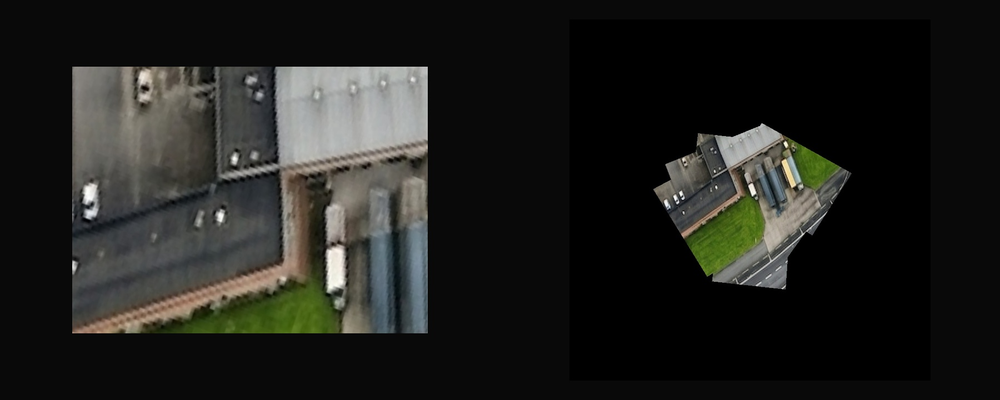

# Try Sensoraia With Paparazzi

Fly a complete mission from takeoff to landing in Paparazzi NPS—even without a
MORA board or physical camera attached. Paparazzi flies the simulated aircraft;
USHER supplies sensor observations and target updates over a simulated local
UART (`/tmp/usher-sim`) or a real FTDI cable to MORA.

[Prepare your first demo](../examples/paparazzi/README.md) |
[Glossary](glossary.md) | [Install Sensoraia](README.md)

## Quick Start: Install Links With `./kickstart.sh`

With Paparazzi already installed at `~/paparazzi`, build the native PC
applications and link the Sensoraia configurations into Paparazzi:

```sh
make native
./kickstart.sh
```

`./kickstart.sh` installs `userconf/SENSORAIA/sensoraia_demo_conf.xml` and the
unified `userconf/SENSORAIA/sensoraia_demo_control_panel.xml` into
`~/paparazzi/conf/`, links the self-contained `SENSORAIA` flight plans,
airframes, radios, and telemetry profiles, and selects the demo configuration
(preserving any previous `conf.xml` and `control_panel.xml` links). Prefer
creating the symlinks yourself or keeping your active `conf.xml` untouched?
Use `./kickstart.sh --no-activate` or follow the exact manual `ln -s` commands
in [Manual Symlink Setup](../examples/paparazzi/README.md#manual-symlink-setup).

## Start A Simulated Flight (Takeoff To Landing)

1. Launch Paparazzi Center: `cd ~/paparazzi && ./paparazzi`.
2. In **Config**, ensure `userconf/SENSORAIA/sensoraia_demo_conf.xml` and
   `userconf/SENSORAIA/sensoraia_demo_control_panel.xml` are selected.
3. Pick the aircraft for the camera you want to fly (for example
   `Easystar_3_SPOTTERCAM` or `Bebop_DIPLACAM`), select target **nps**, and click
   **Build**.
4. Open the **Session** tab, select the matching **Sensoraia \<Camera\> NPS**
   session, and click **Execute**.
5. In **PprzGCS**, wait for live aircraft telemetry and a valid 3D GPS fix
   (`Holding point` or `Ground standby`), then click **Takeoff**.
6. Watch the aircraft climb, fly its camera mission, and complete its landing
   sequence (`Land` $\rightarrow$ `Final` $\rightarrow$ `Flare` on fixed-wing
   demos, or **Return** $\rightarrow$ **Land Here** on `Bebop_DIPLACAM`), then
   click **Stop** in Center before starting another session.

Starting the session programs does not command takeoff. Do not start a second
USHER or simulator on the same endpoints. For MORA hardware-in-the-loop over an
FTDI cable, select **Sensoraia MORA desk NPS** (which omits PC `USHER` so `nps`
connects straight to `/dev/ttyUSB0`).
See the complete [flight walkthrough](../examples/paparazzi/README.md#4-fly-from-start-to-landing).

## Choose Your Camera Demo

| Camera / Mode | Supplied Aircraft | Paparazzi Center Session | What Happens In Flight |
| --- | --- | --- | --- |
| **Spottercam** | `Easystar_3_SPOTTERCAM` (Fixed wing) | **Sensoraia Spottercam NPS** | Captures mock vehicle views, runs native YOLO11n ONNX detection, and projects ranked hits onto `T1..T5` |
| **AI Camera** | `Easystar_3_AICAM` (Fixed wing) | **Sensoraia AIcam NPS** | Periodic wings-level visible-camera survey photos tagged with EXIF flight pose |
| **LWIRcam** | `Easystar_3_LWIRCAM` (Fixed wing) | **Sensoraia LWIRcam NPS** | Thermal survey capture and session protocol flow |
| **CHDKbridge** | `Easystar_3_CHDKCAM` (Fixed wing) | **Sensoraia CHDKcam NPS** | Ticketed optical zoom, distance-triggered survey photos, and pre-landing lens retraction |
| **EARcam** | `Easystar_3_EARCAM` (Fixed wing) | **Sensoraia EARcam NPS** | Flower search over a simulated acoustic beacon and guarded `TARGET` waypoint update |
| **LOOMcam** | `Easystar_3_LOOMCAM` (Fixed wing) | **Sensoraia LOOMcam NPS** | Outbound reference archiving (`START`) followed by return-leg evaluation (`STOP`) |
| **MIMIC / PANGEA** | `Easystar_3_MIMIC` (Fixed wing) | **Sensoraia MIMIC PANGEA NPS** | Renders camera views from cached aerial tiles and reconstructs a georeferenced photo map |
| **Diplacam** | `Bebop_DIPLACAM` (Rotorcraft) | **Sensoraia Diplacam NPS** | Native GP/diffusion planner refreshing eight 2 m sampling waypoints (`P1..P8`) |

Fixed-wing flight plans and the `Bebop_DIPLACAM` rotorcraft flight plan are not
interchangeable: always pair a flight plan with the matching vehicle firmware.

## Add The Paparazzi Module To Your Own Aircraft

The supplied `Easystar_*` and `Bebop_DIPLACAM` demo aircraft already include
everything needed. When adding Sensoraia to **your own Paparazzi aircraft**:

1. **Point Paparazzi at Sensoraia's shared protocol headers/sources:**
   Export `SENSORAIA_SRC=/path/to/sensoraia` in the environment before building
   your aircraft in Paparazzi Center or `make`. `digital_cam_uart` compiles
   `usher_protocol.c` and `camera_control.c` directly from `$SENSORAIA_SRC/src`
   while preserving Paparazzi's standard `dc.c`/`dc.h` boundary.
2. **Add `digital_cam_uart` to your airframe XML (`<target name="ap">` and `<target name="nps">`):**

```xml
<module name="digital_cam_uart">
  <!-- Hardware autopilot target ("ap"): select the FC UART wired to MORA's 3.3 V GPIO14/15 -->
  <configure name="CAMERA_PORT" value="uart4"/>
  <!-- Stream periodic pose updates (required by EARcam and pose-aligned sensors) -->
  <define name="DIGITAL_CAM_UART_POSE_STREAM" value="1"/>
  <!-- Optional default camera bitmask (1=CHDK, 2=AIcam/Spotter/LOOM, 4=LWIR, 8=EARcam, 16=Diplacam) -->
  <define name="DIGITAL_CAM_UART_CAMERA_MASK" value="2"/>
</module>
```

   Do not enable a second conflicting `digital_cam_*` transport in the same
   target. On the `nps` simulation target, `CAMERA_PORT` is replaced
   automatically by the local `/tmp/usher-sim` bridge (or your FTDI cable).
3. **Add `digital_cam_point` in your flight plan XML** whenever your mission
   consumes geographic target points returned by USHER (`EARcam`, `Spottercam`,
   `LWIRcam`, `LOOMcam`, or `Diplacam`):

```xml
<modules>
  <module name="digital_cam_point"/>
</modules>
```

   Use `uart_cam_ctrl_set_camera_mask(...)` to choose which camera triggers,
   `digital_cam_uart_start(CAM)` / `digital_cam_uart_stop(CAM)` for session
   sensors, and `cam_point_fresh(CAM)` + `cam_point_valid(CAM)` +
   `cam_point_to_waypoint(CAM, WP_TARGET)` + `cam_point_consume(CAM)` to validate
   and apply returned target coordinates safely without altering flight altitude.

## MIMIC And PANGEA

Cache aerial imagery over the example route and surrounding camera footprint
in pprzgcs before starting. The session renders camera-view photographs
from the aircraft pose, and PANGEA works from those saved photographs, not
by stitching the provider's original tiles directly.



Use the [MIMIC guide](mimic.md) for cache preparation and
[PANGEA](../modules/pangea/docs/pangea.md) for map inputs and output files.
Missing terrain imagery is a capture problem to resolve, not a reason to
substitute invented field texture.

## Understand Waypoint Updates

An observation, an accepted point and a navigation decision are different
events. A GCS shot marker records an admitted trigger, not necessarily a
saved photograph. Moving a target waypoint does not itself select a block
or tell the aircraft to visit it.

The UART module can suppress shot reports independently of triggering and
returned results. The Diplacam demo uses this to avoid dense yellow shot
markers; see [reporting controls](../modules/dipla_cam/docs/diplacam.md#control-gcs-shot-markers)
for airframe defaults, flight-plan calls and the live GCS setting.

The flight plan retains control of the route and flight altitude. Invalid,
stale or unconfirmed points must not be treated as new targets. A normal
mission can finish without a usable detection or sound fix.

## MORA In The Loop

Use the [Laptop to MORA desk test](desk-test.md) to connect NPS through an
FTDI cable to real USHER. It includes the setup illustration, 5 V power and
3.3 V UART pin table, dedicated Center session and mock-then-real capture
steps. This is a supported user workflow, not a private regression procedure.

## If The Demo Does Not Start

Check that the configuration selects the intended flight plan, every session
program remains running, and no earlier session owns the ports. Read the
first reported error rather than starting duplicate programs. Module guides
explain their specific model, cache and sensor requirements.
