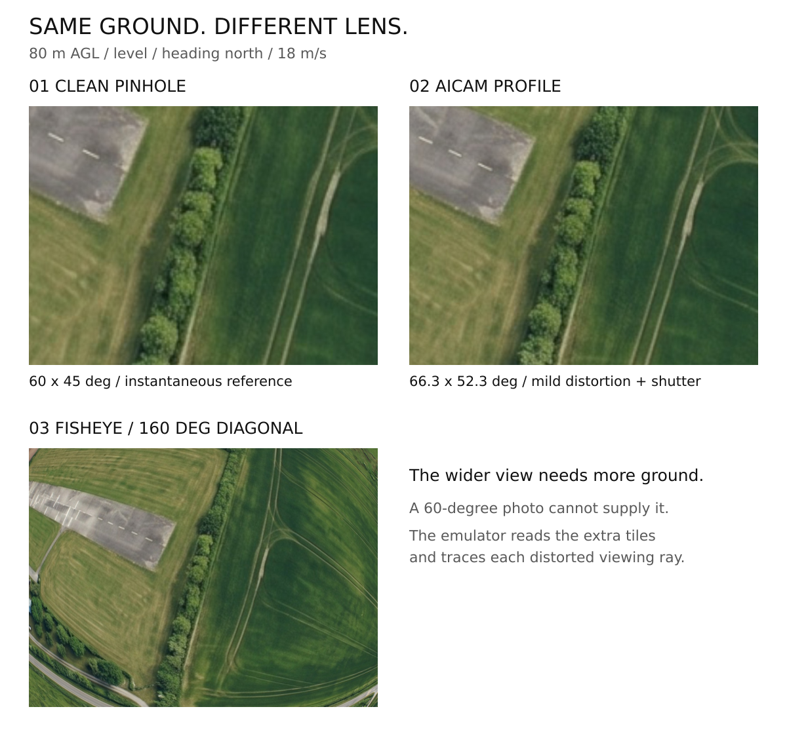
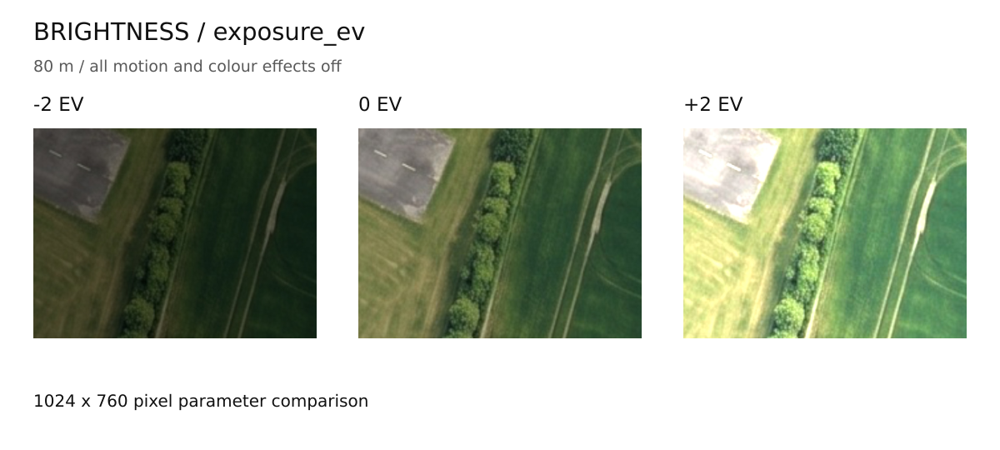
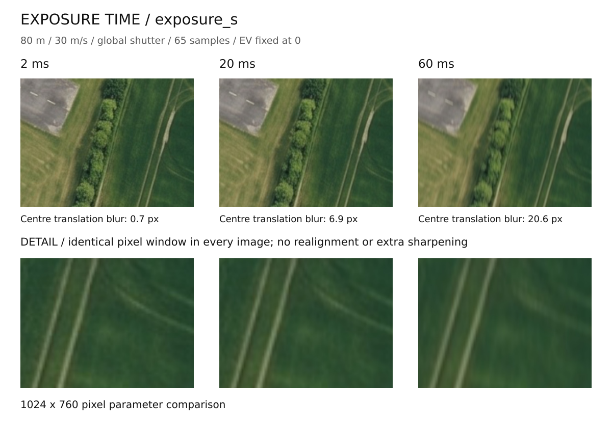
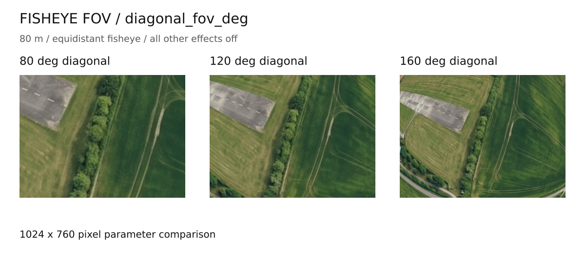

# Try Different Lenses And Shutters

The lens emulator adds declared optical and exposure effects to supported
MIMIC photographs. Use it to compare views, not to claim a physically
calibrated camera. The original clean photo remains available.

[MIMIC flight setup](mimic.md) | [Lens terms](glossary.md#camera-lens)
| [LOOM flight camera selection](../modules/loom_cam/docs/loom-cam.md#select-the-simulated-camera-profile)



## Run With USHER

Build on the PC, then start a local camera peer with a supplied profile:

```sh
make -j32 usher soda camera-lens
./usher --local --mock-map --debug --mock-lens ./bin/camera_lens_aicam.json
```

Connect your NPS aircraft using the [MIMIC walkthrough](mimic.md#a-complete-simulated-flight),
but do not also start a second session-managed USHER. Start with a single
AIcam photo at a suitable simulated pose.

To try the wider fisheye profile, restart the peer using
`bin/camera_lens_fisheye160.json`. Its quoted 160 degrees is diagonal, not
horizontal. A wider view needs more cached surrounding imagery.

## Compare The Two Images

For a clean capture such as `ma000006.jpg`, the processed companion is
`ma000006.lens.jpg`. Open both at the same scale. USHER selects the derivative
before AIcam/LOOM saved-image consumers: outbound LOOM reference links,
return-phase neural inference, and SODA all see the same processed photo,
only after successful emulation. Real hardware captures are unaffected.

| Image | Keep It For |
| --- | --- |
| Original `.jpg` | The clean camera view and available flight metadata |
| `.lens.jpg` | The declared optical/exposure experiment |

Check the current log and file time if processing fails. An old derivative
left on disk is not a new successful result. Different profiles use the same
derivative name, so save comparison copies before processing again.

## Process A Saved MIMIC Photo

```sh
./bin/soda --local --aicam \
  --lens-profile ./bin/camera_lens_aicam.json \
  --lens-cache "$HOME/.local/share/paparazzi/pprzgcs/map" /absolute/path/ma000006.jpg
```

Use an original MIMIC photo with its metadata intact and the same suitable
terrain cache. This does not take a new photo or change the aircraft's altitude.

## Choose Effects Deliberately

Make a copy of a supplied JSON profile before changing it. Compare one effect
at a time so you know what caused the difference.

For example, copy `bin/camera_lens_aicam.json` to your own `my-lens.json`.
Keep the other fields in this complete profile and change selected values;
do not replace it with an incomplete JSON fragment.

| Effect | What To Look For |
| --- | --- |
| Exposure/brightness | Lost shadow or highlight detail |
| Exposure duration and speed | Motion blur across the ground |
| Distortion or fisheye field of view | Bent lines and changed ground coverage |
| Chromatic aberration | Colour separation near edges |
| Vibration | Wobble and blur |
| Rolling shutter | Different row times causing geometric skew |

### Which Settings Change The Picture?

| Profile Key | Meaning |
| --- | --- |
| `exposure_ev` | Brightness offset; 0 is the baseline |
| `exposure_s` | Exposure duration in seconds, not milliseconds |
| `motion_scale` | Scale of the aircraft-translation motion effect |
| `shutter` | `global` or `rolling` |
| `readout_s` | Time across rolling readout, separate from exposure duration |
| `vibration_deg`, `vibration_hz` | Angular vibration size and frequency |
| `samples` | Maximum temporal samples; actual count follows predicted image motion |
| `vignetting`, `optical_blur_px` | Residual corner shading and lens softness |
| `sensor_full_well_e`, `sensor_read_noise_e` | Effective shot/read noise after camera processing |
| `isp_sharpen` | Luma sharpening strength |

Keep brightness fixed and compare `exposure_s` values such as 0.002 and
0.02 with motion enabled. The result also depends on recorded speed and AGL:
a stationary view need not blur like a fast low pass. Restart the local peer
with `--mock-lens /absolute/path/my-lens.json`, or use that file with the
saved-photo command's `--lens-profile`.







The height used comes from the photograph's AGL information. Selecting an
example profile does not make the simulated aircraft fly at that profile's
example height. A transformed image cannot recover terrain outside the
available source imagery.

## Pi Zero 2 W Resource Baseline

The Raspberry Pi Zero 2 W is the 512 MB reference used when considering
onboard resource limits; it is not the only board that can run Sensoraia.
Begin these experiments on the PC. Large images, wide fisheye views and
multiple temporal samples can be expensive. Check actual combined camera,
analysis and operating-system use on the intended MORA board; a successful PC
example is not an onboard throughput measurement.

## Profile Reference

Profiles are JSON objects with `"schema": "USHER_LENS_PROFILE_V1"`.
Unknown keys, nonfinite numbers, wrong types, and out-of-range values are
errors. Omitted optional keys use the defaults below. Copy a supplied profile
and edit it; validate before flying:

```sh
./bin/camera_lens --validate-profile /absolute/path/flight-camera.json
```

| Key | Units, accepted values, and default |
| --- | --- |
| `name`, `calibration` | Nonempty text, at most 160 characters; record the camera/mode and measurement provenance |
| `model` | `brown` (default) or `fisheye` |
| `horizontal_fov_deg`, `vertical_fov_deg` | Brown full field of view, 1..170 degrees; defaults 66.3, 52.3 |
| `diagonal_fov_deg` | Fisheye full diagonal field of view, 1..170 degrees; default 160 |
| `distortion` | Brown `[k1,k2,p1,p2,k3]` (five zeros by default), or fisheye `[k1,k2,k3,k4]`; each -2..2 |
| `output_width`, `output_height` | Both `null`/omitted (keep input dimensions), or both integers 2..4096; product at most 8,388,608 pixels |
| `chromatic_aberration` | Relative red/blue ray scaling, 0..0.01; default 0.0005 |
| `exposure_s` | Seconds, 0.000001..1; default 0.002 |
| `exposure_ev` | Relative exposure stops, -8..8; default 0 |
| `shutter` | `rolling` (default) or `global` |
| `readout_s` | Seconds across rolling readout, 0..0.2; default 0.02; must be positive for rolling shutter, ignored for global |
| `readout_direction` | `top_to_bottom` (default) or `bottom_to_top` |
| `motion_scale` | Ground-velocity multiplier, 0..10; default 1 |
| `angular_rate_deg_s` | Constant roll, pitch, yaw Euler rates, each -360..360 degrees/s; default `[0,0,0]` |
| `vibration_deg`, `vibration_hz` | Sinusoidal angular amplitude 0..5 degrees and frequency 0..1000 Hz; defaults 0.03, 80 |
| `vibration_phase_deg` | -360..360 degrees; default 0 |
| `samples` | Odd integer 1..65 maximum temporal samples; default 7; stationary cases use one. Moving cases target 0.5 px spacing, capped here; compare convergence for long exposures |
| `height_override_m` | `null` (default, use flight AGL), or 0.1..10000 metres; non-null requires a map cache |
| `jpeg_quality` | Integer 1..100; default 95; lossy JPEG encoding follows rendering |
| `vignetting` | Residual linear-light loss at a corner, 0..0.95; default 0 (off); cos-fourth falloff shape |
| `optical_blur_px` | Gaussian optical blur sigma in output pixels, 0..5; default 0 (off), applied in linear light |
| `sensor_full_well_e` | Effective full-well electrons, 10..1,000,000, or 0 (default, noise off). Controls Gaussian shot-noise approximation, not a measured RAW sensor capacity |
| `sensor_read_noise_e` | Effective RMS read noise in electrons, 0..100; default 0; positive values require full well enabled |
| `isp_sharpen` | Luma-only unsharp-mask amount, 0..3; default 0 (off); fixed 1 px Gaussian radius |
| `max_tiles` | Integer 1..225 for the complete projected tile rectangle; default 121 |
| `threads` | Integer 1..32 requested workers; default 4, further restricted by available resources |
| `memory_budget_mb` | Integer 96..1024 MiB working-set budget; default 192, further restricted by available resources |
| `f_number` | 0.5..64, default 1.79; metadata only, not a depth-of-field/diffraction model |
| `focal_length_mm` | `null` (default) or 0.1..1000 mm; metadata only; projection uses field of view |

Calibration coefficients follow
[OpenCV Brown and fisheye conventions](https://docs.opencv.org/4.x/d9/d0c/group__calib3d.html).
Projection assumes a centred principal point and a fixed nadir mount. Calibrate
the lens, crop, and saved-image mode together; the stock
[AI Camera](https://www.raspberrypi.com/products/ai-camera/) profile's nominal
field of view does not measure distortion, readout, or aircraft vibration.
The profile JSON is **not** a PANGEA camera INI or an ONNX assignment.

### Realism Boundary

The renderer integrates motion/exposure in linearized sRGB and then re-encodes
JPEG. Time zero is the shot pose at the centre row's mid-exposure. Translation
uses the photo's speed/course/AGL; angular rates and sinusoidal vibration are
configured, not inferred from neighbouring IMU samples. Brightness is relative
EV, not sensor RAW radiometry. Optional residual shading, Gaussian optical
softness, signal-dependent shot/read noise, sRGB encoding and luma sharpening
approximate the saved camera JPEG, not the actual Bayer sensor/libcamera ISP.
Noise is deterministic for the same effective profile and shot metadata,
independent of worker count; changed shot metadata changes the seed. Saturated
highlights clip. No autoexposure, automatic white balance, Bayer demosaicing,
spatial denoising, physical depth of field, weather, buildings, or terrain-height
reconstruction is included.
The cache itself already contains an aerial image's imaging/compression effects.

Use paired captures and held-out real-flight JPEGs to validate geometry,
ground sampling, blur, shutter skew, colour, compression, and model performance.
An attractive simulated photo is not evidence that the neural-network domain
gap is closed. Preserve the effective profile and its EXIF SHA-256 with results.

### Calibrate Against Real Captures

The supplied AIcam profile matches USHER's saved **2028x1520, quality 90,
4:2:0 JPEG** format (see the [AIcam capture guide](../modules/ai_cam/docs/raspberry-pi-ai-camera.md)).
Its optical distortion, readout, noise and ISP values are **nominal**, not
measurements. No real AIcam flight-photo calibration is supplied.

1. Collect real photos in the actual capture mode, with representative
   lighting, speed, height and terrain. Keep a separate held-out flight.
2. Calibrate FOV/distortion using
   [OpenCV camera calibration](https://docs.opencv.org/4.x/dc/dbb/tutorial_py_calibration.html).
   Measure rolling readout, exposure and vibration independently; photo
   statistics alone cannot recover them.
3. Generate matching simulated views and compare batches:

   ```sh
   ./bin/camera_lens --measure /data/real-flight/*.jpg > /tmp/real-camera.json
   ./bin/camera_lens --measure /data/sim-flight/*.lens.jpg > /tmp/sim-camera.json
   ```

   This works on ordinary JPEGs without MIMIC EXIF. JSON contains per-file
   values and medians: dimensions, estimated IJG JPEG quality, luma mean and
   1st/99th percentiles (0..255), flat-region noise sigma (luma levels),
   Laplacian variance (detail), corner/centre luma ratio, and R/G and B/G.
   `jpeg_table_error=0` means an exact standard IJG luma quantization table;
   vendor tables give an approximation. Colour subsampling is reported per file.
   Saturated-only images without usable noise samples are explicitly rejected.
   Undefined ratios are `null` and excluded from their batch median.
4. Tune `optical_blur_px` and `isp_sharpen` for detail, then effective full
   well/read noise for flat-region grain, `vignetting` for residual shading,
   and `exposure_ev`/`jpeg_quality` for brightness/compression. Higher full well
   reduces noise. Disable each optional effect with 0. To disable the whole
   emulator in LOOM use
   [`LOOM_CAMERA_PROFILE=none`](../modules/loom_cam/docs/loom-cam.md#select-the-simulated-camera-profile).
5. Record the camera mode, conditions, measurements and date in `calibration`.
   Validate the profile, restart with fresh LOOM references, and evaluate
   held-out real-flight neural results before calling the profile representative.

Noise, sharpness, colour and corner ratios are scene-dependent diagnostics,
not automatic calibration or proof of a domain match. Use comparable terrain
and uniform targets for shading/noise; avoid fitting texture as sensor noise.
White-balance differences require matching the real capture/model preprocessing;
this profile does not provide a colour-calibration matrix.

## Performance and Validation

Rendering uses bounded strips and a bounded tile cache. A nonblocking job lock
prevents concurrent renderers from multiplying their working sets. The budget
is a conservative renderer estimate, not a whole-system RAM guarantee. No
Python runtime is required for emulation or LOOM inference.

Each successful render prints `elapsed_s`, `process_peak_rss_kib`,
`effective_threads`, `effective_samples`, `estimated_peak_bytes`, and
`center_translation_blur_px_level_estimate`. `exposure_blur_px_max` estimates
motion from nine image probes; `ray_grid_step_px` and
`ray_interpolation_error_px` report the green/reference channel's node spacing
and maximum cell-centre forward-reprojection residual.
Each colour grid halves its spacing until that residual is at most 0.02 px,
or uses exact per-pixel inversion. This is a sampled accuracy check, not a
mathematical bound everywhere.
Measure at the actual JPEG
resolution, flight AGL, speed, and widest required view. In LOOM, rendering
finishes before reference admission/inference; slow rendering can reduce the
3-second flight-plan photo cadence. The shared launcher cancels on owner
shutdown or after 90 seconds; this limit does not promise real-time operation.

On the development PC, the supplied full-effect AIcam profile rendered a
2028x1520 clean MIMIC source into a 2028x1520 q90 JPEG in **0.13..0.14 s**
(warm-cache runs including EXIF and `fsync`, eight workers, about 77 MiB peak
process RSS). The 160-degree fisheye profile (spanning 35 zoom-18 tiles) took
**0.16..0.18 s** at 2028x1520 with about 79 MiB peak process RSS.
Both used five effective exposure samples; the AIcam reference-grid residual
was 0.0161 px. These are renderer-only host measurements on cached real aerial
tiles, not complete flight-cadence, MORA, or real-camera accuracy guarantees.

Reduce temporal `samples` (odd values only) after checking convergence, or
disable unneeded chromatic aberration to avoid three independent colour-ray
passes. Do not lower resolution or remove measured effects solely to obtain a
favourable timing number. Keep enough cached terrain for the entire distorted,
moving footprint; missing imagery fails rather than filling neural inputs
with invented terrain.

## When Emulation Fails

Check that the source is a supported clean MIMIC photo, the profile parses,
its pose/height information is available, and the cache covers the wider
view. Read SODA's error rather than assuming the clean image was used as a
quiet fallback. Preserve the original while adjusting the profile.
