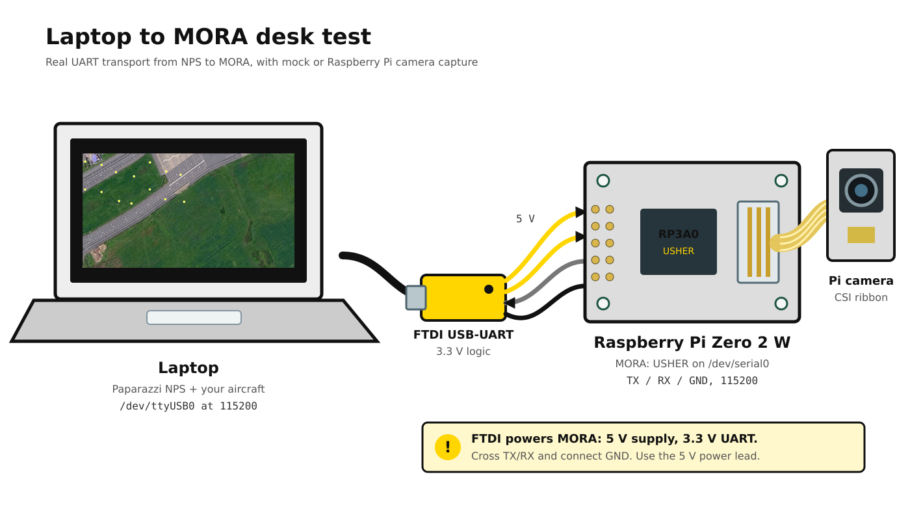

# Laptop To MORA Desk Test

Run the simulated aircraft on the laptop and **real USHER on MORA**. The
FTDI cable supplies 5 V power and carries camera requests/replies over a
3.3 V UART. Start with a mock photo on the board, then use the real camera.

[PC demo setup](../examples/paparazzi/README.md) |
[Prepare the reference Pi board](README.md#prepare-the-reference-pi-board)

[](images/desk-test-setup.svg)

## 1. Connect Power And UART

Make connections while unpowered. Use the cable's **5 V power lead** and
**3.3 V UART signals**; those voltages have different jobs.

| FTDI Lead | Pi Zero 2 W Reference Pin And Purpose |
| --- | --- |
| 5 V | Pin 2, 5 V; power MORA and its camera |
| GND | Pin 6, GND; common ground |
| TXD | Pin 10, GPIO15 / RXD; laptop sends to MORA |
| RXD | Pin 8, GPIO14 / TXD; MORA replies to laptop |

Check connector labels, not assumed wire colours—adapter makers treat wire
colours as creative expression, and feeding 5 V into a 3.3 V GPIO pin ends the
bench test faster than intended. Never connect the 5 V lead
to TXD/RXD or the Pi's 3.3 V pin. Connect the camera ribbon while MORA is off,
then plug the FTDI cable into the laptop. Keep a real flight controller
disconnected for this simulated-aircraft exercise.

MORA needs the installed release, matching sensor runtime and
[configured UART](setup-os-rpi-zero-2w.md#configure-uart-for-usher). Both ends
use **115200 baud**. Wi-Fi/SSH starts programs and retrieves files; the
FTDI UART carries the camera protocol, not an SSH login.

## 2. Choose The Laptop Port

On the laptop:

```sh
ls -l /dev/serial/by-id/
```

Use your adapter's stable by-id path, or its actual device such as
`/dev/ttyUSB0`. The laptop account needs serial access, normally through
`dialout` on Debian/Ubuntu.

Stop the previous local session. The example launcher automatically prefers
a connected MORA cable and skips local sensor companions. Hardware sessions
pin both NPS endpoints to that cable; startup refuses a leftover
`/tmp/usher-sim` instead of silently testing the PC. Do not run a serial
monitor on the FTDI port.

## 3. Prepare NPS For The Cable

Use your working fixed-wing NPS aircraft and the
[public setup](../examples/paparazzi/README.md). From the Sensoraia root:

```sh
export PAPARAZZI_HOME="$HOME/paparazzi"
./kickstart.sh
make -C "$PAPARAZZI_HOME" -f Makefile.ac AIRCRAFT=Easystar_3_SPOTTERCAM nps.compile
```

By default, the `nps` transport uses `/dev/ttyUSB0` whenever no local PC
`/tmp/usher-sim` peer is running. If several USB-serial adapters are attached,
pass `MORA_UART_DEVICE=/dev/serial/by-id/usb-FTDI_...` via
`DIGITAL_CAM_UART_FALLBACK_DEVICE="$MORA_UART_DEVICE"` on the `make` command
above (after removing `var/aircrafts/Easystar_3_SPOTTERCAM/nps/modules/digital_cam/uart_cam_ctrl.o`).
This photo-survey plan requests the AI camera slot; USHER on MORA selects
whether to capture a mock or physical image.

Start Paparazzi Center:

```sh
cd "$PAPARAZZI_HOME"
./paparazzi
```

Select `userconf/SENSORAIA/sensoraia_demo_conf.xml`, aircraft
`Easystar_3_SPOTTERCAM` (or your own configured aircraft) and **nps** (click
**Build** if you have not built `nps` yet).
Choose `userconf/SENSORAIA/sensoraia_demo_control_panel.xml` and
**Sensoraia MORA desk NPS**. This
session starts `Simulator`, `Data Link`, `Server` and `PprzGCS`, with **no local
sensor peer**, so `nps` connects straight to MORA over the FTDI cable.

## 4. Check Real UART With A Mock Photo

In another laptop terminal, connect to MORA over SSH and run foreground USHER
against `/dev/serial0`:

```sh
ssh -t air@theatre.local 'sudo systemctl stop usher.service && cd /home/air/sensoraia && ./usher --serial /dev/serial0 --aicam --test --debug; status=$?; sudo systemctl start usher.service; exit $status'
```

Substitute your MORA SSH target (`air@theatre.local`) and installation path
(`/home/air/sensoraia`). The command stops the managed service, runs foreground
USHER over SSH and restores `usher.service` after the foreground command ends.

If you prefer running each step interactively in an SSH terminal on MORA:

```sh
sudo systemctl stop usher.service
cd /home/air/sensoraia
./usher --serial /dev/serial0 --aicam --test --debug
```

Use your actual installation path. End foreground USHER with Ctrl+C when
finished, then run `sudo systemctl start usher.service`. Do not leave the
managed service and foreground program competing for the UART or camera.

### Optional: Full Hands-Free Automation With `/home/air/pass.txt`

If you want completely hands-free deployment (`make mora-deploy`) and SSH desk
testing with zero password typing, you can place your MORA
account's `sudo` password in `/home/air/pass.txt` on MORA (replacing
`replacewithyourpass` with your actual password) and lock its permissions to
owner-only (`chmod 600`):

```sh
ssh air@theatre.local 'umask 077 && printf "%s\n" "replacewithyourpass" > ~/pass.txt && chmod 600 ~/pass.txt'
```

Edit `~/pass.txt` on MORA so it contains your real `sudo` password (the literal
placeholder `replacewithyourpass` is safely ignored until you change it).
`deploy_mora.sh` automatically detects `~/pass.txt` on MORA and authenticates
`sudo` without prompting. You can also
start and restore foreground bench runs directly from your PC in one line:

```sh
ssh air@theatre.local 'sudo -S -p "" systemctl stop usher.service < /home/air/pass.txt && cd /home/air/sensoraia && exec ./usher --chdk --debug'
```

After the foreground process exits, restore the managed service:

```sh
ssh air@theatre.local 'sudo -S -p "" systemctl start usher.service < /home/air/pass.txt'
```

Wait for USHER to report `/dev/serial0` and readiness. Start the Center desk
session, wait for live telemetry/GPS, then select **Takeoff**. Watch requests
arrive on MORA and mock JPEGs complete during the survey. Do not use
`--local` on MORA: the physical UART is the point of this step.

## 5. Change To The Physical Camera

Stop the desk session and end foreground USHER with Ctrl+C before changing
the backend. With the AI Camera prepared:

```sh
ssh -t air@theatre.local 'sudo systemctl stop usher.service && cd /home/air/sensoraia && ./usher --serial /dev/serial0 --aicam --debug; status=$?; sudo systemctl start usher.service; exit $status'
```

Repeat the desk flight. Without `--test`, this uses actual camera exposures.
Other sensors need their corresponding camera mask and mission selection,
not just a different backend flag.

The desk session checks UART/capture operation. It does not run the PC
T1..T5 ranking companion. Physical pixels paired with simulated pose do not
measure real-flight geolocation accuracy.

## Inspect Results And Finish

For the default account, in another laptop terminal:

```sh
ssh air@theatre.local 'ls -lt ~/Pictures/sensoraia/ | head'
```

Use the actual output directory printed by USHER. The files are on MORA,
not in a PC companion's run directory. Check the new readable JPEG, completion
diagnostic and EXIF; a GCS shot marker alone does not prove capture finished.

Let NPS land, stop its session programs and end foreground USHER with Ctrl+C.
Check that `usher.service` is active again. To return to PC-only simulation,
disconnect the cable, unset any explicit `MORA_UART_DEVICE` override, and
restart the normal session. An explicitly empty `MORA_UART_DEVICE` can force
PC-only operation while the cable remains connected.

## If Nothing Arrives

Check crossed TX/RX, common ground, serial permissions, the actual laptop
device and MORA's disabled serial login console. Check that no local peer
is taking precedence and no second application owns a UART. If requests
arrive but capture fails, investigate the sensor error rather than rewiring
a working link.
