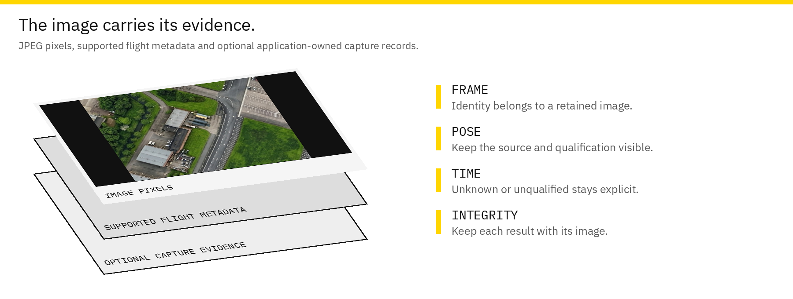

# Read The Information In Your Photos

A photo is more useful when you know where it came from. Sensoraia keeps
available aircraft, capture and analysis information with supported JPEGs
using EXIF metadata. Keep the original images: editing or exporting them
through another program may discard that information.

[Metadata terms](glossary.md#images-and-timing) |
[Capture with USHER](usher-camera-pipeline.md)



## Inspect A Saved JPEG

On the PC, ExifTool can display the supported records without changing them:

```sh
sudo apt install libimage-exiftool-perl
exiftool -G1 -a -s /absolute/path/photo.jpg
```

Start with the image dimensions, GPS fields, image description and user
comment. Read the whole record rather than assuming a single GPS field says
everything about a capture. A generic viewer may not display custom evidence.

| Information | What It Helps You Check |
| --- | --- |
| Camera and photo identity | Which observation a result belongs to |
| Position, altitude and attitude | Where the aircraft was reported and how it was oriented |
| Request/observation timing | Whether the pose describes a request or an estimated sensing interval |
| Mock or lens-emulation records | Whether the pixels are simulated or derived |
| Detection or thermal records | What optional processing returned |

Availability depends on the backend. Missing data must not be interpreted
as zero, and a precise-looking coordinate is not a measured accuracy claim.

## Request Pose Is Not Always Exposure Pose

The aircraft can move between requesting a capture and the actual exposure.
Where supported timing evidence is available, Sensoraia can estimate a pose
for the observation interval. Other captures retain the request-time pose.

When comparing a detected object with a ground reference, check which timing
information is actually present. At 10 m/s, a tenth of a second corresponds
to about one metre of travel, before other errors are considered.

## Embedded Capture And LOOM Evidence

Native camera paths can retain capture identity and timing inside the JPEG.
LOOMcam can also retain model-related features. These records help associate
processing with the correct frame; they do not prove physical timing accuracy
or make an unspecified feature vector a navigation direction.

Stock camera tools do not necessarily provide the same evidence. A usable
photo can therefore have less qualified timing than another backend's photo.
Do not copy evidence records from a different image to make it appear complete.

## Original, Review Copy And Sidecar

The original flight JPEG is the archive. SODA may create separate annotated
copies or crops, and saved-image model analysis may write a neighbouring
result file. Keep required sidecars with their source image.

Thermal JPEGs may also contain a temperature plane. A resized screenshot or
colourized export cannot replace those samples. Use the
[LWIRcam guide](../modules/lwir_cam/docs/lwir-cam.md) for supported readback.

## Use Photos For Mapping Or Evaluation

Use original images and the input contract required by
[PANGEA](../modules/pangea/docs/pangea.md). An arbitrary GPS-tagged JPEG may
lack the attitude, height or camera geometry needed by a mapping workflow.

For model evaluation, retain the image's origin, model identity and independent
labels. Provider imagery terms still apply to MIMIC-derived material.

## If A Field Looks Wrong

Check the sensor, coordinate units, altitude reference and timing first.
Compare an original with any edited copy to see whether metadata was removed.
If the backend never supplied a measurement, changing an EXIF field cannot
recover it. Keep the original and investigate the capture source instead.

## Read A Detailed Application Record

Inspect the text payload without the rest of ExifTool's listing:

```sh
exiftool -b -UserComment /absolute/path/photo.jpg
```

Look for sensor/result type, photo identity, available pose/time information
and whether observations are simulated. Field availability varies by backend;
an absent measurement is different from a valid zero.

If an object position looks wrong, first distinguish the aircraft's GPS tag
from a projected target record. Then check timing, lens/mounting geometry
and altitude reference. The coordinate alone does not explain those inputs.
