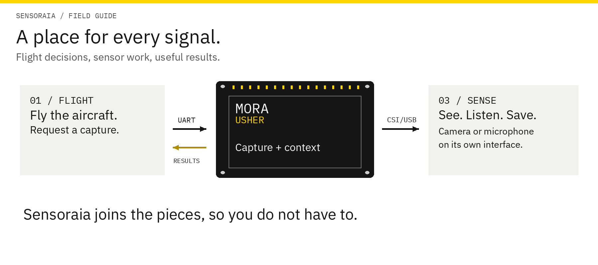
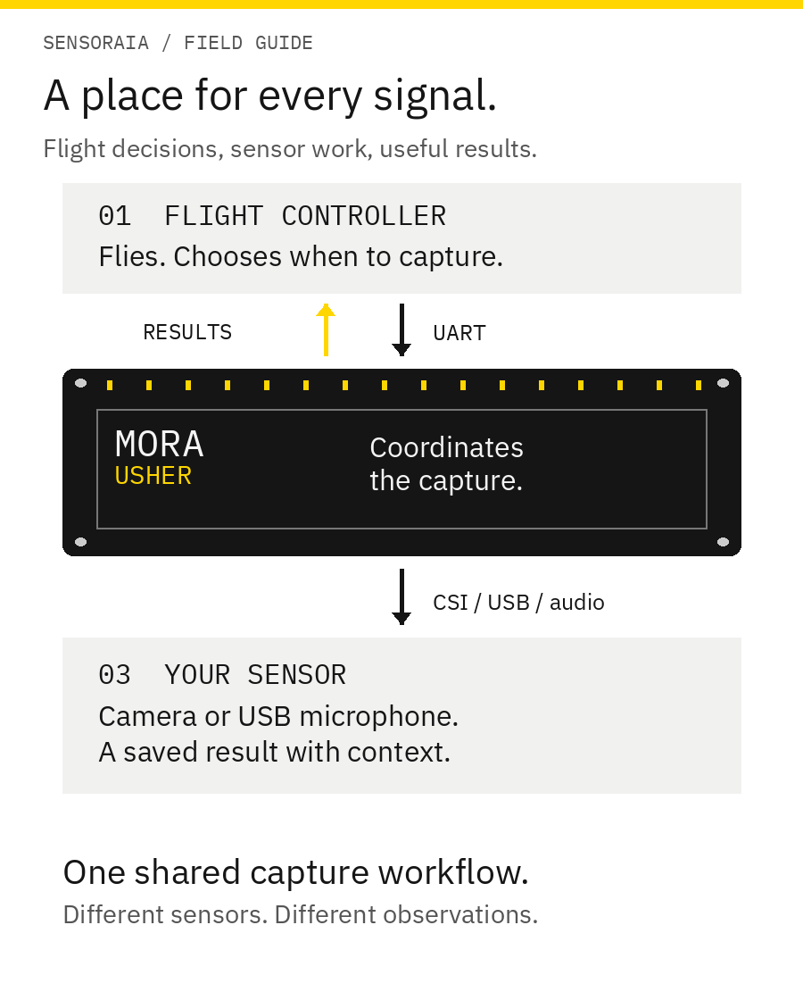
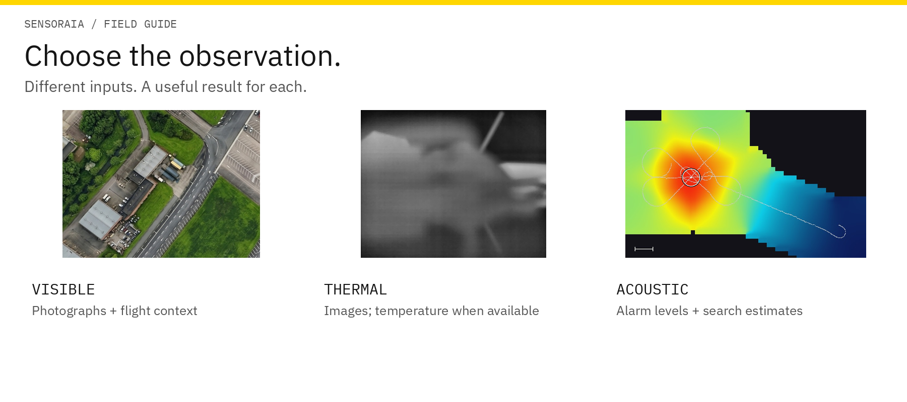
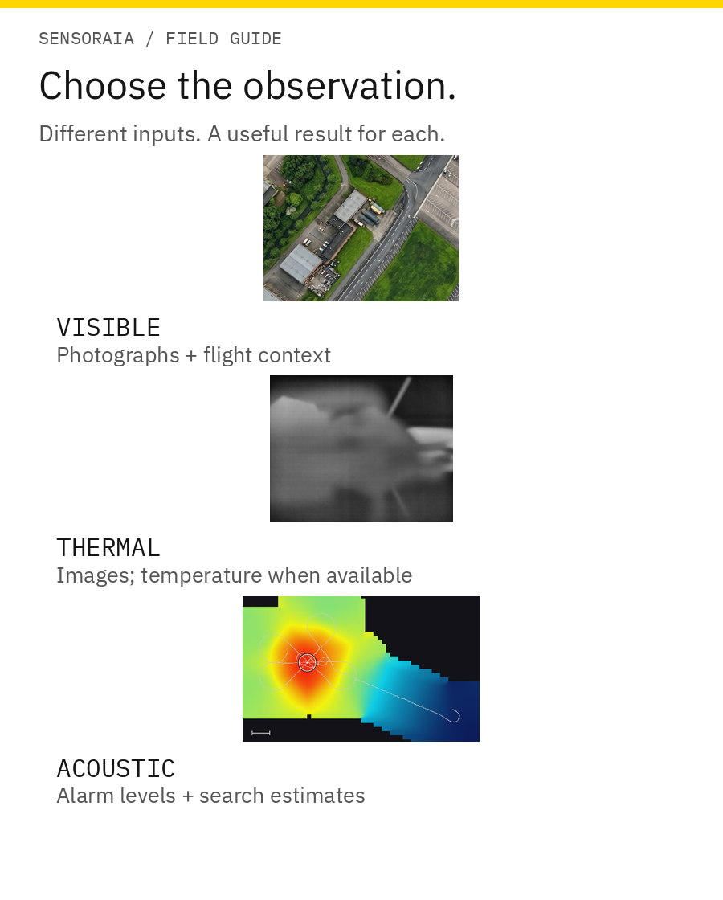

## What Is Sensoraia?

Sensoraia is an **AI-enabled, in-flight sensing suite** for connecting cameras,
microphones and supported processing to an aircraft's onboard computer.
It takes care of requesting captures,
saving the results and keeping the available flight information with them.
It also connects live sensor processing back to the flight: MORA can exchange
data with the airborne aircraft while the mission is running, not just
collect files for you to inspect after landing.
The result is more useful than a folder of photographs whose story you
have to reconstruct afterwards.

You might use it to look for vehicles with a neural network, listen for an
alarm, inspect thermal observations, or feed supported live results into
the next flight-plan decision.
You choose the sensors and the job; Sensoraia provides a shared way to
connect them to the flight.

[New to the names? The Sensoraia glossary explains the shared vocabulary and each module's terms.](glossary.md)

## Why Use It?

### Spend Less Time Joining The Pieces

A sensor, an AI model, an autopilot and an onboard computer do not
automatically agree on when to observe, how to process the result or which
flight position belongs to it. Sensoraia handles the shared coordination,
so supported modules can concentrate on their sensing and processing jobs.

### Keep The Context, Not Just The Picture

A photograph becomes much more useful when you can relate it to the
aircraft's position, attitude and capture request. Sensoraia records the
available context in image metadata and reports what completed. When
timing or calibration is uncertain, it keeps that distinction visible
rather than turning an estimate into a promise.

### Explore Before You Connect Hardware

Run the suite on a Linux PC with a simulated aircraft and camera views
made from cached aerial imagery. Follow a request through capture,
processing and supported mission results, then move to your real onboard computer
and sensors. Your first experiment does not need a flying aircraft.
The propeller is welcome to sit this one out.

### The Same Application Code, Simulated Or Airborne

Local simulation runs the **same production application source code** as the
software built for MORA, not a separate demonstration reimplementation.
The simulated aircraft and camera inputs stand in for physical hardware;
the capture coordination, processing and result-handling code remain the
application you are preparing to deploy.

The PC and ARM64 executables are different builds, and real sensors have
their own drivers, timing and calibration. Simulation lets you exercise the
application workflow before making those hardware connections.

### Let Your PC Do The Heavy Lifting

Use the cores on your PC to build in parallel, including cross-compiling
the ARM64 applications for MORA. You do not need to wait for the small
companion board to compile its own software or install a development
toolchain there: build on the fast machine, deploy the ready-to-run binaries,
and keep MORA focused on sensing and processing. The build instructions use
`make -j"$(nproc)"` to use your PC's available CPU cores.

## A Live Conversation With The Aircraft

During flight, the controller sends pose information and capture requests
to MORA. USHER coordinates the sensor work and returns supported completion
or target-point results. A compatible flight plan can use fresh results to
update a waypoint, follow a returned point or choose its next mission action.
The flight controller remains responsible for flying the aircraft.

This is **live, real-time interaction while flying**: sensing, supported
processing and mission decisions can happen during the flight, without
waiting for a post-flight download. Actual update rates depend on the sensor,
model and available computing resources; live operation is not a guarantee
of hard real-time deadlines.

### Neural Networks Can Take Part In The Flight

Neural-network processing is not limited to an offline report. Spottercam
produces vehicle detections from the IMX500 during capture. Its built-in
output is image detections and metadata; geographic target publishing for
flight response is an additional integration step. Diplacam's
experimental neural planner can return XY points that the supplied rotorcraft
flight plan follows and refreshes in simulation. With the appropriate result
interface and flight-plan logic, observations can therefore influence mission
behavior while the aircraft is airborne.

You decide which results the flight plan may act on. A detection alone does
not command a maneuver, and a network does not take over the motors. Each
module's guide explains what it currently returns and its qualification
limits; Diplacam is experimental, and LOOM's guarded return-vector integration
awaits its trained homing model and physical accuracy validation.

## How The Hardware Fits Together

{ .field-guide-wide loading=lazy decoding=async }

{ .field-guide-tall loading=lazy decoding=async }

Think of it as three parts with different jobs:

1. **The flight controller flies the aircraft.** Your flight plan or
  operator requests a capture at the appropriate moment.
2. **MORA carries the sensor software.** MORA is the aircraft's companion-
  computer role, not a particular board. Sensoraia uses the Raspberry Pi Zero
  2 W as its initial, resource-constrained reference platform; another suitable
  compute board can fill the role. It connects to the flight controller over
  UART and to cameras or microphones through their own interfaces.
3. **USHER coordinates the work.** USHER is Sensoraia's service on MORA:
  it receives the request, works with the selected sensor, saves the
  result with its context, and sends completion or supported target results
  back to the flight controller. The connection works in both directions.

**Sensoraia** is the whole suite, **MORA** is the computer, and **USHER**
is the coordinating service. Three names, not three things you must learn
before you can take a picture.

The current ready-made ARM64 build, package and setup instructions target
64-bit Raspberry Pi OS Trixie on the Pi Zero 2 W. That is a starting point,
not a hardware lock-in: other Linux compute boards can run Sensoraia when
their architecture, OS libraries, sensor drivers, interfaces and available
resources are supported or adapted. They need a matching build and deployment
configuration; Pi-specific instructions do not automatically apply.

Paparazzi examples connect this workflow to simulated and real flight
controllers. You can also run individual sensor tools from a terminal.
You do not need every sensor or every module to make a useful setup.

## What Could You Do With It?

{ .field-guide-wide loading=lazy decoding=async }

{ .field-guide-tall loading=lazy decoding=async }

**Search for vehicles with live AI.** Spottercam runs a compatible trained
vehicle network on the IMX500, keeping its detections tied to captured
images. Use the results for live review and recording; add a qualified
geographic-target integration when your mission should act on a location.

**Respond to supported observations in flight.** Feed fresh target or planner
results into compatible flight-plan logic: update a waypoint, follow up an
observation or choose a mission branch. Each backend defines what it returns;
the flight controller retains navigation and control.

**Listen while you fly.** EARcam detects an alarm tone and combines useful
sound readings from different positions into an acoustic search estimate.

**Explore thermal targets.** Save thermal images, examine supported temperature
samples and regions, and use measured lens/mounting calibration when projecting
thermal observations onto the ground. A warm patch is a candidate, not an
automatic identification of a particular object.

**Add the sensor your mission needs.** The architecture separates sensor
adapters, processing and the flight-controller protocol. That gives developers
a place to integrate a gas, particle or radiation sensor and define the
result a mission may use. These are extension examples, not built-in Geiger,
gas or particle drivers; new sensors need an adapter and an agreed data/result
contract. It is extensible, not a universal plug-and-play driver collection.

**Try a new idea without changing the flight interface.** Use the local
simulation with the same production application source, then connect MORA
and the actual sensor. Check both your result handling and the physical
sensor's behavior before relying on the combination.

**Build better datasets and keep useful evidence.** Original photographs,
metadata and permitted MIMIC imagery can support external model training
and evaluation. PANGEA maps and tiles can help with scene selection and
annotation context; they are an additional tool, not the main mission.
Training still needs suitable labels, imagery rights and independent
evaluation, and camera-view models need representative camera-view inputs.

**Keep conventional capture alongside AI.** Use supported visible-light and
thermal cameras for ordinary photographs too. You choose where inference
adds value instead of making every capture depend on a model.

These are options, not a checklist. A dependable setup with one sensor is
a perfectly good place to begin.

## Start Small, Grow Deliberately

If you are curious, explore the example below. If you already have a sensor
in mind, choose its guide next. When you are ready to try it yourself, the
installation guide walks you through a PC build, a local simulation and
deployment to MORA.

Sensoraia helps you collect and interpret observations; it is not a flight
controller or certified navigation, rescue or measurement system. Real-world
accuracy depends on your sensors, calibration and timing. The guides explain
those limits where they matter, so you can make informed choices as you go.
