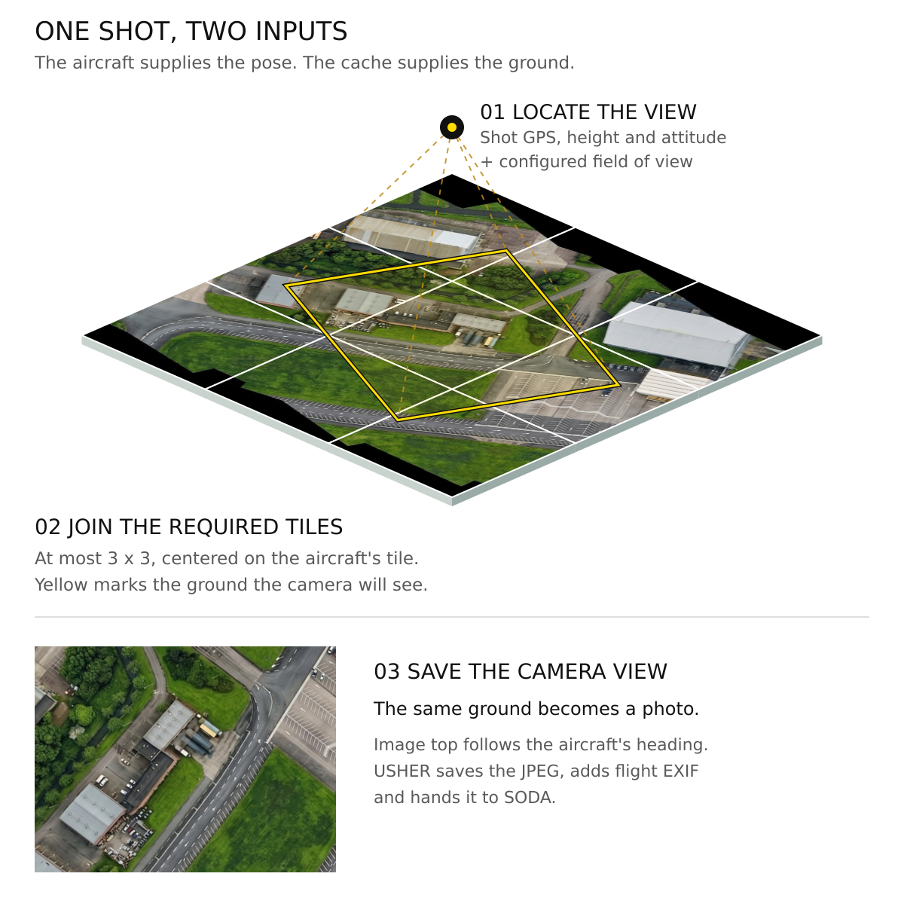
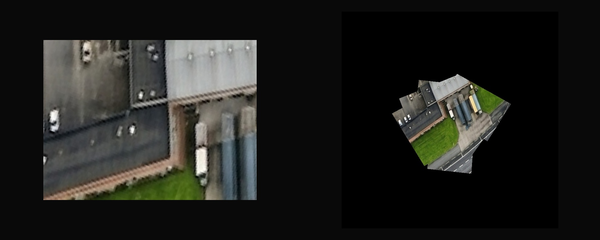
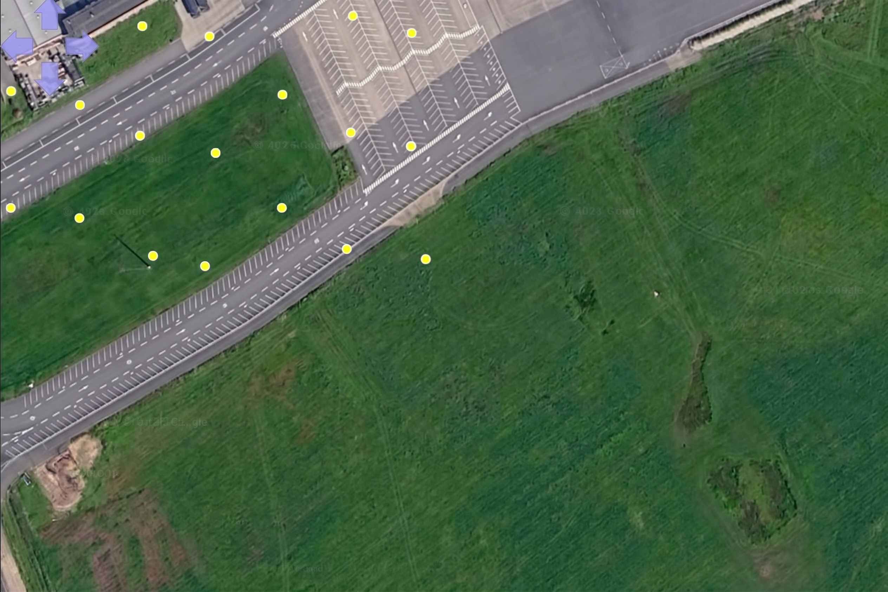

# MIMIC: Fly With A Simulated Camera

MIMIC turns cached aerial imagery into camera views for a simulated flight.
The aircraft's position and attitude determine what appears in each photo.
USHER saves the JPEG and its available flight information just as it would
for a camera observation.

[Prepare a simulated flight](../examples/paparazzi/README.md) |
[Simulation terms](glossary.md#mimic) | [Photo maps](../modules/pangea/docs/pangea.md)

## From Tiles To A Photo



The cache supplies pixels; NPS supplies pose. Banking or turning the aircraft
changes the next camera view. Panning the GCS map does not move the camera.
The renderer uses a flat ground model, not reconstructed buildings or terrain.

## Quick Start

Use a working fixed-wing Paparazzi NPS aircraft. Start with the shared
[demo setup](../examples/paparazzi/README.md); no MORA or camera is required.

### 1. Prepare The Map Cache

In PprzGCS, display aerial imagery at zoom 18 over the example route and
enough surrounding ground to cover the camera footprint. The default cache
is `~/.local/share/paparazzi/pprzgcs/map`, with the configured zoom-18
JPEG layout (`--mock-map-cache DIR` on `USHER` selects another existing cache):

```sh
find ~/.local/share/paparazzi/pprzgcs/map -path '*/18/*/*.jpeg' | head
```

Missing tiles stop capture. MIMIC does not download missing terrain or
substitute blank/generated fields. Prepare the cache while online before
expecting an offline flight to work.

### 2. Prepare Your Aircraft

From the Sensoraia root:

```sh
make -j32 usher soda pangea camera-lens
./kickstart.sh
```

`./kickstart.sh` installs the Sensoraia flight plans, demo airframes and
unified control panel into your Paparazzi `conf/` directory.

## A Complete Simulated Flight

Start Paparazzi Center (`cd ~/paparazzi && ./paparazzi`), select
`userconf/SENSORAIA/sensoraia_demo_conf.xml`, aircraft **`Easystar_3_MIMIC`**
(or your own aircraft using `flight_plans/SENSORAIA/sensoraia_mimic_pangea_demo.xml`),
and target **nps**, then click **Build**. In the **Session** tab choose
`userconf/SENSORAIA/sensoraia_demo_control_panel.xml` and
**Sensoraia MIMIC PANGEA NPS**, then click **Execute**. It starts `Simulator`,
`Data Link`, `Server`, `PprzGCS` and native `USHER` together.

Wait for valid GPS and live telemetry, then select **Takeoff**. The example
collects images on suitable survey legs near its nominal 100 m altitude.
Look for newly saved camera JPEGs and a PANGEA map, not merely GCS shot dots.
Let the normal landing finish and stop the session programs afterwards.



A photo map is made from saved camera photographs, rather than joining the
input tiles directly.



The companion prints the fresh map directory. Original photos use the normal
USHER output location. Preserve both for comparison. The session can be
repeated with the same configuration; a new map is created for each run.

## Try A Single Photograph

For an existing NPS setup where you manage the other programs yourself:

```sh
./usher --local --mock-map --debug
```

Do not start this alongside a Center session that already owns USHER.
Select the AIcam capture mask and use the GCS photo control once the aircraft
is in a suitable simulated pose. Wait for completion before retrying.

For optical blur, exposure and shutter experiments, use the optional
[lens emulator](camera-lens.md). It retains the clean MIMIC photograph.
The [LOOM NPS session](../modules/loom_cam/docs/loom-cam.md#select-the-simulated-camera-profile)
passes `--mock-lens resources/camera_lens_aicam.json` on its `USHER` command
line by default; edit that `--mock-lens` argument in the Session tab to use a
custom profile or remove it to disable emulation. The selected derivative,
not the clean source, reaches LOOM's reference archive and neural input.

## Camera Geometry And Limits

The camera is fixed to the simulated aircraft. Height, heading, bank and
pitch affect its footprint. The clean renderer uses an aircraft-centred
3-by-3 tile neighbourhood; a view extending beyond it may be rejected.

The default field of view is illustrative. These visible map pixels are not
thermal temperatures or a physical exposure. Check the module's model and
input requirements before treating the pictures as representative evaluation
data.

## When A Photo Is Missing

| Symptom | Check |
| --- | --- |
| Cache check fails | Zoom, imagery layout and coverage around the entire route |
| GCS dot but no JPEG | USHER's completion/error message and output permissions |
| Rejected view during a turn | Bank, height and footprint size relative to available tiles |
| No new map | Saved-photo availability and PANGEA's diagnostics |
| Endpoint already in use | Stop the previous session rather than starting duplicate peers |
