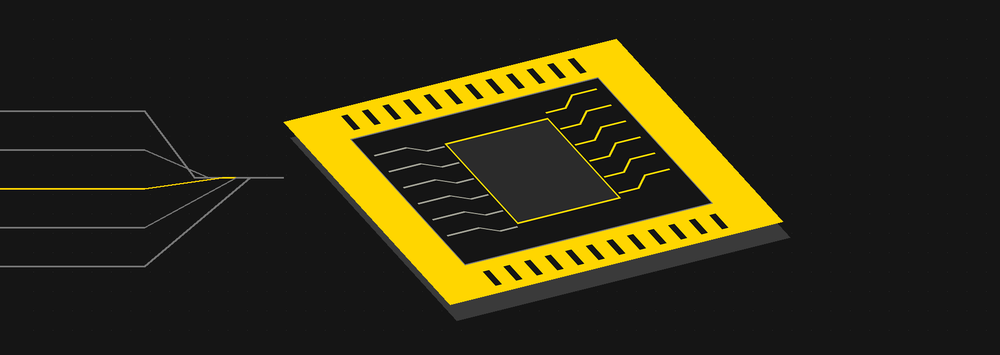

# Prepare a Pi Zero 2 W for USHER

{ .chapter-art }

This guide covers the Raspberry Pi Zero 2 W reference board and its current
64-bit Raspberry Pi OS Trixie setup. MORA means the onboard compute role, so a
different suitable board may be used; its OS, UART, drivers, runtime packages
and deployment need board-specific setup. These Pi instructions are not
universal.

When this guide says **OS image**, it means the single operating-system file you
flash onto a microSD card—not a camera JPEG—and **flashing** simply means
writing that operating system onto the card so MORA can boot from it.

Use the official [Raspberry Pi Imager](https://www.raspberrypi.com/software/) to
write Raspberry Pi OS to a microSD card. The steps below cover first access,
the camera UART and network settings you may need away from the desk.

Before flashing, make sure the selected Wi-Fi network is reachable by a Raspberry
Pi Zero 2 W. It supports 2.4 GHz Wi-Fi; use WPA2-Personal or a WPA3-Personal
network verified to work with the selected image and access point. Avoid
enterprise authentication and legacy TKIP.

1. In Imager, select **Raspberry Pi Zero 2 W**, the 64-bit **Raspberry Pi OS
   Trixie** headless image, and the intended microSD card. Confirm its capacity and name
   before continuing: writing erases the selected card.
1. Open OS customization. Set a hostname, a non-default user, the Wi-Fi network
   and country, then enable SSH. Prefer public-key authentication; paste
   the public key from the development PC into **Authorized keys**.
1. Write the card and wait for Imager's verification to succeed. Eject it,
   insert it into MORA, and power the board.
1. From the development PC, confirm the configured account and network work:

   ```sh
   ssh air@theatre.local
   ```

   This example uses the project's default account and hostname. Substitute the
   username and hostname you configured in Imager if they differ. The `.local`
   name requires mDNS support on the development PC and local network; if it
   does not resolve, use the board's DHCP address from the router instead.

For Imager-specific screens and recovery options, see the official
[Raspberry Pi getting-started documentation](https://www.raspberrypi.com/documentation/computers/getting-started.html).

## Fast SD-Card Backup, Cloning, And Auto-Expanding Restore

Configuring Raspberry Pi OS, Wi-Fi, SSH keys, UART overlays, device groups, and
camera tools from scratch takes real effort—and microSD cards at an airfield
occasionally get lost, soaked, or corrupted right before flight day. Sensoraia
ships two Linux PC helpers in `build-support/` that turn your finished "golden"
MORA card into a small archive you can clone onto spare cards in minutes:

- **Why this saves so much time:** A plain whole-card `dd` reads every single
  empty gigabyte on a 32 GB, 64 GB, or 128 GB card. Instead,
  `build-support/fast_sd_backup.sh` inspects the partition table (`sfdisk`),
  reads **only up to the last sector actually used by your partitions**, shows a
  live progress bar and ETA (`pv`), and compresses across all CPU cores in
  parallel (`xz -1 -T0`). When restoring or cloning onto a new card,
  `build-support/fast_sd_restore_and_expand.sh` streams the image straight to
  hardware and **automatically expands the EXT4 root partition to 100% of the
  destination card** (`parted` + `e2fsck` + `resize2fs`) before you even eject
  it—no extra resize dance on MORA needed!

Install the standard Linux disk utilities once on your PC if needed
(`sudo apt install pv xz-utils parted e2fsprogs util-linux`), shut MORA down
cleanly, and insert its microSD card into your PC.

1. **Back up your configured MORA card** (confirm the whole-disk device name
   such as `/dev/sdX` or `/dev/mmcblk0` with `lsblk`—never a partition like
   `/dev/sdX1`):

   ```sh
   lsblk -o NAME,SIZE,MODEL,TRAN,MOUNTPOINTS
   sudo bash build-support/fast_sd_backup.sh /dev/sdX /path/to/mora-golden.img.xz
   ```

2. **Clone or restore onto another microSD card** (at least as large as the
   used partition boundary; **this erases the entire target card**, so double-
   check `lsblk` so your laptop's own SSD stays safe and happy):

   ```sh
   lsblk -o NAME,SIZE,MODEL,TRAN,MOUNTPOINTS
   sudo bash build-support/fast_sd_restore_and_expand.sh \
     /path/to/mora-golden.img.xz /dev/sdY
   ```

Wait until the script prints `==> Restore and expansion complete!` before
removing the card. Keep two cloned cards in your flight box and future-you will
thank present-you. (For flashing a brand-new blank OS for the very first time,
Raspberry Pi Imager remains the easiest starting point.)

## Configure UART for USHER

On MORA, disable Bluetooth and dedicate the full UART to USHER. Run the following
on MORA, then reboot:

```sh
sudo nano /boot/firmware/config.txt
```

Under the existing `[all]` section in `config.txt`, add:

```ini
enable_uart=1
dtoverlay=disable-bt
```

Save the file, then open `raspi-config` to turn off the Linux login prompt on
that serial port (an autopilot and a Linux login prompt make terrible
conversation partners):

```sh
sudo raspi-config
```

In `raspi-config`, select **Interface Options > Serial Port**, answer **No** to
the login shell, and **Yes** to serial hardware, then reboot:

```sh
sudo reboot
```

After reboot, log back in and verify the UART device mapping and group
membership:

```sh
ls -l /dev/serial0 /dev/ttyAMA0
id -nG
```

Expected mapping: `/dev/serial0 -> ttyAMA0`. The account running USHER must
belong to `dialout`; if `dialout` is not listed yet, add it once:

```sh
sudo usermod -aG dialout air
```

Log out and back in so the new group membership takes effect.

## Preventing Sleep and Suspend States

Raspberry Pi OS normally does not suspend a headless Pi. If a board is managed
by software that might request suspend, disable those targets explicitly:

```sh
sudo systemctl mask sleep.target suspend.target hibernate.target hybrid-sleep.target
```

If you do not like the change for whatever reason, to reverse the change later, run:

```sh
sudo systemctl unmask sleep.target suspend.target hibernate.target hybrid-sleep.target
```

## Save Multiple Wi-Fi Networks

Raspberry Pi OS Trixie uses NetworkManager. You can save more than one Wi-Fi
profile so MORA can connect to a known network when it is available. Configure
each profile for a network you expect MORA to use in the field.

Check the Wi-Fi interface name on MORA:

```sh
nmcli device status
```

It is usually `wlan0`. Add each network, replacing the example SSIDs and profile
names. `--ask` prompts for a password instead of putting it in shell history or
the process argument list:

```sh
sudo nmcli --ask device wifi connect "Desk SSID" ifname wlan0 name "Desk WiFi"
sudo nmcli --ask device wifi connect "Field SSID" ifname wlan0 name "Field WiFi"
```

NetworkManager saves each profile. To prefer one when it chooses among available
autoconnect profiles, assign it a higher priority (the valid range is -999 to
999):

```sh
sudo nmcli connection modify "Desk WiFi" connection.autoconnect-priority 20
sudo nmcli connection modify "Field WiFi" connection.autoconnect-priority 10
```

A higher priority is considered first when NetworkManager selects a profile to
autoconnect; it does not disconnect an already active network just to switch to
a higher-priority one. Check saved and active profiles with:

```sh
nmcli connection show
nmcli connection show --active
```

For a network that does not broadcast its SSID, add `hidden yes` to the connect
command and provide the SSID explicitly. Hiding an SSID is not a security
measure and can cause clients to probe for that network:

```sh
sudo nmcli --ask device wifi connect "Hidden SSID" ifname wlan0 name "Hidden WiFi" hidden yes
```

## Add Wi-Fi Before First Boot

Use this recovery path when MORA has no network connection and you cannot reach
it over SSH. It requires a Linux development PC with an `nmcli` version that
supports `--offline`, plus a way to read the microSD card. The saved profile
contains the Wi-Fi password, so keep the card secure.

1. Shut MORA down, remove the microSD card, and attach it to the Linux PC. Mount
    the card's Linux root filesystem partition (typically the larger ext4
    partition), not its small FAT boot partition. Set `ROOT` below to that
    partition's actual mount point; mount locations vary by PC and desktop.
1. Generate a WPA2-Personal profile and install it with the permissions
    NetworkManager requires. Replace the example network name in both places.
    This command deliberately does not put the password on the command line:

    ```sh
    ROOT=/path/to/mounted/rootfs
    nmcli --offline connection add \
       type wifi ifname '*' con-name 'Field WiFi' ssid 'Field WiFi' \
       wifi-sec.key-mgmt wpa-psk connection.autoconnect yes \
       ipv4.method auto ipv6.method auto |
    sudo install -D -o root -g root -m 600 /dev/stdin \
       "$ROOT/etc/NetworkManager/system-connections/Field-WiFi.nmconnection"
    ```

1. Edit the generated profile as root:

    ```sh
    sudoedit "$ROOT/etc/NetworkManager/system-connections/Field-WiFi.nmconnection"
    ```

    In its existing `[wifi-security]` section, add `psk=YOUR_WIFI_PASSWORD` on a
    new line. Save the file. Use the actual password, not the placeholder. A
    WPA2 passphrase is normally 8 to 63 characters; a 64-character hexadecimal
    key is also accepted.
1. Safely unmount/eject the card from the PC, return it to MORA, and power on
   the board. Allow time for it to join the access point and obtain an address.
   Connect using the hostname configured in Imager. If mDNS does not resolve
   that name, find MORA in the router's DHCP client list and connect using its
   IP address.

After regaining access, use the previous section to add other Wi-Fi networks.
