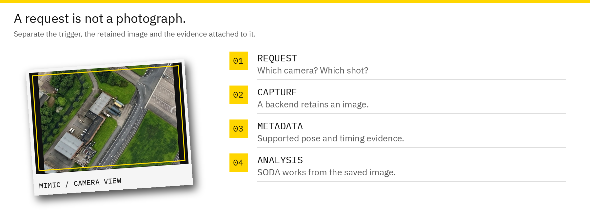

# Capture With USHER

USHER connects an aircraft's capture requests to the selected sensors on
MORA. It saves the observation, keeps the available flight information with
it, and reports the outcome. You can try the same flow on a Linux PC before
connecting hardware.

[Install and get started](README.md) | [Glossary](glossary.md) |
[Simulated flights](../examples/paparazzi/README.md)



## Compute-Board Baseline

MORA is the onboard-computer role, not a Raspberry Pi model. Sensoraia starts
from the Raspberry Pi Zero 2 W as a deliberately constrained 512 MB ARM64
reference. The current ready-made cross-build and deployment workflow targets
64-bit Raspberry Pi OS Trixie and Cortex-A53. A different compute board can
host Sensoraia when its OS/ABI, drivers, peripherals and resource budget are
compatible; it may need a board-specific build profile, package and service
configuration. The Pi baseline is not proof that every module fits or runs
unchanged on every board.

## Choose A Camera

You never need to edit systemd unit templates by hand to switch sensors. Pick
your camera in whichever way matches how you are running Sensoraia:

1. **For MORA deployment & local standalone runs:** Set `CAMERA = <name>` in
   `camera.conf` at the repository root, **or** pass `CAMERA=<name>` on the
   command line (`make mora-deploy CAMERA=lwircam`, or
   `bash examples/paparazzi/run_local_demo.sh --camera lwircam`).
2. **For Paparazzi Center simulation:** Select the matching aircraft and
   session in the GUI after running `./kickstart.sh`.

| `CAMERA` value | USHER CLI Flag | Paparazzi Center Aircraft & Session | Use It For | Start Here |
| --- | --- | --- | --- | --- |
| `spottercam` *(default)* | `--spottercam` | `Easystar_3_SPOTTERCAM` / **Sensoraia Spottercam NPS** | Visible IMX500 photos + vehicle detection (`T1..T5`) | [Spottercam](../modules/spotter_cam/docs/spottercam.md) |
| `aicam` | `--aicam --native-photo` *(or `--aicam`)* | `Easystar_3_AICAM` / **Sensoraia AIcam NPS** | Plain Raspberry Pi AI Camera photographs | [AI Camera](../modules/ai_cam/docs/raspberry-pi-ai-camera.md) |
| `lwircam` | `--lwircam` | `Easystar_3_LWIRCAM` / **Sensoraia LWIRcam NPS** | Tiny1-C / TDK USB thermal capture | [LWIRcam](../modules/lwir_cam/docs/lwir-cam.md) |
| `chdk` | `--chdk` | `Easystar_3_CHDKCAM` / **Sensoraia CHDKcam NPS** | Canon compact camera running CHDK over USB PTP | [CHDKbridge](../modules/chdkbridge/docs/chdkbridge.md) |
| `earcam` | `--earcam` | `Easystar_3_EARCAM` / **Sensoraia EARcam NPS** | Microphone observations and acoustic search | [EARcam](../modules/ear_cam/docs/earcam-loudest-spot-explained.md) |
| `loomcam` | `--loomcam` | `Easystar_3_LOOMCAM` / **Sensoraia LOOMcam NPS** | Experimental visual-return observations | [LOOMcam](../modules/loom_cam/docs/loom-cam.md) |
| `diplacam` | `--diplacam-config FILE` | `Bebop_DIPLACAM` / **Sensoraia Diplacam NPS** | Experimental 8-waypoint rotorcraft planner | [Diplacam](../modules/dipla_cam/docs/diplacam.md) |

AIcam, Spottercam and LOOMcam are alternative owners of the same physical
IMX500 camera; do not start them together. A USB microphone and a supported
thermal camera are separate devices, but their combined resource use still
needs checking on MORA. `MORA_PROFILE=lwircam` and `MORA_PROFILE=diplacam`
remain available when you want a smaller single-sensor MORA package instead of
the full-suite package. Selecting a backend does not install board OS camera
packages or physical calibration files.

## Building And Deploying USHER

Follow [Build on your PC](README.md#build-on-your-pc) for local binaries and
[Deploy to MORA](README.md#deploy-to-mora) for cross-building, packaging and
activation. The root `make help` lists the supported commands.

After installing the PC prerequisites, `make all` prepares its missing SDKs
and source dependencies, builds every PC and ARM64 application, and checks
the complete executable list. The same command works after `make clean`;
no private camera-library checkout or manual SDK recovery is required.

Building and packaging do not contact MORA. Activation is a separate step
that restarts USHER. Keep model/settings changes with the release you deploy.

## Start Here: Local Simulation

For a full simulated flight, use the
[Paparazzi demo walkthrough](../examples/paparazzi/README.md). Its Center
sessions start the sensor companion, simulator and ground tools together.
Do not start another USHER beside a session that already owns it.

For a terminal-only camera peer, use:

```sh
bash examples/paparazzi/run_local_demo.sh
```

This starts local mock capture, not a complete flight. Leave the terminal
open while your simulated aircraft connects. Stop it with Ctrl+C afterwards.
[MIMIC](mimic.md) supplies views of cached terrain when you want changing
camera imagery instead of a fixed test picture.

## Deploy To MORA

Complete the [installation and activation steps](README.md#deploy-to-mora),
then check the selected sensors on the bench. A running service means the
program started; it does not establish that a camera is focused, a microphone
gain is suitable or a geographic estimate is accurate.

### When Sudo Requires Your Password

For completely hands-free `make mora-deploy` runs with zero password prompts,
you can configure passwordless `sudo` on MORA or create `/home/air/pass.txt`
(`chmod 600 /home/air/pass.txt`, replacing `replacewithyourpass` with your MORA
`sudo` password) as shown in the
[desk-test automation guide](desk-test.md#optional-full-hands-free-automation-with-homeairpasstxt).

If you prefer interactive `sudo` and upload succeeded before activation reported
that `sudo` needs a password, connect with `ssh air@theatre.local`. In that same
MORA terminal, substitute the exact staging path printed by your upload:

```sh
stage=/home/air/sensoraia/.deploy.XXXXXXXX
[[ -s "$stage/deploy_mora_remote.sh" ]] && sudo -v && \
   bash "$stage/deploy_mora_remote.sh" /home/air/sensoraia "$stage"
```

Use your installation directory/account. `sudo -v` authenticates subsequent
privileged operations in this terminal; another SSH session may not share
it. This resumes the uploaded release's normal activation path, so no new
build/upload is needed merely to enter a password.

If activation fails, inspect the reported error and service journal before
trying again. Keep the previous release and the deployment's backup until
you have confirmed the new one works.

## Start Here: Physical Desk Test With MORA

For a laptop running NPS connected by FTDI, use the
[illustrated desk-test guide](desk-test.md). It explains the cable's 5 V
power output, crossed 3.3 V UART, Center session and mock-to-real sequence.

Connect the FC-to-MORA UART with the documented voltage levels and a common
ground. Camera and microphone connections go to MORA, not to that UART.

1. Check the selected sensor by following its standalone capture/listening
   guide. Stop any existing owner before opening the same device separately.
2. Restore or start the reviewed USHER service configuration.
3. Send one capture request through the connected flight controller.
4. Check the saved file and the completion result, not just a GCS photo dot.
5. Inspect focus, expected image dimensions and the available flight metadata.

For service status and recent diagnostics:

```sh
systemctl --no-pager --full status usher.service
journalctl -u usher.service -n 50 --no-pager
```

Run these on MORA, either in an SSH session or a local terminal. Take one
sensor at a time through this check before combining workloads.

## Find Your Results

USHER's usual photo directory is `~/Pictures/sensoraia/` for the account
running it. The service account and any explicit output settings determine
the actual location. A simulation companion prints its own session directory.

Keep original JPEGs. SODA can make separate annotated/cropped review images;
PANGEA can make maps from accepted originals. Neither is a reason to replace
the original capture with an edited copy.

| What You See | What It Means |
| --- | --- |
| A GCS shot marker | A trigger was admitted; inspect completion to confirm a saved image |
| A saved, readable JPEG | Image capture completed; optional analysis may still fail |
| Zero accepted detections | A successful model run may have found no accepted objects |
| An invalid or missing point | Do not treat it as a new geographic target |
| A map or sound picture | A derived result; retain its source observations too |

## Position And Timing

For measured still-image throughput on MORA or a PC, follow the
[Camera Speed Test](camera-speedtest.md). Sensor frame rate and saved-image
throughput are different measurements.

The aircraft keeps moving between a request and the actual measurement.
Sensoraia records available pose and timing evidence, but not every camera
provides the same exposure information. A request-time geotag must not be
mistaken for a demonstrated exposure-time position.

See [image metadata](exif.md) for what to inspect and the
[glossary](glossary.md#images-and-timing) for pose, latency and uncertainty.
Use measured camera geometry and mounting when turning image positions into
ground locations.

### Hotspot GPS Coordinates And Center Temperatures

Thermal geolocation needs a supported temperature plane, enabled analysis,
camera calibration, mounting information and a suitable observation pose.
Follow the [thermal calibration guide](../modules/lwir_cam/docs/lwir-calibration.md)
before relying on projected locations. Image-only thermal capture cannot
supply missing temperature measurements.

### LWIR Integration And Effective Lag

Capture delay, pose timing and camera mounting are separate sources of
error. A sharper display or a timing label alone does not validate them.
Use the thermal guide's independent target checks, and inspect the recorded
timing information rather than assuming the request and exposure coincide.

### Spottercam

Use the [Spottercam guide](../modules/spotter_cam/docs/spottercam.md) for model
selection and same-image detections. A box in image coordinates needs valid
projection and a flight-plan integration before it becomes a geographic target.

### EARcam Acoustic Backend

EARcam combines sound measurements with aircraft positions. Keep microphone
gain fixed during a search, and inspect whether the result is usable rather
than assuming every completed search returns a reliable location. Follow the
[sound-search guide](../modules/ear_cam/docs/earcam-loudest-spot-explained.md).

## If Something Stops

| Symptom | Check First |
| --- | --- |
| Local endpoint already in use | Stop the previous simulator/sensor session; do not start a second owner |
| Camera busy or unavailable | Check cabling, device permissions and other camera clients |
| No saved photograph | Read the capture error and check free space/output permissions |
| Model rejected | Check that the graph, descriptor and settings belong together |
| Photo saved but no review copy | There may be zero detections or an analysis error; inspect the original's metadata and worker log |
| Target updates stop | Inspect freshness/model/confirmation diagnostics; the existing target is not a fresh observation |

For the available options, run `./usher --help` and the selected sensor's
`--help`. Diagnose the stage that failed before repeating a physical capture.

## Tailor Or Add A Module

Each Sensoraia sensor module is self-contained under `modules/<module>/`:

1. **Tailor an existing module:** Edit its C/C++ sources or settings file under
   `modules/<module>/` (for example `modules/lwir_cam/` or `modules/ear_cam/`),
   update its `modules/<module>/README.md` and `modules/<module>/docs/*.md`
   guide, and run `make all` to rebuild both PC and ARM64 binaries cleanly.
2. **Create a new module:**
   - Create `modules/<your_module>/` with your C11/C++17 worker source,
     `README.md`, and `docs/<your-module>.md` user guide (keeping within
     MORA's 512 MB total shared RAM and avoiding Python on MORA).
   - Register the backend in `src/camera_backend_registry.c` using the shared
     `struct camera_backend` interface in `src/camera_backend.h` while keeping
     `src/usher_protocol.h` wire-compatible with the flight controller.
   - Add your build rule to `build-support/make/camera-modules.mk` (and
     `SUITE_APPLICATIONS` in `Makefile` plus `build-support/mora-package.list`
     if packaged for MORA) and expose a `CAMERA` option in `camera.conf` and
     `build-support/package_mora.sh`.
3. **Share via Fork & Pull Request:** Fork `sensoraia` on GitHub, commit your
   module and documentation updates on a feature branch, verify `make all`, and
   open a Pull Request.

