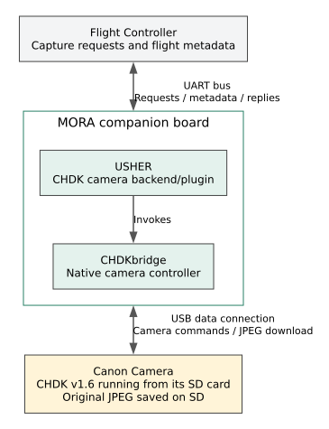
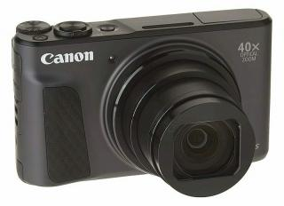

# Use A Canon Camera With CHDKbridge

CHDKbridge lets USHER request photographs and supported controls from a
Canon camera over USB. **CHDK runs inside the camera; CHDKbridge runs on
MORA or your PC.** You need both—CHDK loaded on the camera's SD card and
CHDKbridge on the host—for this camera path.

[Canon-camera terms](../../../docs/glossary.md#chdkbridge) |
[Capture with USHER](../../../docs/usher-camera-pipeline.md#choose-a-camera)



## Prepare The Camera



Obtain a stable, non-beta CHDK v1.6 build matching the exact camera model and
Canon firmware revision. Sensoraia does not install CHDK, prepare the SD card
or replace the camera's firmware for you.

- [Supported cameras](https://chdk.fandom.com/wiki/Supported_Cameras)
- [Downloads and build selection](https://chdk.fandom.com/wiki/Downloads)
- [CHDK 1.6 manual](https://chdk.fandom.com/wiki/CHDK_1.6_User_Manual)
- [Prepare an SD card](https://chdk.fandom.com/wiki/Prepare_your_SD_card)

Verify that CHDK loads after a power cycle and that the camera can save a
normal JPEG. Leave CHDK's USB Remote shutter-switch feature disabled; 
it is different from USB/PTP control.

- [Firmware](https://mighty-hoernsche.de/)
- [Interesting other library](https://www.emsi.me/libptp)

## Take Your First Photo

Build on the development PC. Stop USHER and other camera owners before a
standalone bench capture, connect a USB data cable and provide reliable power.

```sh
make -j32 chdkbridge
bin/chdkbridge --list
bin/chdkbridge --info
bin/chdkbridge photo-001.jpg
```

Use a new filename in a writable directory. Open the saved JPEG and check
focus and exposure. Ordinary capture saves the original on the camera's SD
card and downloads it. Existing destination files are not overwritten.

On MORA, deployment installs `99-chdkbridge.rules`, which gives the `plugdev`
group (and so the USHER service) access to Canon cameras in PTP mode. If a
desktop has mounted the camera, CHDKbridge releases that mount when it starts.

If several cameras are connected, use the port printed by `--list`:

```sh
bin/chdkbridge --port 1-3 photo-002.jpg
```

The example port is not universal. USB bus/device addresses can change after
reconnecting; verify the selected device each time.

## Choose Settings Deliberately

Unspecified standalone settings are left unchanged. Set only the options
your camera supports, and inspect a real photo after changing them:

```sh
bin/chdkbridge --iso-mode 400 --flash 2 --resolution 0 --quality 0 photo-003.jpg
```

| Option | Meaning |
| --- | --- |
| `--iso-mode` | Camera ISO-mode property; supported values depend on the model |
| `--flash 2` | Flash off |
| `--resolution 0` | Usually the largest image; confirm your camera's mapping |
| `--quality 0` | Requested superfine JPEG quality where supported |
| `--date-stamp 0` | Date stamp off |
| `--configure` | Apply supplied settings without taking a photo |

Readback errors can leave earlier settings changed. Check the camera before
retrying rather than assuming the whole operation was rolled back.

## Focus And Exposure

Start with autofocus and verify sharpness. For a camera that supports the
requested mode, examples include:

```sh
bin/chdkbridge --focus-mode af photo-af.jpg
bin/chdkbridge --focus-mode manual --focus-distance inf photo-infinity.jpg
bin/chdkbridge --shutter 1/1000 --iso-real 400 photo-exposure.jpg
```

Manual/infinity focus, adjustable aperture and ND-filter controls depend on
the camera. A successful distance/property readback does not establish image
sharpness or actual exposure quality. Do not choose infinity merely because
the aircraft will fly; measure the useful focus for your optics and scene.

`--iso-mode` is not the same as a real-sensitivity override. Use `--help`
for supported alternatives and ranges rather than combining conflicting
exposure options. Save comparison photographs before choosing a mission setup.

## Zoom

```sh
bin/chdkbridge zoom 0
bin/chdkbridge zoom 128
bin/chdkbridge zoom 255
```

These are separate commands. Zero is the wide end and 255 the tele end of
the normalized optical range. The middle value is not a guaranteed 2x ratio.
Zoom does not take a photo, and changing it can require a fresh focus check.

## Powered Lens Retraction

```sh
bin/chdkbridge --retract-lens
```

This requests playback mode without powering the camera off. To request
prompt retraction on cameras offering the setting, select **Lens Retraction:
0 sec** in Canon's menu. Confirm the physical lens has retracted: playback
confirmation alone does not measure its position. A later capture can extend
it again.

## Keep The Camera Awake

```sh
bin/chdkbridge --configure --keep-awake 1
```

This changes CHDK's idle-shutdown policy to Always; `--keep-awake 0` selects
Never, not restoration of an earlier intermediate setting. It consumes power
and cannot prevent low-battery shutdown or wake an already powered-off camera.
Omitting the option leaves the setting unchanged.

Check the result without changing anything. This reads CHDK's setting and,
when the firmware reports them, battery voltage and temperatures:

```sh
bin/chdkbridge --power-status
# idle_shutdown_policy=3; keep_awake=1; battery_mv=3987; optics_c=30; ...
```

It exits with an error unless the policy is Always, so it suits a pre-flight
check. The bridge never powers the camera off or restarts it, and it never
resets the USB device when a command ends.

When the camera exposes them, the same read-only report includes `zoom_step`,
`focus_mm`, `focus_mode` and `af_lock`. Focus mode 0 is autofocus and 1 is
manual in the bridge's supported property convention. A focus-distance
readback alone does not establish sharpness.

USHER applies `--keep-awake 1` on every shot by default (see below), so the
policy is re-asserted before each exposure and a camera that lost its saved
setting is corrected on the next shot. Before flight, charge the battery and
run `--power-status`: no software setting can prevent shutdown from an empty
battery or a camera fault.

## Retrieve A Camera Crash Log

After an unexpected camera shutdown, switch it on without taking another
photo. In CHDK's Miscellaneous menu, enable **Enable Lua Native Calls?** and
confirm its prompt. Stop other camera owners before retrieving the log:

```sh
bin/chdkbridge --timeout 60 --usb-timeout 5000 --romlog camera-crash.log
```

This exports Canon's stored ROM crash log to `A/ROMLOG.LOG` on the camera's
SD card and downloads it to a new local file, limited to 64 KiB. It does not
enter record mode, shoot, zoom or power off the camera. The native-call
permission must be enabled on the camera; the bridge does not change it.
Disable that permission again after the diagnostic when it is no longer needed.

Read the log's timestamp, assertion or exception, and task name before
repeating the failed capture. A stored log can describe an earlier failure;
compare it with the host's USB and capture logs. For manual export instead,
use CHDK's **Miscellaneous > Debug parameters > Save ROM crash log** command.

## Optional Direct USB Capture

`--direct-download` requests direct JPEG transfer rather than an SD-saved
JPEG. Support depends on the actual CHDK camera port. If unavailable, resolve
compatibility or use ordinary capture; do not assume a failed direct request
can be replayed without another exposure.

The bridge reports `direct JPEG unsupported; USB capture mask=N` when the
camera port lacks it. The mask is a bit set: 1 JPEG, 2 RAW, 4 YUV. A Canon
SX730 HS (CHDK PTP 2.9) reports mask 6, so only RAW and YUV transfers exist
and direct JPEG capture is not available on that camera.

## Use With USHER

To select CHDKbridge as MORA's active camera service, set `CAMERA = chdk` in
`camera.conf` at the Sensoraia root or pass `CAMERA=chdk` when deploying:

```sh
make mora-deploy CAMERA=chdk MORA_SSH_TARGET=air@theatre.local
```

See the [deployment guide](../../../docs/README.md#deploy-to-mora) for full
MORA verification steps.

### Choose USHER's Capture Profile

USHER supplies its own capture profile on each shot. A setting left by a
standalone command is not necessarily what USHER will use. For example,
select the Canon ISO-mode request while packaging on the PC:

```sh
make -j32 mora-package USHER_CHDK_ISO_MODE=400
```

Keep this choice consistent when rebuilding. The default ISO request is 1600
and the default JPEG quality is 2 (normal). Related settings include
`USHER_CHDK_FLASH` and `USHER_CHDK_QUALITY`. Confirm supported values and
actual photos on your camera; the mode number alone is not measured exposure.
Packaging does not activate the service.

The ISO request is applied only when the camera's mode dial is in **P, Tv,
Av or M**. In AUTO and scene modes Canon chooses ISO itself and does not
accept a user value; forcing one there made the SX730 HS exposure driver
assert (`DegeenGain.c` in its crash log) and power off when shooting zoomed in
dim light. CHDKbridge therefore leaves ISO to the camera in those modes and
still applies the other settings. Set the dial to **P** if you want the
configured ISO. On the SX730 HS, ISO 3200 at a zoomed position also powered
the camera off, so check any value above 1600 on your own camera.

### Increase The Shot Rate

For the SX730 HS, start with **Canon Image Review: Off**, flash off and CHDK
RAW saving off. Disable continuous/servo AF when using a focus lock. Image
review is a camera-menu setting here, not an option applied by CHDKbridge.
These settings remove avoidable camera work; their timing benefit has not
been measured on this setup.

The largest measured improvement is JPEG compression, without changing
resolution, which is why USHER uses quality 2 (normal) by default. In
standalone SX730 captures on MORA, resolution 0 with quality 0 (superfine)
produced roughly 8.4--10.5 MB files in 4.85--5.3 s once warm; quality 2
produced roughly 2.8--3.9 MB files in 2.7--3.1 s at the wide end and about
1.9 MB in 3.4--3.5 s zoomed to `zoom 128` indoors. These are
scene-dependent capture-and-download times, not a guaranteed flight cadence.
Normal quality loses some fine detail through stronger compression; inspect
small features before relying on it for mapping or detection. To keep
superfine JPEGs instead:

```sh
make -j32 mora-package USHER_CHDK_QUALITY=0
```

Packaging alone does not deploy it. Keep the setting on subsequent builds.
Do not probe other resolution codes: the SX730 HS uses 0 (L), 2 (M1), 3 (M2)
and 5 (S), and an unsupported code ended in a USB disconnect.

To compare fixed focus, with no other camera owner:

```sh
bin/chdkbridge --usb-timeout 5000 --focus-mode auto --focus-distance inf photo-focus.jpg
```

Here `auto` selects the CHDK port's supported manual-focus or AF-lock distance
mechanism; it does not request autofocus. Unsupported modes or rejected
distance readback fail explicitly. Check sharpness at the intended zoom and
subject distance. If the comparison succeeds, carry it into USHER using
`USHER_CHDK_FOCUS_MODE=auto USHER_CHDK_FOCUS_DISTANCE=inf` on the packaging
command. Recheck after zoom changes; fixed infinity focus measured about
0.2 s faster per wide-angle shot on the bench but has not been checked zoomed.

M or Tv mode and a suitable short shutter time can limit exposure time and
motion blur, but do not eliminate all camera processing. Lower ISO is not
inherently faster: in dim light it may require a longer exposure. Select
daylight white balance for consistent color when appropriate; no measured
speed gain is established here. The existing `--shutter` and ISO overrides
are available for comparison, but should not replace a correctly exposed
photo with a dark one merely to shorten capture time.

USHER overlaps CHDK metadata writing with the next capture. The camera/USB
capture lane is still single-flight, so triggers faster than capture and
download can finish are not guaranteed to produce photos. Direct JPEG USB
capture is unavailable on this SX730 port; it is not a speed option here.

On a camera whose CHDK port supports direct JPEG capture, USHER can ask the
bridge for it instead of saving to the SD card first:

```sh
make -j32 mora-package USHER_CHDK_DIRECT=1
```

The default is 0 (SD-saved capture). USHER does not fall back to the other
mode when direct capture fails, because that would expose twice.

Every shot also carries `--keep-awake 1` (CHDK "Always" idle-shutdown
prevention). Select `USHER_CHDK_KEEP_AWAKE=0` to request Never, or
`USHER_CHDK_KEEP_AWAKE=` (empty) to leave the camera's own setting alone.

With no other camera owner, a separately managed bench session uses:

```sh
./usher --chdk --debug
```

Do not run standalone CHDKbridge commands while USHER owns the camera.
For mission controls use the [camera-control guide](../../../docs/camera-control.md#before-you-start).

## Troubleshooting

| Symptom | Check |
| --- | --- |
| No camera | Power, USB data cable and the selected port |
| Camera busy | Desktop photo importers or another camera owner |
| CHDK/protocol rejected | Exact camera firmware and stable CHDK build |
| Setting rejected | Your camera's supported values and current state |
| Timeout after capture | Inspect the camera and destination before deciding whether to request another photo |
| Blurred JPEG | Focus, zoom, exposure duration, vibration and real scene detail |

When an earlier run was interrupted (stopped, timed out or unplugged), the
camera can still hold that run's PTP session or unsent data. CHDKbridge then
prints `Recovering camera PTP state left by an earlier run`, sends the
still-image class reset once and opens a fresh session; it never resets the
USB port. Likewise it waits for a camera script left running by an interrupted
run instead of killing it. USHER removes partial `cNNNNNN.jpg.part.*` downloads
left in the photo directory by a forcibly stopped controller. A camera that
has powered off still needs to be switched on again.

Keep usable originals and the diagnostic. A successful build or USB reply
does not replace a bench check of the actual camera configuration.

### Recover Before Requesting Another Photo

A timeout after triggering can mean the exposure succeeded but transfer or
confirmation failed. Check the camera's SD card and output directory before
repeating it. If you know the saved camera path, download the existing JPEG
without another exposure:

```sh
bin/chdkbridge --download A/DCIM/100CANON/IMG_0042.JPG recovered.jpg
```

Use the actual camera filename and a new local destination, with `--port`
when needed. Do not delete originals or kill an unrelated camera script to
force recovery. Once the camera is idle and the connection healthy, a new
independent capture can be requested.
