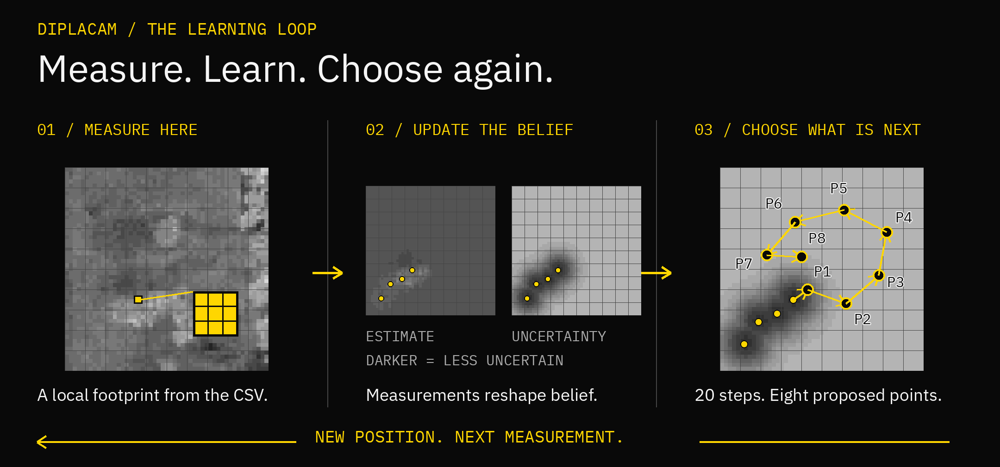
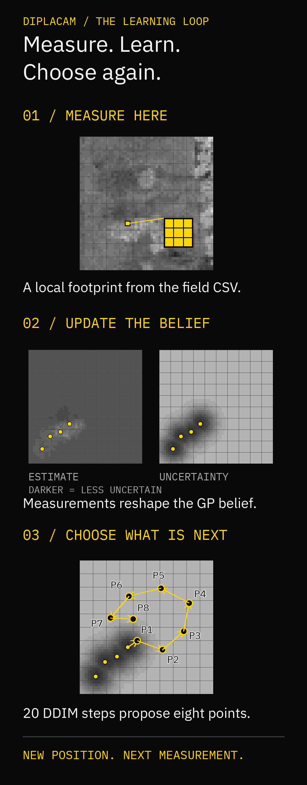
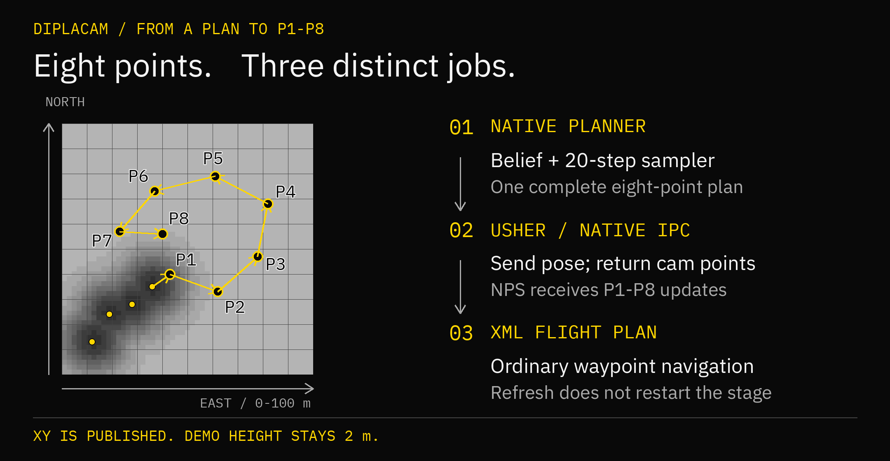
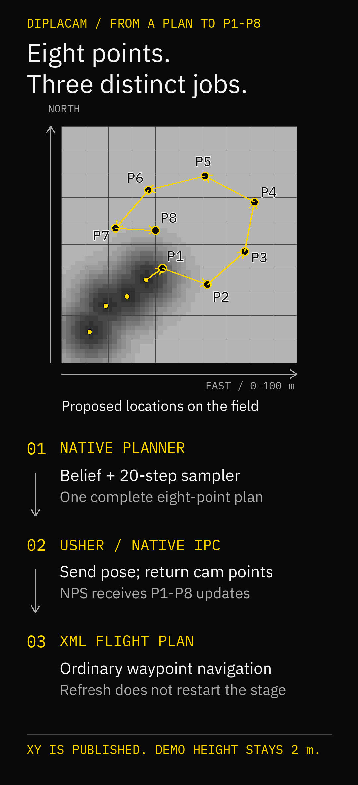

# Diplacam: Choose Where To Measure Next

Diplacam uses measurements already collected to propose eight useful places
to sample next. Its map belief tracks both estimated values and uncertainty,
so the next proposal can change as new observations arrive.

The supplied experiment samples a numerical field from a CSV. It runs the
native planner and selected ONNX model, not a physical full-spectrum-camera
driver. Start with the standalone command, then try the rotorcraft simulation.

[Planning terms](../../../docs/glossary.md#diplacam) |
[Paparazzi setup](../../../examples/paparazzi/README.md)

{ .field-guide-wide loading=lazy decoding=async }

{ .field-guide-tall loading=lazy decoding=async }

## Try A Standalone Plan

From the Sensoraia root:

```sh
make -j32 diplacam
bin/diplacam --field modules/dipla_cam/data/map_26_NAIP_grid_counts.csv --east 4 --north 4
```

The command prints eight `slot,east_m,north_m` rows. Internal slots 0..7
correspond to P1..P8 in the example. This does not start a flight or move
waypoints. Read model/field diagnostics on stderr if planning fails.

## Choose The Model And Field

The assignment lives in `modules/dipla_cam/diplacam_settings.ini`. Keep the
graph, descriptor and deployment metadata together. Paths are relative to
the settings file; `--settings` selects another assignment.

The current field uses `x,y,count` CSV rows on a 51-by-51, two-metre grid
covering 0..100 m east/north. Only the sensor footprint is sampled into the
belief. Unmeasured field truth is not handed to the network as the answer.
The supplied profile uses a two-grid-cell flight margin: XY stays within
4..96 m. This also applies to the standalone command's printed points.
`flight_margin_cells` changes that inset for both planners without changing
the model grid or the demo height.

The worker INI selects the field, not its geographic location. The flight plan
chooses where the aircraft begins the survey; Diplacam anchors the field to its
first accepted position. For custom experiments, an absolute field path avoids
working-directory ambiguity.

## Place The Survey

The existing START command arms the survey. Its first valid admitted shot
provides the measured latitude/longitude that becomes local **(50,50)**, the
centre of the 100-by-100-metre field. Local X increases east and Y increases
north. With the supplied two-cell margin, targets span approximately 46 m in
each direction from that measured centre.

Paparazzi owns the approach and GPS checks. The supplied **Begin survey** block
flies to **CENTRE**, waits there at the configured height, and starts Diplacam.
Choose that entry waypoint using Paparazzi's normal local or geographic
coordinates; its existing relative-waypoint facilities can also position an
entry manoeuvre. No geographic origin is duplicated in the worker settings.

The anchor is the accepted shot's actual position, not an assumption that the
aircraft is exactly at the waypoint. The mission's area check around CENTRE
allows for entry-position error as well as the field extent. Keep that check
consistent with the entry location when adapting the mission. HOME and landing
geometry remain independent.

| Event | Geographic Frame And Belief |
| --- | --- |
| START from stopped | Wait for the first valid admitted shot, then capture its position once |
| Another START while active | Retain the anchor and belief; request the next eight-point chunk |
| Duplicate or rejected shot | Do not establish or move the anchor |
| STOP, then START | Start a new survey with a new first-position anchor and belief |

Shot numbering does not have to start at one. The existing session token and
shot number correlate commands and measurements; they do not replace the
flight controller's GPS-validity checks. Before anchoring or before a complete
route is ready, replies cannot authorize waypoint updates.

Standalone planning has no geographic frame: `--east` and `--north` select an
observation directly on the CSV grid and still default to `(4,4)`. To exercise
the worker's centred first-observation case with a fresh standalone stream:

```sh
bin/diplacam --field modules/dipla_cam/data/map_26_NAIP_grid_counts.csv --east 50 --north 50
```

## How The Method Works

A Gaussian Process updates the estimated field and uncertainty from the
observed footprint. A learned diffusion model, trained to imitate informative
plans, then supports twenty denoising steps that produce eight locations.
This is a measurement planner, not an object detector or a motor controller.

Each accepted shot supplies one measurement footprint. Measurements include
reproducible Gaussian sensor noise, separate from the diffusion sampler's
random stream. They update the GP in order while the aircraft follows its
retained route, rather than being replaced by whichever pose arrives last.

The bundled model uses XYZ internally and was trained for 10..40 m heights.
The current demo deliberately commands 2 m and uses only predicted XY.
Predicted Z never commands altitude. Correct software execution at 2 m does
not establish planning quality outside that training range.
In the supplied profile, injected noise and GP likelihood both use variance
0.01. The reference's height-dependent law cannot be extrapolated unchanged
to 2 m because it would produce a negative variance.

## Configure An Experiment

Two flat INI files have different responsibilities:

| File | Purpose | Path Base |
| --- | --- | --- |
| `diplacam_settings.ini` | Model assignment, inference limits, GP, synthetic sensor and comparison policy | Paths inside this file are relative to the file |
| Worker INI selected by `--config` | Field, planning cadence and planning-pose age | `field` is relative to the worker's working directory; an absolute path avoids ambiguity |

The module supplies a commented `diplacam_settings.ini` and
`diplacam-example.ini`. Use one `key=value` per line, no sections, and put
comments on separate lines. Unknown or duplicate keys, malformed numbers,
nonfinite values and out-of-range settings stop startup instead of silently
choosing another experiment.

Inspect the effective application settings without loading a graph, field or
ONNX Runtime:

```sh
bin/diplacam --show-config
bin/diplacam --settings /absolute/path/experiment.ini --show-config
```

This reports resolved application paths and defaults, not worker configuration.
Both files are read once at process startup. Restart the standalone program or
USHER's Diplacam worker to apply edits; requesting another chunk does not reload
settings. Standalone and worker planning use the same application snapshot.

### GP, Sensor And Flight Margin

| Setting | Default | Meaning And Accepted Values |
| --- | --- | --- |
| `diffusion_seed` | `123` | Independent sampler seed, unsigned 64-bit integer including zero |
| `sensor_noise_seed` | `149` | Independent synthetic measurement-noise seed, same integer range |
| `flight_margin_cells` | `2` | Integer `0..24`; inset is this value times 2 m on each XY edge |
| `gp_prior_mean` | `0.2` | Finite initial field estimate, in field units |
| `gp_kernel_variance` | `0.0079` | Positive finite Matern marginal variance, in squared field units |
| `gp_lengthscale_m` | `4.78` | Positive finite spatial correlation length, in metres |
| `sensor_fov_deg` | `60` | Finite full footprint angle, strictly between 0 and 180 degrees |
| `sensor_noise_variance` | `0.01` | Positive finite measurement variance, used for both injected noise and GP likelihood |

For example, `flight_margin_cells=5` constrains published XY to 10..90 m and
also constrains comparison controls. It does not change raw DDIM output,
the observation domain or the fixed 2 m mission height. The GP prior mean is
independent of `cmaes_utility_threshold`; changing one does not change the other.

Identical seeds reproduce each stream for the same inputs and call sequence;
they do not make differently ordered observations equivalent. A standalone run
starts fresh streams. The worker retains both streams and its belief across
active START chunk requests. STOP followed by START creates a new survey and
resets the sensor stream; the diffusion stream continues until process restart.
Rejected duplicate observations consume no sensor noise.

Changing the GP or sensor profile changes the belief presented to the trained
model. The graph and its normalization are not retrained by an INI edit.
Keep the supplied profile as the reproducible baseline when evaluating changes.

### Cached Conditioning

An optional matched model bundle computes the map and position conditioning
once per route instead of repeating it in all twenty denoising calls. The
number of diffusion steps, GP observations, noise and flight-height policy are
unchanged. Select it in model settings with:

```ini
conditioning_cache=conditioning-cache
```

The path is relative to the settings file. The bundle must match the original
model and contain its verified encoder, denoiser and tensor descriptors. An
invalid selected bundle is an error, not a silent fallback. Omitting the
setting retains the original sampler; `--conditioning-cache DIR` selects a
bundle for one invocation, while an explicitly empty CLI value disables it.

Releases packaged with this option include both
`diplacam_cached_settings.ini` and `diplacam_reference_settings.ini` under
`share/diplacam/`. Compare either from the installation root:

```sh
bin/diplacam --field share/diplacam/field.csv \
   --settings share/diplacam/diplacam_reference_settings.ini
bin/diplacam --field share/diplacam/field.csv \
   --settings share/diplacam/diplacam_cached_settings.ini
```

For the managed service, copy the chosen settings over
`share/diplacam/diplacam_settings.ini` and restart `usher.service` to apply it.
Keep the named copies for switching back without rebuilding. A measured Pi
Zero 2 W comparison reduced warm inference from about 1.68 seconds to 0.56
seconds. Across sixteen complete test routes, the largest difference from the
original sampler was 0.44 mm; the two paths are numerically close, not
bit-for-bit identical.

### Worker Field And Timing

```ini
field=/absolute/path/map_26_NAIP_grid_counts.csv
cadence_ms=1000
planning_pose_max_age_ms=1000
```

Only `field` is required. Geographic placement is captured from the first valid
admitted shot of each survey, not read from this file. The small-field
conversion accepts an anchor within absolute 80 degrees latitude and 179.99
degrees longitude; polar and date-line-crossing surveys are not supported.

`cadence_ms` defaults to 1000, accepts `100..5000`, and sets the minimum cooldown
after a planning attempt finishes, not a fixed-rate timer, measurement cadence
or route-completion rule. Another requested chunk and fresh input are required.
`planning_pose_max_age_ms` defaults to 1000 and accepts `1..5000`: an admitted
pose must still be this fresh when a new plan starts. An older accepted
measurement can update the belief without being eligible to start a plan.
Continue providing fresh observations while waiting for a route.

This plan-start age check is separate from the fixed 5000 ms observation/reply
lease and the transport's point-cycle timeout. Those remain transport rules,
not experiment tuning controls. The fixed model contract also remains
51-by-51 cells over 0..100 m, eight XYZ points, three belief channels and twenty
denoising steps. The model's 10..40 m Z normalization does not change the demo's
2 m command height in the original plan. A smaller physical survey uses the
explicit frame settings below; the original defaults remain unchanged.

### Cyberzoo And OptiTrack

Select `sensoraia_dipla_cam_cyberzoo_demo.xml` instead of the original
`sensoraia_dipla_cam_demo.xml`. It retains the same START, load-eight,
follow-eight, STOP, return and landing sequence, with the supplied Cyberzoo
corners and a centre at local east/north `(0,0)`. It commands **1 m height**,
limits survey speed to **0.35 m/s**, and requires **20 cm** horizontal arrival
at each P1..P8. These explicit arrival checks do not inherit an airframe's
larger outdoor waypoint radius. Survey entry requires a **15 cm** centre
check and height between 0.9 and 1.1 m before the first anchor is captured.

Use the supplied worker profile `modules/dipla_cam/diplacam-cyberzoo.ini`:

```ini
field=modules/dipla_cam/data/map_26_NAIP_grid_counts.csv
cadence_ms=100
planning_pose_max_age_ms=3000
field_size_m=4
field_rotation_deg=125
flight_height_m=1
flight_height_tolerance_m=0.15
```

`field_size_m` is the physical side of the square, from 1 to 100 m; its
default is 100. `field_rotation_deg` rotates the model's X axis
counterclockwise from east, from -180 to 180 degrees; its default is zero.
The 125-degree orientation follows the supplied room edges. The complete
4 m square has at least 0.58 m nominal clearance inside the supplied inner
polygon before anchor or tracking error. The model's existing two-cell margin
adds a further 0.16 m inset along each square edge.

All three measured coordinates use the **same scale**: physical metres are
multiplied by `100 / field_size_m` before planning. Thus 4 m maps to the
unchanged 100-unit field, and a real 1 m AGL maps to 25 model units. Position,
sensor footprint, CSV field and GP length scales remain geometrically
consistent; stretching X and Y independently or rescaling only output points
would not preserve them. Predicted model Z is still discarded. Returned XY
points are rotated and scaled back into physical metres, while the aircraft
continues to command 1 m. Field-value noise variance is not a distance and is
not rescaled. The graph, normalization constants and twenty DDIM steps are
unchanged; no retraining is implied.

`flight_height_m` defaults to 2 m and accepts 0.2..40 m.
`flight_height_tolerance_m` defaults to 0.75 m and must be positive and less
than the selected height. A resized survey is rejected unless its entire
accepted height interval maps inside the model's 10..40 altitude domain.
The profile above maps 0.85..1.15 physical metres to 21.25..28.75 model units.
Its 3000 ms planning-pose admission setting accommodates the initial MORA GP
update while the aircraft holds CENTRE. The existing point freshness and
flight-plan loading limits remain unchanged. Reading retained route points is
independent of processing a pending sensor observation, so expensive GP work
does not serialize delivery of P1..P8. Point-only reads do not create additional
sensor observations; every admitted observation is processed once.
Resized profiles use the diffusion planner; the optional fixed-height CMA-ES
comparison rejects them explicitly. The original outdoor profile retains its
original fixed 2 m synthetic footprint, while resized profiles use the measured,
uniformly scaled AGL for both their sensor footprint and neural conditioning.

For a PC-only native session, build `make usher diplacam` from the Sensoraia
root. The launcher selects `diplacam-cyberzoo.ini` automatically when the saved
aircraft configuration selects the Cyberzoo plan. The original plan selects
`diplacam-nps.ini`. No worker-profile environment setting is needed.

Start Center from the Paparazzi directory. The explicit empty UART override
below keeps this test entirely on the PC even with a MORA cable connected.
Clear an old experiment override so automatic profile selection can work:

```sh
unset DIPLACAM_CONFIG
cd "$HOME/paparazzi"
MORA_UART_DEVICE="" ./paparazzi
```

#### Manual Cyberzoo NPS Flight

1. Stop the old session programs. In Center select **Bebop_DIPLACAM**
   (`airframes/SENSORAIA/sensoraia_parrot_bebop.xml`) and choose
   `flight_plans/SENSORAIA/sensoraia_dipla_cam_cyberzoo_demo.xml` as the flight
   plan. Save the configuration and confirm the Flight Plan field contains
   **cyberzoo** before building. If the XML was edited outside Center, reload
   the configuration first so a cached selection cannot overwrite that edit.
2. Select target **nps**, build it, then use session **Sensoraia Diplacam NPS**
   in `userconf/SENSORAIA/sensoraia_demo_control_panel.xml`. Do not select
   either MORA session for this PC-only test. If Center was open while its panel
   changed, switch to another control panel and back to **Sensoraia** to reload
   the program arguments.
3. Start the session's five programs: **Sensoraia USHER**,
   **Sensoraia NPS**, **Data Link**, **Server**, and **GCS Classic**.
   The USHER console must print `worker profile:` followed by
   `diplacam-cyberzoo.ini`. The simulator console must report PC execution.
   An already running USHER does not reload its profile when the flight plan
   changes; restart that program as well as NPS.
4. In the GCS select mode **Nav**. Wait for a valid position and
   **Ground standby** after **Wait GPS** and **Geo init**. NPS supplies this
   position; physical OptiTrack hardware is not needed for this simulation.
5. Press **Takeoff**. This starts the motors and climbs while holding the
   takeoff position. Wait for **Standby** at approximately **1 m**. Do not
   manually start **Start Dipla**, **Load eight**, or **Follow**.
6. Press **Dipla** once. The aircraft moves to **CENTRE**, settles within
   **15 cm** at **0.9..1.1 m**, then passes through **Start Dipla** and
   **Load eight**. Once all eight points are accepted it enters **Follow eight**
   automatically. These short transition blocks can be missed in telemetry.
7. Check that P1..P8 lie in the small rotated survey square and that the
   aircraft follows them at **1 m**. A route is retained while its eight points
   are followed; a new batch is requested after that route completes. USHER
   prints one `anchor_lat_e7` for the survey and successive `diplacam chunk=`
   records. No JPEG files or yellow `DC_SHOT` markers are expected: this is a
   file-backed sensor experiment, and its shot-report mask is 239.
8. Press **Return**, wait until the aircraft is back at HOME, then press
   **Land Here**. Completion is **Ground standby** with the motors off, not
   merely entry into a landing block.

If the aircraft takes off to **2 m**, the outdoor plan was built. If the USHER
console names **diplacam-nps.ini** while the aircraft holds **1 m**, the peer
and flight plan do not match. Stop both, save the Cyberzoo selection, clear any
`DIPLACAM_CONFIG` override, and restart the session. If **Load eight** returns
to **Standby**, inspect the USHER console for worker/configuration errors;
pressing **Follow** does not bypass the missing-route checks.

On MORA, select the indoor worker profile through USHER's `--diplacam-config`
argument instead of the outdoor profile. Automatic PC-launcher selection does
not reconfigure an already running service on MORA.
The normal deployment can package this profile directly:

```sh
make mora-deploy MORA_PROFILE=diplacam \
   DIPLA_WORKER_CONFIG="$PWD/modules/dipla_cam/diplacam-cyberzoo.ini"
```

The package keeps the selected geometry and timing settings, replaces `field`
with `share/diplacam/field.csv`, and includes the selected field data. Omit
`DIPLA_WORKER_CONFIG` to package the original outdoor profile. Model and
conditioning-cache selection remain separate application settings.

For physical Cyberzoo use, the aircraft's OptiTrack input must feed its normal
position/INS and GPS-validity interface with the same geographic origin and
east/north orientation as the supplied plan. Paparazzi's `gps_datalink`
publishes valid external tracking as a 3D fix, so the existing `GpsFixValid()`
gates remain meaningful without an indoor GNSS receiver. The supplied Bebop
airframe still selects Furuno GPS; selecting the plan does not reconfigure
that aircraft input. Clocking, tracking alignment and room coordinates must
be checked on the actual installation. The existing geographic UART points
have 1e-7-degree quantization, about 11 mm north and 7 mm east here.

Local NPS exercises the native USHER/Diplacam path, room geometry, point
sequencing, return and landing. It does not measure OptiTrack or physical
flight accuracy. The supplied field remains a scaled file-backed experiment,
not an added physical sensor driver.

## Run The PC Demo

With Paparazzi installed at `~/paparazzi`, build native USHER and Diplacam and
link the demo configurations from the Sensoraia root:

```sh
make usher diplacam
./kickstart.sh
```

`./kickstart.sh` installs `sensoraia_demo_conf.xml`, the unified control panel
`sensoraia_demo_control_panel.xml`, and symlinks for the Sensoraia flight plans
and `Bebop_DIPLACAM` rotorcraft airframe into `~/paparazzi/conf/` (preserving
previous `conf.xml` and `control_panel.xml` links under
`~/.local/state/sensoraia/kickstart/`). No Python simulation adapter is used.

1. Start Paparazzi Center (`cd ~/paparazzi && ./paparazzi`), select
   **Bebop_DIPLACAM** and target **nps**, then click **Build**.
2. Select control panel `userconf/SENSORAIA/sensoraia_demo_control_panel.xml`
   and session **Sensoraia Diplacam NPS**, then click **Execute**.
3. In GCS wait for valid telemetry and **Ground standby**. Select **NAV** mode
   before pressing **Takeoff**.
4. When the aircraft settles at 2 m in **Standby**, press **Dipla**
   (the **Begin survey** block). It approaches **CENTRE**, dwells there,
   seeds the initial P8 hold at the current position, and enters **Start Dipla**.
5. The first admitted shot anchors the field. The mission fills P1..P8 from
   native cam-point replies and enters
   **Follow eight** automatically. P1..P8 stay fixed while that route is flown.
   On completing the path, the mission requests and loads the next route.
6. Press **Return**, wait until the aircraft is back at HOME, then press
   **Land Here**. Wait for **Ground standby** and motors off before stopping
   the session programs.

With no cable, the session starts exactly one local USHER, which starts its
native Diplacam worker on demand. With a cable, the same session skips the PC
peer and uses MORA. The NPS console prints **execution: PC** or
**execution: MORA**, followed by the selected UART device. The launcher
refreshes the selected NPS transport build before starting, including when
the cable choice changed since Center's Build action.
There is no separate waypoint adapter. The simulator runs at real time because
freshness checks use elapsed wall-clock time. The flight plan holds at the
configured HOLD point if initial loading times out or updates stop.

## Deploy Diplacam To MORA

Prepare the board once using [Install and get started](../../../docs/README.md#prepare-the-reference-pi-board).
The ready-made release targets 64-bit Trixie on the Pi Zero 2 W reference
board. The examples below use `air@theatre.local` and `/home/air/sensoraia`.

From the Sensoraia root on your PC:

```sh
make -j32 mora-deploy MORA_PROFILE=diplacam MORA_SSH_TARGET=air@theatre.local
```

This builds the ARM64 applications on the PC, packages Diplacam with its
matching ONNX Runtime, model, settings and field CSV, uploads the release,
and starts USHER on MORA. Repeat the same command for an update. No compiler
or Python planner is installed on the board. To prepare the release without
contacting MORA, use `make -j32 mora-package MORA_PROFILE=diplacam` instead.

Every Diplacam package includes the complete `modules/dipla_cam/models/`
directory, including additional models, metadata and data files, under
`share/diplacam/models/` on MORA. Redeployment refreshes these files even when
they are not the selected model. Copying another model does not select it or
establish that it is compatible with the current planner; the application
settings still choose the active graph, descriptor and metadata.
The default full-suite `make mora-deploy` includes Diplacam and these assets
automatically while starting Spottercam by default; `MORA_PROFILE=diplacam`
starts USHER with the packaged Diplacam worker configuration.
The dedicated `MORA_PROFILE=lwircam` remains an LWIR-only package and service.

The **diplacam** profile packages USHER, Diplacam and their runtime assets,
without the unrelated camera applications or their OS dependencies. It does
not start LWIRcam or EARcam. USHER uses the board UART, normally `/dev/serial0`, and
starts its native Diplacam worker when the mission requests it. This remains
the supplied CSV-field experiment, not a physical spectrum-camera driver.
Deploying does not arm an aircraft or start an NPS session.

The installed worker configuration is
`/home/air/sensoraia/share/diplacam/example.ini`; it selects the packaged
`share/diplacam/field.csv`. Model and experiment settings are beside it in
`share/diplacam/diplacam_settings.ini`. The service working directory is the
installation root. The PC demo instead uses
`modules/dipla_cam/diplacam-nps.ini`; its paths point into the source checkout.

Confirm the selected service:

```sh
ssh air@theatre.local 'systemctl --no-pager --full status usher.service'
ssh air@theatre.local 'journalctl -u usher.service -n 50 --no-pager'
```

Expect an active USHER service whose command includes `--diplacam-config`.
If activation needs administrative authentication, follow
[Deployment recovery](../../../docs/usher-camera-pipeline.md#when-sudo-requires-your-password)
using the staging path printed by that upload. A running service confirms
startup; returned planner points are checked in the next exercise.

## Simulate With Diplacam On MORA

Keep the aircraft simulated on the PC while the real board runs USHER and
Diplacam. Connect the laptop FTDI adapter to MORA using the
[desk-test wiring](../../../docs/desk-test.md#1-connect-power-and-uart):
5 V power, common ground and crossed 3.3 V UART. Leave a real flight controller
disconnected for this exercise. Wi-Fi/SSH carries deployment and logs;
the FTDI UART carries flight requests and returned points at 115200 baud.

1. Deploy the Diplacam profile above and stop the previous Sensoraia session.
2. Connect the MORA FTDI cable.
3. Ensure `./kickstart.sh` has been run once from the Sensoraia root, then start
   Paparazzi Center from `~/paparazzi`:

```sh
./kickstart.sh
cd ~/paparazzi && ./paparazzi
```

Select **Bebop_DIPLACAM**, target **nps**, `userconf/SENSORAIA/sensoraia_demo_control_panel.xml`,
and the ordinary **Sensoraia Diplacam NPS** session. The cable is selected
automatically; the PC peer entry prints that it is using MORA instead of
starting local USHER. **Sensoraia MORA desk NPS** is also available
when you want startup to require a cable rather than permit PC-only operation.
With an already open Center, stop the old session and reload the control
panel after running `./kickstart.sh`.

Detection uses a single FTDI by-id device, otherwise `/dev/ttyUSB0`. If you
have several FTDI adapters, choose MORA's actual path explicitly when starting
Center:

```sh
cd ~/paparazzi && MORA_UART_DEVICE=/dev/serial/by-id/usb-FTDI_YOUR_ADAPTER ./paparazzi
```

Both NPS serial endpoints are pinned to that device in a hardware session,
so a local peer cannot take over later. A leftover `/tmp/usher-sim` makes
startup stop with an explanation instead of silently testing the PC. End
the earlier local session before retrying. No serial monitor should own the
same FTDI port.

Use the same **NAV**, **Takeoff**, **Dipla**, **Return** and **Land Here**
sequence as [Run the PC demo](#run-the-pc-demo). Run NPS at real time.
Watch the board in another PC terminal:

```sh
ssh -t air@theatre.local 'journalctl -fu usher.service'
```

After **Dipla** reaches **Start Dipla**, inspect the native processes:

```sh
ssh air@theatre.local 'ps -o pid,ppid,pcpu,rss,etime,args -C usher -C diplacam'
```

During the survey, `diplacam` is a child of the board's `usher`; its PPID
matches USHER's PID. The journal reports `anchor_lat_e7`,
`initial_gp_update_ms`, and successive `chunk=... inference_ms=...` lines.
Before **Dipla**, and after a STOP/Return ends the survey, only USHER may be
present. Its `--diplacam-config` argument enables the backend; it does not
keep a planner busy continuously. Low idle CPU is normal, and CPU alone
cannot identify where a route was computed.

Check all of these before calling the exercise successful:

- The MORA journal shows Diplacam starting, the first-position anchor, and
   planner results while the simulated aircraft requests measurements.
- GCS receives all eight P1–P8 updates and the mission enters **Follow eight**.
- The simulated aircraft follows the retained route at 2 m, then requests
   another chunk without moving the geographic anchor.
- **Return** reaches HOME and **Land Here** ends in **Ground standby** with
   motors off.

Diplacam does not produce JPEGs in this experiment, and its normal mission
suppresses Diplacam-only shot markers. Inspect returned points and the board
journal, not photo counts. UART errors, worker failures or an expired loading
deadline are failed results, even if USHER remains active. PC simulation
results alone do not establish the board's planning latency or memory headroom.

Stop the Center session after landing; the managed USHER service stays on
MORA. To return to PC-only simulation, disconnect the cable and restart the
session. To deliberately keep the cable attached while using the PC, start
Center with `MORA_UART_DEVICE="" ./paparazzi`; the explicitly empty value
disables cable selection for that session.

### If The Demo Stops

| Symptom | Action |
| --- | --- |
| `./kickstart.sh` reports missing Paparazzi | Install Paparazzi (or set `PAPARAZZI_HOME`), then repeat `./kickstart.sh` |
| Native binaries not built yet | Run `make usher diplacam` from the Sensoraia root |
| Center shows an old aircraft or session | Select `userconf/SENSORAIA/sensoraia_demo_conf.xml` and `userconf/SENSORAIA/sensoraia_demo_control_panel.xml` |
| NPS reports no compiled aircraft | Select **Bebop_DIPLACAM**, target **nps**, and build before starting the session |
| No local UART connection | Check the printed execution location first; a cable-selected session uses board USHER, not a local peer |
| Entry remains at CENTRE | Check GPS, height and arrival/dwell conditions; the mission has not started measurements yet |
| Loading returns to Standby | Inspect the USHER console for model, field or pose errors; press **Dipla** again only after resolving the error |
| Updates stop while following | The mission returns to HOLD/Standby after its update deadline; use **Return** and **Land Here** |
| Worker reports a lost survey | A STOP must end the lost survey before starting again; the supplied Standby and Begin survey blocks issue it |
| Board service starts LWIRcam/EARcam instead of Diplacam | Repeat deployment with `MORA_PROFILE=diplacam` |
| MORA journal stays quiet during the desk flight | Confirm **execution: MORA**, press **Dipla** after takeoff, then check the selected cable, crossed UART wiring and permissions |
| Multiple FTDI cables are detected | Set `MORA_UART_DEVICE` to MORA's stable by-id path before kickoff |
| Startup reports an existing `/tmp/usher-sim` | Stop the earlier local USHER session; do not start a second peer or silently switch computers |
| Board receives requests but no route loads | Read the worker error in the MORA journal; check model/field paths, memory and planning time rather than changing the flight height |
| Deployment reports another listener on `127.0.0.1:32000` | Find its owner with `ss -lunp '( sport = :32000 )'` on MORA; stop the older camera service before repeating deployment |
| Journal reports permission errors under `/root` | Redeploy the current service template; USHER must run with `air`'s home directory, not a `HOME=%h` override |
| NPS exits with `Floating point exception` | Inspect the simulator backtrace before retrying; a speed-norm/integer-square-root crash is on the FC side, not a MORA inference timeout |

{ .field-guide-wide loading=lazy decoding=async }

{ .field-guide-tall loading=lazy decoding=async }

The USHER console contains native worker diagnostics and shot results. The
worker reports the captured anchor latitude/longitude in integer 1e-7-degree
units and the shot number that established it. Kickoff
keeps the build log and standalone preflight output under
`~/.local/state/sensoraia/kickoff/` (or the corresponding `XDG_STATE_HOME`).

## Understand A Refresh

The flight plan owns route completion, including Paparazzi's configured arrival
margin and segment-passing rules. Diplacam does not run a second arrival check.
Its eight XY targets stay fixed until the path completes. The mission then
requests the next chunk using the existing START command, holds at P8 while
loading, and enters Follow only after all eight slots have arrived. Active
START retains both the geographic anchor and accumulated belief; STOP ends
that survey. The repeating chunk loop does not revisit CENTRE.

Initial loading uses P8 seeded at the entry position. Later loading holds at
the previous route's P8. Worker loss cannot silently relocate the survey:
USHER rejects further chunk starts until STOP explicitly ends the lost survey.

USHER retrieves pinned slots and the FC applies them through its existing
camera-point API, preserving the configured 2 m height. The eight moves are
not atomic, so the mission loads them before following the new chunk. HOME and
landing points never move. The GCS displays points; it does not plan the route.

The worker has one GP owner and room for 64 pending observations. If processing
cannot keep up and that queue fills, it invalidates the route and reports the
failure instead of silently losing measurements. The mission's existing timeout
then returns it to Standby. Resolve the cause and restart the session programs
before trying again. A retained route also requires continuing fresh observation
replies; a long execution is not permission to replay stale replies.

Entering Standby, Return or landing clears loaded-route readiness. Press
**Dipla** to load a fresh route before following again; manually selecting
**Follow eight** does not reuse a stopped route.

## Control GCS Shot Markers

The supplied mission suppresses `DC_SHOT` telemetry for Diplacam-only triggers,
so repeated measurements do not add yellow shot circles to the GCS. P1..P8
updates, capture requests, shot numbering and returned results continue normally.
This does not clear circles already drawn; use **Clear DCSHOTS** for those.

The UART module's **shot report mask** setting is independent of its
**camera mask**, which selects what to trigger:

| Report Mask | Behavior |
| --- | --- |
| `255` (`0xff`) | Report triggers from every camera slot |
| `239` (`0xef`) | Silence Diplacam-only triggers; keep other cameras' reports |
| `0` | Silence all shot reports without disabling captures |

A mixed trigger still produces one report if any requested camera's bit is
enabled. A silent trigger still advances its shot number once, after UART
admission. Rejected requests advance neither numbering nor reports. Silent
shots are absent from `DC_SHOT` telemetry logs, not from the camera protocol.

For an aircraft startup default, add this define to its existing UART module:

```xml
<module name="digital_cam_uart">
   <define name="DIGITAL_CAM_UART_SHOT_REPORT_MASK" value="239"/>
</module>
```

Omitting the define preserves normal reporting (`255`). A flight plan can set
the policy before starting autoshoot:

```xml
<call_once fun="uart_cam_ctrl_set_shot_report_mask(239)"/>
```

The supplied **Start Dipla** block applies `239` each time it starts. To keep
reports enabled in this mission, change that call to `255`. During a session,
change **control / tb / shot report mask** in the GCS settings to toggle reports
without rebuilding or restarting USHER. Include `modules/digital_cam_uart.xml`
in the aircraft's `settings_modules` list to expose that setting; the supplied
configuration already does so. Only integer masks `0..255` are accepted.

Runtime changes override the startup default and survive a USHER reconnect;
entering **Start Dipla** reapplies the mission's value. No GCS or USHER update
is needed for this policy, but the FC must be rebuilt with the matching UART
module and generated settings.

## Compare With CMA-ES

`cmaes=true` in the settings explicitly selects the classical comparison
planner instead of ONNX diffusion. It is not a fallback after model failure.
Use the same field/observations when comparing results; one attractive route
does not establish a model's performance.

| Setting | Default | Meaning And Accepted Values |
| --- | --- | --- |
| `cmaes_budget_ms` | `1000` | Cooperative whole-search budget, integer `1..4000` ms |
| `cmaes_maxfevals` | `300` | Objective evaluation ceiling, integer `12..3000`; population size remains 12 |
| `cmaes_seed` | `55` | Positive optimizer seed, integer `1..2147483647` |
| `cmaes_utility_threshold` | `0.3` | Finite importance threshold in field units |
| `cmaes_confidence_beta` | `1` | Finite nonnegative multiplier of posterior standard deviation |
| `cmaes_step_xy_m` | `20` | Positive finite initial XY search standard deviation, in metres |

These settings are validated at startup even when `cmaes=false`, but affect
only the selected comparison planner. It uses the same GP/sensor profile and
flight margin as diffusion. Cancelled or incomplete searches publish no partial
route. A tight wall-clock budget can interrupt a search at different points
under different load; a fixed seed does not make timed-out runs identical.

## ONNX Runtime

Diplacam uses the shared native runtime, with one default inference thread
and a budget for the whole plan. See [model selection](../../../docs/onnxruntime.md)
for compatible assignments and packaging.

`onnx_threads` accepts `1..32`. The supplied INI sets
`inference_timeout_ms=4000` for all twenty passes together; omitting that key
uses the shared application default of 2000 ms. These are cooperative limits,
not hard-real-time guarantees.

## Before Onboard Use

The simulation exercises native USHER/Diplacam IPC and the shared FC point
transport. It does not establish real-sensor performance, MORA resource
headroom or field accuracy. The configured NPS height is supplied from the
simulated FC state; a physical installation needs its own valid height source.

Check real sensor integration, model usefulness at the intended height,
terrain/clearance, aircraft response and combined board resource use before
relying on an onboard mission. The dense field belief alone uses substantial
memory; one process's average size is not whole-board headroom.
