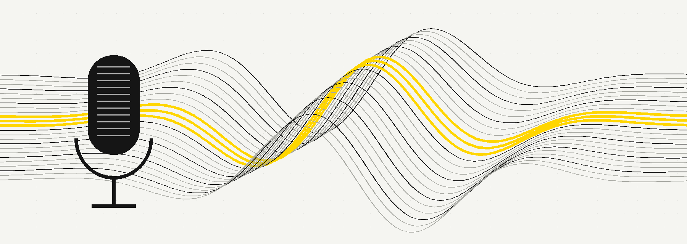

# EARcam: Search By Sound

EARcam listens for an alarm through a USB microphone and combines sound
measurements with aircraft positions to estimate a useful search location.
Start by listening on the bench, then try the supplied simulated flight.

[Sound-search terms](../../../docs/glossary.md#earcam) |
[Simulated flights](../../../examples/paparazzi/README.md)

{ .chapter-art }

## Listen On The Bench

From the Sensoraia root:

```sh
make -j32 earcam
arecord -L
bin/earcam --device hw:CARD=Device,DEV=0
```

Use the actual ALSA device listed on your computer, not necessarily the
example name. Stop with Ctrl+C. Place the intended alarm in a controlled
test area and confirm its tone is detected before adding aircraft noise.

Keep microphone gain and mounting fixed during a comparison. A dramatic
volume knob is useful for music and much less useful for measuring whether
you moved closer to a sound source.

## What The Readings Mean

EARcam looks for useful tone energy rather than treating every loud sound
as the desired alarm. Its signal checks reduce the influence of unrelated
noise, but wind, propulsion, reflections and alarm direction still matter.

Digital microphone levels are normally dBFS, not calibrated dB SPL. Relative
changes can be useful with fixed gain; physical sound-pressure and rough
distance estimates need the appropriate microphone calibration.

| Observation | Interpretation |
| --- | --- |
| Stronger clean alarm tone | Useful evidence, not a location by itself |
| Loud broadband noise | May be wind/propulsion rather than the target |
| Clipped samples | Reduce excessive gain and repeat the check |
| No accepted tone | Check device, frequency band, gain and the actual alarm |

## How It Finds The Source

One microphone does not point at the alarm. Movement supplies different
measurement positions; the software fits a sound model to useful readings
and reduces the effect of outliers. It does not simply select the single
loudest sample's coordinates.

At height, small horizontal movements near the source can change loudness
very little. Several useful passes around an area provide better geometry
than assuming the peak of one pass is an exact fix. Wind and reflections can
also distort the apparent peak.

The result is a search aid. Independent measurements are needed before
claiming position accuracy or making a rescue or flight-safety decision.

## Try A Simulated Search

Use the [Paparazzi demo setup](../../../examples/paparazzi/README.md). The
EARcam session runs USHER natively with a simulated alarm source, so no
physical microphone or MORA board is needed:

```sh
make -j32 usher soda earcam
./kickstart.sh
```

Start Paparazzi Center (`cd ~/paparazzi && ./paparazzi`), select
`userconf/SENSORAIA/sensoraia_demo_conf.xml`, aircraft **`Easystar_3_EARCAM`**
(or your own fixed-wing aircraft assigned `flight_plans/SENSORAIA/sensoraia_ear_cam_demo.xml`),
and target **nps**, then click **Build**. In the **Session** tab select
`userconf/SENSORAIA/sensoraia_demo_control_panel.xml` and start
**Sensoraia EARcam NPS**. Wait for live telemetry/GPS in GCS Classic, then
click **Takeoff**; the plan climbs and enters its flower listening mission
automatically.

Watch the search pattern, result stage and normal landing. An accepted answer
can update `TARGET`; a timeout or unusable answer can finish without a fix.
A completed simulated search does not establish microphone performance.

## Use With USHER

Choose the microphone device and a suitable alarm band in the actual USHER
configuration. A separately managed live listening session can use:

```sh
./usher --earcam --earcam-band 2400,3200 --debug
```

The band is an example for the intended alarm, not a universal setting for
every sound. Avoid another program owning the same input. Check the sensor
alone before combining it with other workloads on MORA.

Capture uses nonblocking PCM reads with waits of at most 100 ms. Two seconds
without PCM progress, including persistent device suspension, fails the worker
so USHER can supervise its restart. This is a device-progress check, not a
sound-level gate: quiet audio still contains PCM samples.

USHER rejects timed measurements whose original audio-window end is more than
500 ms old; a late classifier completion cannot make old audio fresh again.
Unknown chunk timing leaves the whole classifier window explicitly unaligned.
These are software policies, not measured USB latency or synchronization accuracy.

## Inspect The Search Result

Keep the recorded observations, position context and generated sound picture.
The JPEG is a computed heat map, not a photograph taken by a microphone.
Inspect result validity before treating it as a current target.

### Replay And View A Heatmap On A Map

The replay and overlay applications run on the development PC. Replay rebuilds
the EARcam heatmap from a saved session log; overlay adds satellite context and
redraws the source marker and optional observation/flight tracks. This is a
visual review tool, not another localization step, and it never changes the
recorded measurements.

Build both native programs from the Sensoraia root, then replay the session log
to create the decorated image, its `.geo` sidecar and an undecorated `_field.jpg`:

```sh
make -j32 ear_heatmap_replay ear_heatmap_overlay
bin/ear_heatmap_replay /path/to/ear-session.csv /path/to/ear-result.jpg
```

Overlay that result, optionally adding the session samples, aircraft track,
search center and a known simulation source:

```sh
bin/ear_heatmap_overlay /path/to/ear-result.jpg \
  --log /path/to/ear-session.csv \
  --track /path/to/aircraft-track.csv \
  --search 48.8105,7.8516,25 \
  --truth 48.8105,7.8516
```

The default output is `ear-result_sat.jpg`. The application automatically uses
the matching `_field.jpg` and `.geo` files when present; keep all three replay
outputs together. `--search` takes latitude, longitude and optional radius in
metres. Use `--truth` only when the known position is available, such as in a
simulation; it is drawn separately from the estimated loudest spot.

Google imagery reuses Paparazzi GCS's existing
`~/.local/share/paparazzi/pprzgcs/map/GOOGLE/{z}/{x}/{y}.jpeg` cache by default
(or `$XDG_DATA_HOME/paparazzi/pprzgcs/map` when `XDG_DATA_HOME` is set).
`--source esri` selects Esri imagery, and `--cache DIR` chooses the cache root.
Existing tiles are opened directly; there is no network-library dependency.
On a cache miss, the program uses the system `curl` command to fetch that tile.
Add `--offline` to require a complete local cache and fail instead of attempting
a download.
Tile imagery is visual context only: it cannot improve acoustic evidence or
turn an uncertain estimate into ground truth.

Use `bin/ear_heatmap_overlay --help` for zoom, opacity, margin, obstacle-grid,
and other options. An obstacle CSV, when available, must contain
`x_east_m,lat,lon,mnh_m` columns.

## Optional ONNX Sound Classification

Select a compatible assignment in `earcam_settings.ini`. The model must match
the declared PCM sample rate and window; its probability is separate from
raw microphone level. A classifier does not automatically provide a geographic
source. See [model selection](../../../docs/onnxruntime.md).

## Why Height And More Than One Pass Matter

In an ideal free field, doubling source distance reduces sound pressure by
about 6 dB. On an aircraft, slant distance includes height: at 40 m above a
source, moving 10 m sideways changes the distance only to about 41.2 m.
That is roughly 0.26 dB, easily obscured by ordinary noise.

This broad, nearly flat loudness peak is why the loudest single reading is
not an exact ground location. Passes from different directions help constrain
the fit. Reflections, alarm orientation and propulsion can distort the
pattern; the distance relationship explains the method, not a guaranteed
useful range for every installation.

## Read Level, Tone And Quality Together

Where the selected mode reports these diagnostics:

| Reading | What It Tells You |
| --- | --- |
| Level | Strength of the selected tone, not all nearby sound |
| Frequency | Which tone is strongest within the selected search band |
| Contrast | How distinct that tone is from the remaining in-band sound |
| Envelope/trend | Smoothed change across pulses: approaching, receding or steady |
| Alarm/clip flags | Whether tone checks passed or the recording range was exceeded |

Compare a clean alarm recording with quiet/background and propulsion/noise
conditions. Strong RMS alone does not identify the alarm. Keep microphone,
gain and mounting fixed when comparing positions or runs.

## Troubleshooting

Check the correct audio device, gain, clipping and whether the alarm is
actually within the selected band. Compare quiet and propulsion/noise
conditions. If readings change after moving the microphone or changing
gain, start a new controlled comparison rather than combining incompatible
measurements into one search.

## Glossary

Sound and shared project definitions live in the
[Sensoraia glossary](../../../docs/glossary.md), including its dedicated
[EARcam section](../../../docs/glossary.md#earcam).
