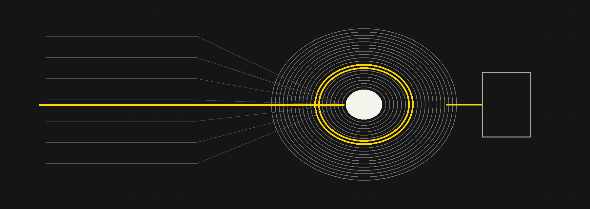
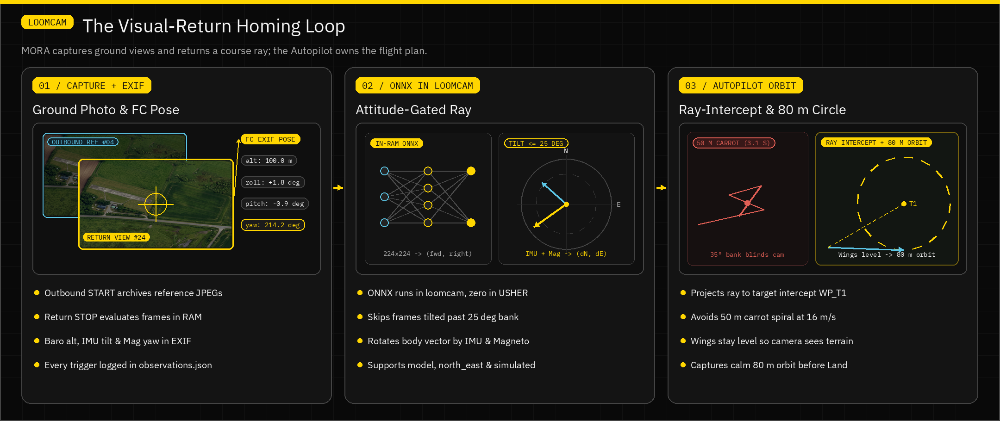
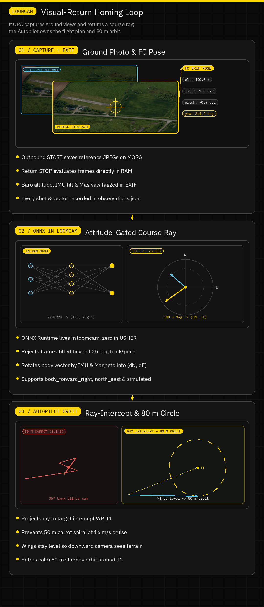
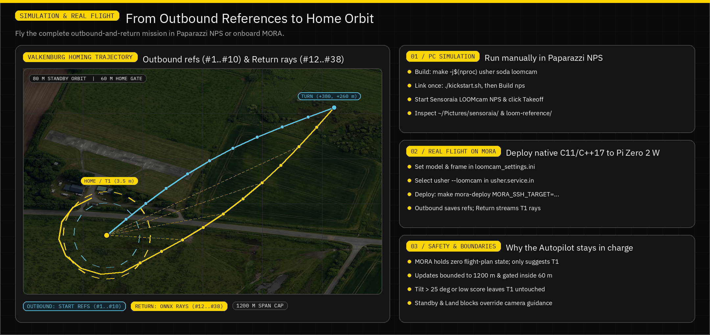
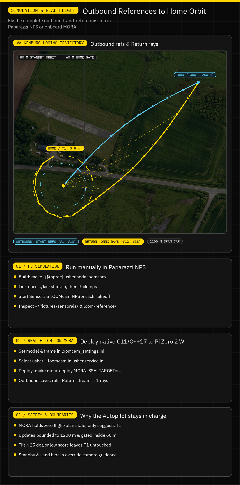

# LOOMcam: Visual-Return Homing

LOOMcam captures outbound reference photographs on the way out and turns
downward return-leg photographs into a course ray back toward **HOME**. On
every accepted return view, **T1** is updated along the predicted homing ray
while the Flight Controller stays in full command of the flight plan, altitude,
and landing sequence.

**A trained homing network is not included.** In the PC simulation, LOOMcam
runs its selected ONNX model on real MIMIC camera views and can synthesize a
clearly labelled, bounded homeward vector from the photo's neural features so
you can fly and test the entire capture, EXIF, ONNX, and waypoint-update loop
before your neural network has earned its pilot's license. Vehicle-detector
outputs or generic features are never silently treated as real navigation
vectors.

[Visual-return terms](../../../docs/glossary.md#loomcam) |
[Try Sensoraia with Paparazzi](../../../docs/autopilot-integration.md) |
[Paparazzi first-flight walkthrough](../../../examples/paparazzi/README.md) |
[AI Camera setup](../../ai_cam/docs/raspberry-pi-ai-camera.md)

For PC flights, [select the simulated camera profile](#select-the-simulated-camera-profile)
before launching Paparazzi Center. The LOOM session now enables the nominal
AIcam lens/shutter profile by default; `LOOM_CAMERA_PROFILE=none` restores the
clean pinhole camera.

{ .chapter-art }

## How the Visual-Return Loop Works

Everything in the LOOMcam pipeline has a single, clear job—nobody tries to
fly the airplane from inside a camera process:

- **MORA (`usher` + `loomcam`)** is a stateless Flight Controller helper. It
  takes periodic ground photos when commanded, stamps the Flight Controller's
  Baro altitude, IMU roll/pitch, and Magneto heading into EXIF, runs ONNX
  inside `loomcam`, and returns a suggested `T1` target. MORA holds **zero**
  flight-plan state.
- **USHER (`usher`)** handles the UART wire protocol, camera triggers, and EXIF
  tagging with **zero** embedded ONNX Runtime.
- **The Autopilot (Paparazzi)** owns the mission blocks (`Outbound`, `Return`,
  `Standby`, `Land`), validates incoming `T1` updates, and flies the aircraft.

| Mission Phase | Camera Command | What MORA & `loomcam` Do | What the Autopilot Does |
| --- | --- | --- | --- |
| **1. Outbound** | `START` (recording on) | Captures downward JPEGs, stamps Baro height, IMU tilt, and Magneto yaw into EXIF, and links up to 256 reference photos into `references/session-<token>/`. | Flies from `HOME` to `TURN` along the outbound leg while triggering a photo every 3 seconds with wings level. |
| **2. Return** | `STOP` (recording off) | Evaluates each return view in RAM without archiving extra reference copies, runs ONNX in `loomcam`, rotates the vector into Earth `(North, East)`, and proposes `T1`. | Flies wings-level toward `T1`, locks onto `HOME` inside the 60 m gate, and enters a calm 80 m standby orbit. |

{ .field-guide-wide loading=lazy decoding=async }

{ .field-guide-tall loading=lazy decoding=async }

### Why Ray-Intercept + an 80 m Orbit Beats a Short Carrot

If you place a waypoint carrot just 50 m ahead of a fixed-wing aircraft cruising
at **16 m/s**, the aircraft covers that distance in **3.1 seconds**. By the
time the next camera frame is processed, the plane has already overrun the
point and rolled into a **35° bank** trying to chase its own tail. Worse yet,
a belly-mounted camera banked at 35° is staring sideways at the horizon instead
of looking at the terrain underneath the aircraft.

LOOMcam avoids the "dog-chasing-its-tail" spiral in two ways:

1. **Attitude-gated capture (`return_max_tilt_deg=25`)**: When a turn or gust
   tilts the aircraft beyond 25° of roll or pitch, `loomcam` skips steering for
   that frame rather than trusting a skewed, oblique view of the countryside.
2. **Ray-intercept projection & 80 m orbit**: Instead of chasing a short carrot
   under the nose, `T1` is projected along the homing course ray to intercept
   the target area, and the flight plan transitions into a smooth **80 m
   standby circle** once inside the **60 m** home-protection radius. Wings stay
   level on the approach, the camera keeps a clear view of the ground, and the
   plane orbits calmly over home until you command landing.

### What Gets Stamped Into Every Photo's EXIF

When the Flight Controller triggers a shot, USHER pairs the image with the
freshest autopilot pose and writes standard EXIF fields before `loomcam`
inspects the frame:

| Datum | Aircraft Sensor | EXIF Tag | Why `loomcam` Needs It |
| --- | --- | --- | --- |
| **Height (`alt_m`, `agl`)** | Barometer / navigation altitude | `GPSAltitude` + `ImageDescription` (`agl=...`) | Scales ground-footprint geometry and logs capture height |
| **Roll & Pitch (`phi`, `theta`)** | IMU attitude estimator | `ImageDescription` (`roll=... pitch=...`) | Rejects banked frames (`> 25°`) and corrects body-to-horizontal tilt |
| **Heading (`psi` / `yaw_deg`)** | Magnetometer / AHRS heading | `GPSImgDirection` (`True North`) + `ImageDescription` | Rotates body `(forward, right)` vectors into Earth `(North, East)` |
| **Capture Position** | Autopilot navigation state | `GPSLatitude`, `GPSLongitude` | Anchors outbound references and bounded step checks |

---

## Run a Manual Simulated Flight on Your PC

You can fly the complete outbound-and-return loop at your desk without a
physical airplane or windburn. Paparazzi's **NPS** flies the simulated
fixed-wing aircraft, **MIMIC** renders realistic downward camera photographs
from your cached Valkenburg satellite tiles at the aircraft's exact pose, and
native **`usher` + `loomcam`** process every frame.

{ .field-guide-wide loading=lazy decoding=async }

{ .field-guide-tall loading=lazy decoding=async }

### Step 1: Build for PC Simulation & Prepare the Ground Imagery

**For this local NPS flight, no physical camera or camera SDK is needed.**
Run this complete command from your Sensoraia checkout:

```sh
cd ~/develop/sensoraia
make -j4 usher soda loomcam CAMERA_CAPTURE=0
```

`CAMERA_CAPTURE=0` is an option on the **`make` command**, not a Paparazzi
setting or a flight-time switch. It leaves out physical-camera capture support
but keeps LOOM's saved-photo processing. **It does not turn off the simulated
camera:** USHER renders new photographs from cached ground imagery at the
simulated aircraft's current position and attitude, then passes those saved
photographs to LOOM. Keep this option on subsequent `make ... loomcam` commands
when rebuilding for PC-only simulation.

Before flying, prepare the aerial imagery:

1. While online, open **PprzGCS**, select aerial/satellite imagery, and display
   the **Valkenburg demo route at zoom 18**. Pan over the whole outbound and
   return route, plus the surrounding ground visible to the downward camera,
   so those tiles are cached.
2. Confirm that the cache contains zoom-18 JPEGs:

   ```sh
   find ~/.local/share/paparazzi/pprzgcs/map/GOOGLE/18 -name '*.jpeg' | head
   ```

The default cache is `~/.local/share/paparazzi/pprzgcs/map`. Confirming that
tiles exist does not prove every camera footprint is covered; missing tiles
can still reject a photo during flight, so cache more of the surrounding area if
that happens. The **Sensoraia LOOMcam NPS** session uses this cache automatically;
do not start another USHER manually. It does not download imagery during flight
or substitute a fixed test picture when tiles are missing. The pictures show
the imagery currently stored in your cache, not a live satellite feed.

If your cache is elsewhere, add `--mock-map-cache /absolute/path/to/map` to the
`USHER` command line in Paparazzi Center's **Session** tab.
See [MIMIC: prepare the map cache](../../../docs/mimic.md#1-prepare-the-map-cache)
for more about the simulated camera.

**Only if you also need a physical camera connected to this PC**, use the
camera-enabled build instead:

```sh
make imx500-native-sdk
make -j4 usher soda loomcam CAMERA_CAPTURE=1
```

That alternative adds hardware capture support; it does not select the
simulation's ground imagery. MORA deployment is covered separately below.

### Step 2: Install Sensoraia Links Into Paparazzi

From the Sensoraia root (with Paparazzi installed at `~/paparazzi`):

```sh
./kickstart.sh
```

This links the Sensoraia flight plans, demo airframes, and unified control panel
into `~/paparazzi/conf/` (see the
[Paparazzi setup walkthrough](../../../examples/paparazzi/README.md)).

### Step 3: Build & Start the Session in Paparazzi Center

Choose the [camera profile](#select-the-simulated-camera-profile) first; Center
passes its environment to the session-managed USHER.

Launch Paparazzi Center from your Paparazzi directory:

```sh
cd ~/paparazzi
./paparazzi
```

*(If a MORA FTDI cable is plugged into your computer and you want a purely
PC-only flight, start Center with `MORA_UART_DEVICE="" ./paparazzi`. Without
that override, Sensoraia's cable-first detection automatically routes the
session to USHER on MORA.)*

In **Paparazzi Center**:

1. Ensure configuration **`userconf/SENSORAIA/sensoraia_demo_conf.xml`** and
   control panel **`userconf/SENSORAIA/sensoraia_demo_control_panel.xml`** are
   selected.
2. Select aircraft **`Easystar_3_LOOMCAM`** (or your own fixed-wing aircraft using
   `flight_plans/SENSORAIA/sensoraia_loom_cam_demo.xml`), select target
   **`nps`**, and click **Build**.
3. In the **Session** tab, select **`Sensoraia LOOMcam NPS`** and click
   **Execute**.

### Step 4: Fly Outbound, Return & Land in `GCS Classic`

1. **Wait for GPS**: In `GCS Classic`, wait a few seconds for live telemetry and
   a valid 3D GPS fix in **Holding point**.
2. **Click `Takeoff`**: The aircraft climbs to 100 m nominal altitude and
   enters **Start demo** (`LOOM outbound`) automatically.
3. **Watch the Outbound Leg (`OUT1` $\rightarrow$ `OUT2`)**:
   - Entering **Session start** sends camera `START` over the simulated UART.
   - During **Outbound**, downward photographs are captured periodically and
     hard-linked into `~/Pictures/sensoraia/loom-reference/session-<token>/`.
4. **Watch the Return Leg (`Return phase` $\rightarrow$ `Return`)**:
   - Entering **Return phase** sends camera `STOP` to switch USHER's native LOOM
     worker from reference recording to return-phase evaluation.
   - In **Return**, each saved photograph is evaluated by `bin/loomcam` and
     correlated `USHER_CAM_POINT_UPDATE` messages are processed through
     `cam_point_to_waypoint(USHER_CAMERA_AICAM, WP_T1)` while the aircraft
     orbits before proceeding into the automatic **Land** sequence.
   - Stop all session programs in Paparazzi Center after landing before starting
     another run.

### Step 5: Inspect Your Saved Photos & Reference Links

After the flight, inspect USHER's native output folders:

- `~/Pictures/sensoraia/` — every captured JPEG stamped with EXIF altitude,
  roll, pitch, and magnetometer heading. With emulation enabled,
  `o000006.jpg` is the retained clean view and `o000006.lens.jpg` is the
  camera-profile view actually submitted to LOOM.
- `~/Pictures/sensoraia/loom-reference/session-<token>/` — the immutable
  outbound reference photographs hard-linked during the `START` leg. These
  link the **emulated** JPEGs when a profile is selected, not the clean views.

*(Because the bundled `nn_loom_v001.rpk` is a feature-only assignment rather
than a trained homing network, native `loomcam` reports uncalibrated/invalid
return directions unless configured with a compatible ONNX homing assignment or
`return_vector_frame=simulated` in `loomcam_settings.ini`, leaving `T1` safely
unchanged rather than inventing a direction.)*

### Select the Simulated Camera Profile

The local **Sensoraia LOOMcam NPS** session defaults to
`resources/camera_lens_aicam.json`: nominal AIcam field of view, Brown
distortion, 2 ms exposure, rolling shutter, motion blur, chromatic aberration,
and configured vibration, residual shading, optical softness, sensor noise
and luma sharpening. Output matches USHER AIcam's 2028x1520 quality-90 JPEG
mode. This is an **illustrative starting point**, not a
measured calibration of your flight camera.

| Selection | Set before starting Center | Result |
| --- | --- | --- |
| Default AIcam | No override | Nominal AIcam profile |
| Your camera | `LOOM_CAMERA_PROFILE=/absolute/path/flight-camera.json` | Validated custom profile |
| No emulator | `LOOM_CAMERA_PROFILE=none` | Original clean pinhole JPEG, no extra render |

For example, prepare your own profile from the Sensoraia root:

```sh
cp resources/camera_lens_aicam.json "$HOME/loom-flight-camera.json"
# Edit that copy, then validate it:
./bin/camera_lens --validate-profile "$HOME/loom-flight-camera.json"
```

In Paparazzi Center's **Session** tab (with **Sensoraia LOOMcam NPS** stopped),
update `--mock-lens resources/camera_lens_aicam.json` on the `USHER` command
line to `--mock-lens /home/you/loom-flight-camera.json` (or remove
`--mock-lens resources/camera_lens_aicam.json` for a clean pinhole baseline)
and click the play button (or **Session -> Save** to keep your choice). Relative
profile paths resolve from the Sensoraia root because `USHER` enters its own
directory at startup. Keep the profile unchanged for the whole sortie; after
editing it, start a fresh session with fresh references. This only affects PC
map simulation; a MORA session uses its real camera, without synthetic effects.

When managing USHER yourself instead of using Center:

```sh
./usher --local --test --mock-map --loomcam \
  --mock-lens "$HOME/loom-flight-camera.json" --debug
```

Omit `--mock-lens` to disable emulation in a manually managed USHER. Add
`--mock-map-cache /absolute/path/to/map` for a non-default cache. Never start
this alongside the session-managed peer.

#### Match the Camera That Produced Your Training Photos

Start with measured parameters for the **saved JPEG mode**, not just the
sensor's advertised maximum resolution:

- Set `horizontal_fov_deg`, `vertical_fov_deg`, `model`, and `distortion`
  from calibration in that mode. Brown coefficients are `[k1,k2,p1,p2,k3]`;
  fisheye uses `[k1,k2,k3,k4]` and `diagonal_fov_deg`. Use
  [OpenCV's calibration conventions](https://docs.opencv.org/4.x/d9/d0c/group__calib3d.html).
- Set `output_width` and `output_height` together to match the real JPEG
  dimensions (for example **2028** and **1520**, if that is your capture mode).
  Omitted or paired `null` values preserve MIMIC's clean-view dimensions.
  Rendering uses the requested output grid directly, before ONNX's independent
  model-input resize. Do not downsize here just to conceal inference cost.
- Match exposure duration (`exposure_s`), shutter/readout, JPEG quality,
  and realistic speed/height. Keep `height_override_m=null` so the photo's
  flight AGL is authoritative. `f_number` and `focal_length_mm` record lens
  metadata; they do not simulate depth of field.
- Match RGB/BGR, scaling, and resize separately in the
  [ONNX assignment](../../../docs/onnxruntime.md). A lens profile is not a
  neural model configuration, nor a PANGEA camera-calibration INI.

Compare batches with `./bin/camera_lens --measure /data/flight/*.jpg`.
Follow [Calibrate Against Real Captures](../../../docs/camera-lens.md#calibrate-against-real-captures)
to compare noise, detail, shading, brightness and JPEG statistics, tune the
profile and verify a held-out real flight. The supplied profile has not been
calibrated against real AIcam flight captures.

See the [complete profile settings and realism limits](../../../docs/camera-lens.md#profile-reference)
for units, ranges, coefficient conventions, performance controls, and
calibration guidance. The [Raspberry Pi AI Camera product information](https://www.raspberrypi.com/products/ai-camera/)
describes the nominal hardware, not your installed lens calibration.

#### What Reaches the Neural Network

```text
cached imagery + capture pose -> clean JPEG + flight EXIF
                             -> camera_lens(profile, same pose/cache)
                             -> saved .lens.jpg + profile/hash provenance
                             -> outbound reference link OR return ONNX input
```

USHER runs the existing native renderer **once**, before the saved-image
callback. LOOM archives and reads that exact derivative; SODA receives the
same path without applying a second lens pass. Pose, GPS, AGL, and shot
identity remain attached. The derivative's EXIF records the effective profile,
its SHA-256, shutter/exposure, rendering assumptions, and source geometry.
The clean file remains available for paired comparisons. Reference filenames
still end in `.jpg`, but their inode is the derivative's inode.

A missing tile, invalid profile, busy renderer, timeout (90 s maximum), or
write failure rejects that simulated observation: no clean-image fallback,
no stale derivative reuse, no reference admission or new LOOM result.
Read `CAMERA_LENS`/`IMAGE_LENS` diagnostics and USHER's
`lens-emulated analysis input` line. The Flight Controller remains in charge.

The renderer reprojects cached terrain rather than stretching only the original
photo, so a wider profile needs a wider cached region. It uses bounded strips,
a bounded tile cache, and one renderer job at a time; it does not add OpenCV
to USHER or LOOM. Profile settings `samples`, `threads`, `memory_budget_mb`,
and output resolution control cost. Capture workers wait for the derivative,
so large images/many samples can miss the flight plan's 3-second photo cadence.
Check the renderer's `elapsed_s` and USHER's timing at your real resolution;
the timeout is a safety ceiling, not a real-time throughput promise. Lower
odd `samples` only after comparing blur convergence. See
[resource guidance](../../../docs/camera-lens.md#performance-and-validation).
Adaptive exposure sampling and verified ray-grid interpolation keep the
full-effect default near 0.60 s/photo on the development PC; this is not a
whole-pipeline or onboard timing guarantee.

Satellite imagery, flat terrain, configured vibration/rates, and relative
sRGB exposure cannot establish real-flight neural accuracy. Saved-image
noise/shading/sharpening are approximations, not a reproduction of the Bayer
sensor or complete camera ISP. Automatic exposure/white balance, physical
defocus, and atmospheric or 3D-scene effects are not reproduced.
Compare held-out real-flight JPEGs with
simulation before calling a profile representative. The simulated homeward
vector mode remains only an integration aid, even with lens emulation enabled.

---

## Choose the Model & Vector Frame (`loomcam_settings.ini`)

Configure `loomcam` in `modules/loom_cam/loomcam_settings.ini` (or your own
copy). ONNX requires a compatible `.onnx` graph and descriptor; IMX500 uses a
compatible `.rpk`. Paths are resolved relative to the settings file. The
bundled `models/nn_loom_v001.rpk` is a feature-only assignment; its presence
does not establish trained homing behavior.

| `return_vector_frame` | How `loomcam` Interprets the Output |
| --- | --- |
| `none` | Extracts features and logs observations only; never moves `T1` |
| `north_east` | First output component is **North**, second is **East** |
| `body_forward_right` | First component is aircraft **forward**, second is **right**; rotated into Earth `(North, East)` using the photo's EXIF IMU roll/pitch and Magneto heading |
| `simulated` | Runs the real `.onnx` graph, then synthesizes a slightly noisy body-frame homeward vector seeded by the photo's neural features and projects it through the 3D IMU/Magneto rotation (ideal for testing before a model is trained) |

A two-value vector has no measured confidence estimate; a three-value output
supplies `(vector_0, vector_1, confidence)`. Vector magnitude in `0..1` scales
the lookahead step down as the aircraft approaches the target spot, while
magnitudes at or above `1` step by the full `return_lookahead_m` ahead of the
aircraft. Photos taken beyond `return_max_tilt_deg` (roll or pitch) are
rejected before steering. Match the declared RGB/BGR order, scaling, resize,
and nearest-neighbor interpolation to your training pipeline; see
[ONNX model selection](../../../docs/onnxruntime.md).

Example `loomcam_settings.ini` for a compatible ONNX assignment:

```ini
inference_backend=auto
input_source=live
model=models/return.onnx
model_descriptor=models/return.ini
onnx_threads=1
inference_timeout_ms=2000
return_vector_frame=body_forward_right
return_home_radius_m=60
return_lookahead_m=50
return_max_step_m=5
return_min_confidence=0.6
return_max_tilt_deg=25
```

Live operation steps from each photograph's aligned pose—or from hardware-bound
camera frames using barometer height and magnetometer heading when GPS
alignment is unavailable. Optional `return_home_latitude` and
`return_home_longitude` add destination hemisphere and arrival bounds when a
fixed coordinate is known.

---

## Prepare & Fly a Real Flight with LOOMcam on MORA

Taking LOOMcam into the air on **MORA** (Raspberry Pi Zero 2 W) with the
**Raspberry Pi AI Camera (IMX500)** uses the exact same native C11/C++17 binary
pipeline—cross-compiled on your PC and deployed cleanly over SSH.

### Step 1: Mount the Camera & Connect the Flight Controller UART

1. Mount the **Raspberry Pi AI Camera** looking straight down (**nadir**) with
   an unobstructed view beneath the fuselage.
2. Connect the Flight Controller UART to MORA (`/dev/serial0` at `115200` baud,
   3.3 V UART logic, crossed `TX`/`RX`, and common ground).
3. In your aircraft's airframe XML, ensure `digital_cam_uart` has
   `DIGITAL_CAM_UART_POSE_STREAM=1` enabled so MORA receives live Baro
   altitude, IMU roll/pitch, and Magneto heading with every trigger.

### Step 2: Prepare Your `loomcam_settings.ini`

Copy `modules/loom_cam/loomcam_settings.ini` to a flight configuration file and
point `model` and `model_descriptor` to your trained return network.

- Keep `return_vector_frame=none` for initial data-collection flights where you
  only want to record outbound/return imagery and verify inference timing.
- Switch to `return_vector_frame=body_forward_right` (or `north_east`) only
  after validating your model on representative aerial views from your flying
  site.

### Step 3: Select `CAMERA=loomcam` For MORA

AIcam, Spottercam, and LOOMcam are alternative owners of the same physical
IMX500 camera (Spottercam is the default when `CAMERA` is left unchanged).
Set `CAMERA = loomcam` in `camera.conf` at the Sensoraia root, or pass
`CAMERA=loomcam` directly when packaging and deploying.

### Step 4: Package & Deploy to MORA

Use the [standard MORA deployment workflow](../../../docs/README.md#deploy-to-mora)
with `CAMERA=loomcam` and pass your settings file via `MORA_LOOMCAM_SETTINGS`:

```sh
make -j32 mora-deploy \
  CAMERA=loomcam \
  MORA_SSH_TARGET=air@theatre.local \
  MORA_LOOMCAM_SETTINGS=/absolute/path/loomcam_settings.ini
```

This cross-compiles the ARM64 binaries on your PC, configures `usher.service`
to start `usher --loomcam`, installs the graph, descriptor, and settings under
`share/loomcam/` on MORA, and restarts `usher.service`. (To build the package
without contacting MORA, run
`make -j32 mora-package CAMERA=loomcam MORA_LOOMCAM_SETTINGS=/absolute/path/loomcam_settings.ini`.)

Confirm the service is running on MORA:

```sh
ssh air@theatre.local 'systemctl --no-pager --full status usher.service'
ssh air@theatre.local 'journalctl -u usher.service -n 40 --no-pager'
```

### Step 5: Optional FTDI Desk Flight Before Going to the Field

Before flying the aircraft, you can connect your laptop's FTDI cable to MORA
(5 V power, common ground, crossed 3.3 V `TX`/`RX`; see the
[FTDI desk-test guide](../../../docs/desk-test.md)) and start the **Sensoraia
LOOMcam NPS** session in Paparazzi Center. With the cable attached, the
simulator automatically uses your real MORA board (`execution: MORA`) instead
of a local PC peer.

### Step 6: What Happens During the Real Flight

1. **Takeoff & Standby**: Take off normally and verify stable telemetry, GPS,
   barometer altitude, and magnetometer heading in `pprzgcs`.
2. **Outbound Leg (`START`)**: Entering the outbound block sends `START` to
   USHER on MORA. Native USHER creates a fresh, exclusive
   `references/session-<token>/` directory for the sortie and links up to **256**
   downward reference photographs with full EXIF pose tags.
3. **Return Leg (`STOP`)**: Entering the return block sends `STOP`, locking the
   outbound reference set for the sortie while periodic captures continue. Each
   level return photo (`<= 25°` tilt) is evaluated in RAM by `loomcam` without
   writing extra reference copies to the SD card.
4. **Approaching `HOME` & Landing**: Accepted return vectors step **`T1`**
   toward the return spot, bounded within **1200 m** and gated inside
   `return_home_radius_m` (**60 m**). Once at the return circle, the aircraft
   orbits `T1` calmly at **80 m** radius until you command **Land**.

---

## Keep References Separate & Troubleshoot

Use a clean reference directory for each sortie, and never mix different model
feature spaces or edit hard-linked originals.

- **Per-sortie reference caps**: Each `START` creates a new `session-<token>`
  directory under `references/`, capped at **256** hard links per session and
  **64** top-level sessions. Once at the 256-photo cap, photos are still
  captured and evaluated normally, with no further reference links added.
  Existing sorties are never silently deleted; archive or remove old sessions
  deliberately before storage runs low.
- **Strict startup and confirmation**: Missing, feature-only, or incompatible
  model assignments are rejected at startup. Rejected vectors never move `T1`.
  Missing waypoint confirmation does not commit a proposed target, and its
  confirmation channel enforces a four-second deadline.

### If Return Updates Stop

| What You See | Why It Happens | What to Do |
| --- | --- | --- |
| A shot during a turn produces no `T1` move | Roll or pitch exceeded `return_max_tilt_deg` (`25°`) | Normal! Wait for the aircraft to roll wings-level on the straight leg |
| `T1` stops updating near `HOME` | Aircraft is inside `return_home_radius_m` (`60 m`) | Normal! `T1` holds at `HOME` so the aircraft can fly a steady 80 m standby orbit |
| No `T1` updates on straight, level legs | `return_vector_frame=none`, confidence below threshold, or model/descriptor mismatch | Read the helper or journal diagnostic; check `loomcam_settings.ini` and model paths |
| Capture rejected with `--mock-map` | Missing zoom-18 tile in the local `PprzGCS` cache | Pan over the missing area at zoom 18 in `PprzGCS` so `~/.local/share/paparazzi/pprzgcs/map/GOOGLE/18` is populated |

When updates stop for any reason, the Flight Controller retains its existing
target and normal flight-plan behavior—the absence of a visual update is never
treated as a new fix. Use the mission's normal **Standby** or **Land** controls
to manage the flight.

PC simulation demonstrates end-to-end integration, not visual homing accuracy.
Before relying on a model onboard, validate it on independent representative
views, check camera calibration and timing, and verify MORA's combined memory
and CPU headroom.

