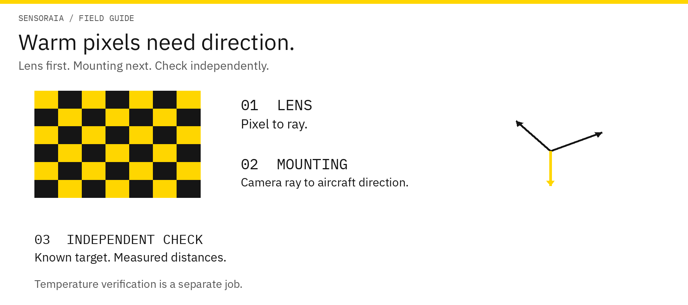
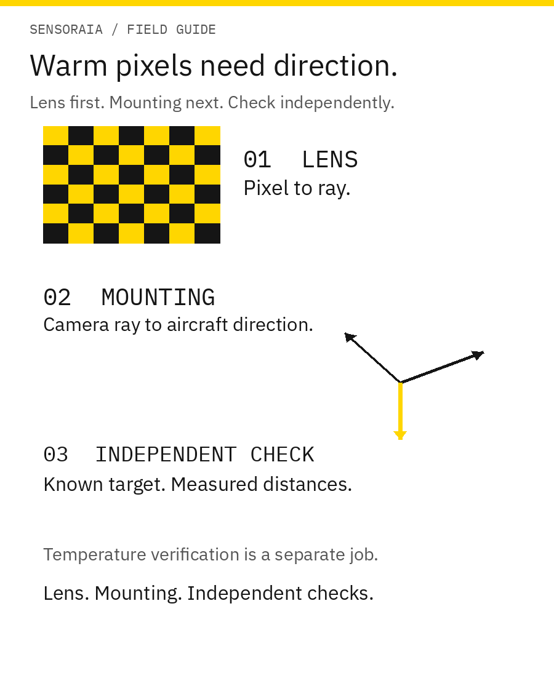
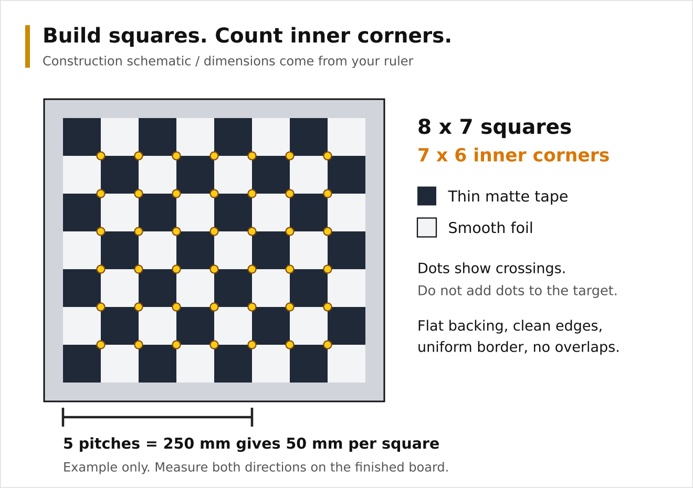
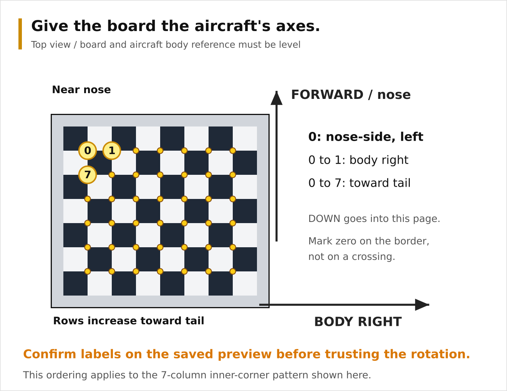
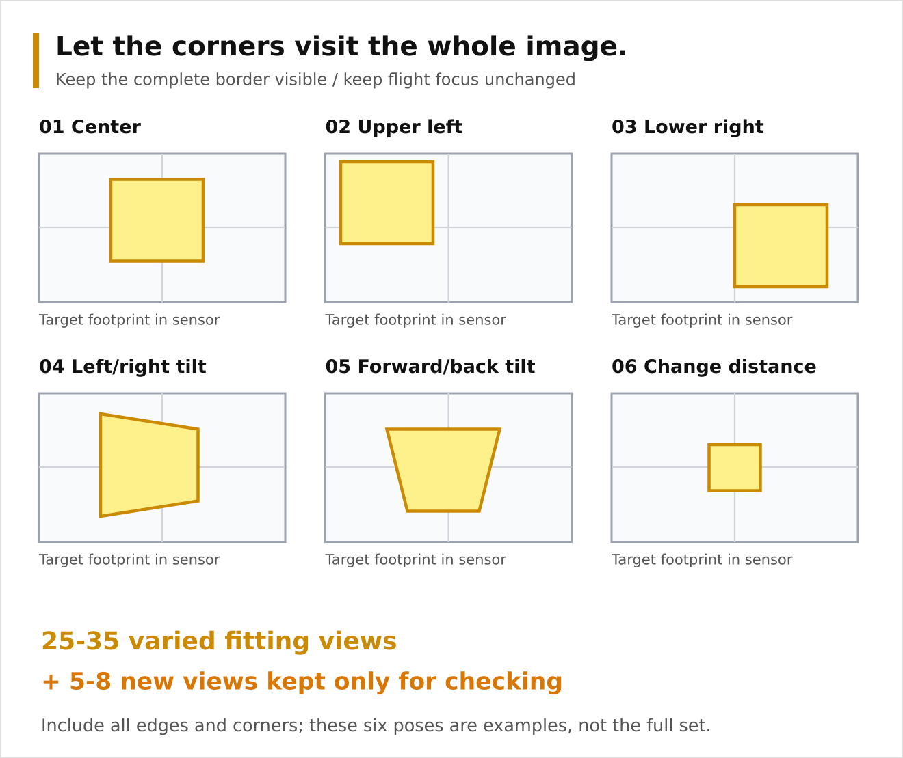

# Calibrate Your Thermal Camera

A hotspot's map position depends on more than the camera's GPS tag. Measure
the lens, measure how the camera is mounted, then check the combination on
independent targets. Keep temperature verification as a separate task.

[First thermal capture](lwir-cam.md#first-camera-jpeg) |
[Calibration terms](../../../docs/glossary.md#lwircam)

{ .field-guide-wide loading=lazy decoding=async }

{ .field-guide-tall loading=lazy decoding=async }

## 1. Know What You Are Calibrating

| Part | What You Measure |
| --- | --- |
| Lens/intrinsics | How a native image pixel corresponds to a camera direction |
| Mounting/extrinsics | How that direction relates to aircraft axes |
| Position and timing | Where the camera was during the observation |
| Temperature response | How measured thermal values compare with independent references |

Changing resolution, focus, lens or bracket can invalidate the corresponding
calibration. A fitted file is not an independent field-accuracy measurement.

## 2. Gather Ordinary Materials

Use a flat rigid board, materials that give clear thermal contrast, measured
square spacing, a tape measure, a square and a level. You also need a laptop
for fitting and separate folders for fitting and checking photographs.

Remove the propeller before working around the installed aircraft. Keep the
camera in its final bracket for the mounting measurement.

## 3. Make A Target The Camera Can See

Test a small patch first. Ordinary printed black and white may look nearly
identical in thermal imagery. Contrasting surface materials/emissivity and
reflections can make the grid visible; inspect the actual camera image
before constructing a large target. Avoid glare, uneven heating and warped
surfaces.

### Make A Small Trial Patch

Put a matte tape square beside a smooth aluminium-foil-tape square on one
flat backing. Look at their boundary with the actual camera from the intended
distance and a modest tilt. Gentle, uniform warmth behind the board can help;
keep liquids and heaters clear of electronics and follow their instructions.
Do not use flames, boiling water or a heat gun to obtain contrast.

Foil reflects the thermal surroundings. Move your body and other warm objects
away from the reflected view; the foil's apparent brightness is not a
temperature reference. Continue only when edges remain sharp at several
angles. Wrinkled foil, thick overlaps and a bowed board are reasons to
improve the patch before making a full grid.



The commands below use **7 by 6 internal corners**: that means 8 by 7 squares.
They also use an example **50 mm square pitch**. Measure your real pitch and
substitute it; the fitter cannot know that a handmade target is slightly
different from its intended dimensions.

Add a uniform border at least half a square wide. Measure the finished grid
pitch across several squares in both directions and divide by their count:
five pitches spanning 250 mm means 50 mm per square. Measure grid-line to
grid-line, not the remaining exposed foil width. Rebuild a crooked grid or
one with unequal horizontal/vertical pitch rather than averaging the error.

Choose a size that fills useful parts of the image while remaining sharp.
If corners are not visible or stable, fix the target/contrast before taking
a large collection of photos.

Keep the intended flight focus. If a small indoor board is blurred, use a
larger board farther away instead of refocusing just for calibration.
Roughly 10-20 pixels per square is a useful starting size; inspect the native
image at 100% and retain the complete grid and border in each fitting view.

## 4. Freeze The Camera Setup

Keep native dimensions, focus and optics fixed. Save original thermal JPEGs,
not resized screenshots, rotated exports or annotated previews. Do not change
the bracket between mounting measurement and use.

Record the camera serial, mode, dimensions, lens/focus and relevant gain
state. A gain label you type is a record of your intention, not hardware
readback.

For a standalone capture with USHER and other camera owners stopped, use a
new filename on the camera computer:

```sh
mkdir -p calibration/photos
bin/lwircam calibration/photos/view01.jpg
```

Take the next view under a new name. Copy originals to the laptop without
resizing or re-encoding them; copy matching raw companions too if recorded.
Do not use mock imagery or display-rotated exports for the real lens fit.

## 5. Take A Useful Set Of Photos

Collect at least 15 usable fitting views with varied tilt, position, distance
and in-plane rotation. Let corners visit the image edges as well as the centre.
Keep the full grid visible, flat and sharp.

Set aside 5-8 genuinely new views for checking. Do not fit with those same
images or delete difficult views merely to improve a score. Replace an image
only when you can identify its problem, and retain your reason.

## 6. Fit The Lens On The Laptop

The native calibration application runs on the development PC. Build it from
the Sensoraia root; the project reuses its static OpenCV calibration modules
and bundled JPEG codec, so no separate calibration package is needed:

```sh
make -j"$(nproc)" lwir_calibrate
```

Keep fitting photos in `calibration/photos`, independent checks in
`calibration/check` and mounting views in `calibration/mount`. Then run:

```sh
bin/lwir_calibrate lens \
  --images calibration/photos --check calibration/check \
  --columns 7 --rows 6 --square-mm 50 \
  --output calibration/tiny1c-lens.yml
```

The normal ARM64 build also creates a MORA-compatible copy, included in the
release package for optional manual calibration work. It is not started by the
USHER service, and packaging does not upload or activate it:

```sh
make -j"$(nproc)" arm64
bin/lwir_calibrate-arm64 --help
make -j"$(nproc)" mora-package MORA_INSTALL_DIR=/home/air/sensoraia
```

The package is assembled on the development PC; deployment is a separate
command. The utility remains a standalone tool and is not part of USHER's
startup command.
Use your actual board dimensions and measured pitch. A new output name is
required for a separate attempt. Inspect the corner overlays, detected/skipped
file list and independent-check errors, not only the summary number.

Reprojection error is in **pixels**, not metres of GPS error. Correct-looking
overlays and comparable independent checks are necessary; no universal RMS
threshold guarantees geographic accuracy. A good centre-only fit does not
validate the image edges.

## 7. Measure The Mounting Without Guessing

Secure the aircraft over a horizontal target, using its defined body-axis
reference. A convenient fuselage surface may not be that reference. Align
board columns with aircraft right and rows toward the tail. Resolve any
disagreement between the FC's level reference and the physical datum first.



With the camera in its final bracket:

```sh
bin/lwir_calibrate mount \
  --image calibration/mount/mount01.jpg \
  --lens calibration/tiny1c-lens.yml \
  --columns 7 --rows 6 --square-mm 50 \
  --output calibration/tiny1c-mounted.yml
```

Inspect the numbered corners: 0 is the near-nose, aircraft-left inner corner;
1 is next toward aircraft right; 7 starts the next row toward the tail for
this seven-column board. A checkerboard can be detected in the opposite
order. Use `--reverse-corners` only for the identified 180-degree reversal,
with a new output name. Do not guess signs or rotations until a result looks
plausible.

## 8. Check Distances Before Checking GPS

Use target positions and distances not used in fitting. Compare predicted
directions/ground offsets with measured physical references across the image,
including its edges. Recheck with a separately collected set.

For a local geometry check, secure the aircraft over a level patch with
propulsion disconnected. Measure camera height and use a plumb line to mark
its ground projection. Put independently measured targets forward, right,
left and near the usable image edges. Check directions before comparing
small distance errors, then repeat with known changed heading/attitude.
Use the actual stationary pose/height rather than old flight metadata.

Checkerboard fitting does not require hotspot detection. A checkerboard can
correctly produce zero detected hotspots; do not heat a household target
dangerously to force a detection. End-to-end hot-target checks need a suitable
controlled target. Tape measurements check relative geometry, while absolute
GPS error needs an independently surveyed reference and its uncertainty.



A systematic offset suggests mounting/reference error; growing edge error
suggests lens or mode mismatch. Before blaming GPS, check the image axes,
target geometry, ground plane and observation timing.

| Error Pattern | Investigate First |
| --- | --- |
| Grows toward image edges | Lens fit, crop or wrong image dimensions |
| Similar offset that rotates with heading | Mounting alignment |
| Changes with speed/turn direction | Observation timing or motion blur |
| Slowly drifting displacement of every target | Position reference or GNSS bias |
| Changes over sloping terrain | AGL and the flat-ground assumption |

These are clues, not unique diagnoses; change one thing at a time.

## 9. Install The Profile Deliberately

Retain the original fit and reports. Set `verified: 1` only after reviewing
the lens, corner ordering, mounting and independent geometry checks. It is
a review gate, not certification of GPS or field accuracy.

The runtime profile uses original native dimensions, fitted `fx/fy/cx/cy`,
distortion coefficients and the camera-to-body rotation. Do not substitute
a cropped display matrix or pre-undistort the image: the runtime projects
the calibrated ray itself.

Copy the reviewed profile to MORA and select it in the actual USHER launch
configuration, for example:

```text
--lwir-calibration /home/air/sensoraia/calibration/tiny1c-mounted.yml
```

Use your installed account/path. Changing a command in an SSH terminal does
not update an already running service. Apply configuration changes through
the [deployment procedure](../../../docs/README.md#deploy-to-mora).

To inspect a copy of an existing flight-tagged photo:

```sh
bin/lwircam --geolocate calibration/check-shot.jpg \
  --calibration calibration/tiny1c-mounted.yml
exiftool -b -UserComment calibration/check-shot.jpg
```

The geolocation command updates the JPEG, so work on a copy. Preserve any raw
companion too. Missing/unreviewed calibration or unsuitable pose evidence
must not be treated as a valid target position. ExifTool is optional inspection
software, not a runtime requirement.

## 10. Keep Temperature Checks Separate

Lens fitting does not calibrate temperature. Begin by checking the camera's
existing temperature response rather than replacing factory corrections
without evidence.

Use stable references with known uncertainty and suitable surfaces. Allow
camera and references to reach a stable condition, record gain/range and
repeat measurements at several temperatures. Reflections and emissivity
matter: a shiny surface can show reflected surroundings rather than its own
temperature.

A contact probe and matte comparison patch can help triage a problem, but
are not automatically a traceable absolute-temperature reference. For such
claims use suitable calibrated references and include their uncertainty.

If measured corrections are necessary, fit only within the verified camera,
gain and range, then test independent intermediate/hold-out references.
Keep raw observations and prior results. Do not divide Celsius by emissivity
or extrapolate a profile beyond its support range.

## 11. Check The Whole Flight Measurement

Onboard geolocation also depends on aircraft position, real AGL, attitude,
mounting, exposure timing and terrain. Compare independent ground targets
under representative conditions before relying on a metre-level claim.
Simulation, successful fitting and printed decimal places cannot replace
that check.

## 12. Quick Troubleshooting

| Symptom | Check |
| --- | --- |
| Few detected boards | Thermal contrast, sharpness, complete pattern and correct corner counts |
| Large edge errors | Edge coverage, focus, dimensions and lens model |
| Mount rotated/reversed | Physical board axes and numbered corner order |
| Good fit, poor ground locations | Mounting, timing, height/reference system and terrain |
| Good geometry, poor temperatures | Independent thermal references, gain, emissivity and reflections |

## 13. Save A Reusable Calibration Pack

Keep originals, fitting/check sets, board dimensions, overlays, reports,
reviewed profiles, camera/mode identity and independent reference results
together. If you change the optics or installation, retain the old pack and
make a new one rather than silently reusing it.
