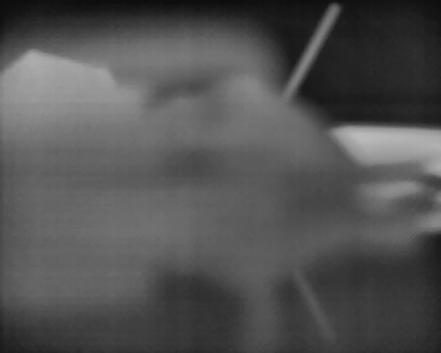

# LWIRcam: Capture Thermal Images

LWIRcam saves images from supported USB thermal cameras. With supported
Tiny1C data it also retains temperature samples and can measure selected
regions. Start with one clean capture before changing rendering or analysis.

[Thermal terms](../../../docs/glossary.md#lwircam) |
[Calibrate your camera](lwir-calibration.md)

| Camera | Available Data |
| --- | --- |
| Tiny1C combined mode | 256 x 192 display image and a separate 256 x 192 temperature plane |
| TDK IRcamera `5474:5411` | 640 x 512 display image; no temperature plane in this supported mode |

## Build On The PC

```sh
make -j32 lwircam
bin/lwircam --features
```

For an ARM64 release use the [installation workflow](../../../docs/README.md#deploy-to-mora).
`--features` reports the capture backend (`capture=v4l2`, native Linux V4L2
with the kernel `uvcvideo` driver) and which optional analysis/mock features
are built.
The development PC supplies Linux headers; no compiler or development packages
are needed on MORA.
Hotspot geolocation and ONNX classification need analysis enabled consistently
for USHER and its worker, for example `LWIR_ENABLE_ANALYSIS=1` when building
the selected release. Ordinary image/temperature capture does not require it.

To deploy the full Sensoraia suite on MORA with LWIRcam selected as the active
service, set `CAMERA = lwircam` in `camera.conf` or run:

```sh
make mora-deploy CAMERA=lwircam
```

Or, to deploy a minimal LWIR-only package (excluding the other camera workers
and models):

```sh
make mora-deploy MORA_PROFILE=lwircam
```

Both configure `usher.service` to start `usher --lwircam`. For an NPS flight
using the physical thermal camera and UART, follow the
[laptop-to-MORA desk test](../../../docs/desk-test.md) with aircraft
`Easystar_3_LWIRCAM` (`USHER_CAMERA_MASK_LWIR`). The connected FTDI cable
selects MORA automatically. The capture-only build does not return hotspot
navigation points.

### ARM64 CPU Profiles

The normal ARM64 build targets Raspberry Pi Zero 2 W. Select the intended CPU
when cross-compiling on the development PC:

```sh
make lwircam-arm64 ARM64_BOARD=pi-zero2w
```

| `ARM64_BOARD` | CPU Tuning |
| --- | --- |
| `pi-zero2w` | Cortex-A53; default for MORA |
| `radxa-zero3w` | Cortex-A55 |
| `orange-pi5b` | Cortex-A76/A55 combination |
| `generic` | Portable ARMv8-A baseline |

Choose one profile for the board that will run the binary. Tuned builds are
not interchangeable with every ARM64 processor. Rendering and temperature
statistics already use native NEON fast paths where supported. CPU tuning does
not activate a GPU, hardware JPEG encoder or NPU, and does not qualify a board's
OS image or camera drivers. Use a matching target sysroot when required and
measure on the actual board. Continue to build on the PC and deploy binaries,
not compilers or development packages, to MORA.

Tiny1C's combined stream supplies 25 independent frames per second in the tested
mode. Faster processing cannot create additional camera frames. Measure camera
wait, rendering, JPEG encoding, metadata and durable storage separately; using
more threads is not automatically faster for a 256x192 image. Keep resource
headroom for the whole Pi Zero 2 W's shared 512 MB, not only the capture worker.

## Native V4L2 Capture

Native capture opens only supported USB camera identities and image-capture
endpoints, not arbitrary video or metadata devices. Automatic discovery checks
`/dev/video0` through `/dev/video63` and requires exactly one supported image
endpoint. Multiple cameras are an error, never an arbitrary first-device choice.
Select the actual serial or an actual stable `/dev/v4l/by-id/` image-device link:

```sh
bin/lwircam --device /dev/v4l/by-id/ACTUAL-CAMERA-IMAGE-LINK \
  --native-raw --stats /absolute/path/native-thermal.jpg
```

An explicit path can also select a higher-numbered device. If both path and
serial are provided, they must identify the same camera. The config key
`device=/dev/v4l/by-id/ACTUAL-CAMERA-IMAGE-LINK` selects the worker device when
USHER is given that LWIR config. Device selection is rejected for offline replay.

The driver requires exact YUYV dimensions, tightly packed rows and full frame
length. Tiny1C image-only 256x192 negotiation, padded rows, partial/error frames,
duplicate/backward sequences and stale qualified monotonic buffers cannot become
successful captures. It owns two to four bounded MMAP buffers, requeues each
dequeued frame before success and releases partial startup resources on failure.
Eight-frame qualification is only for the first startup of a newly seen USB
camera instance. It is not repeated for later photos, a quiet interval, rejected
frames, a sequence gap, reopen or a worker restart. A private volatile record
under `/run/lock` remembers completion for the service user, keyed to the host
boot and USB enumeration identity. The kernel does not expose a sensor power-cycle
counter: a genuinely new USB enumeration is treated as new startup. An inaccessible
startup record is an explicit error, never a reason to silently repeat the wait.

Later requests select the next usable fresh frame without rebuilding a frame
count. Older queued frames are skipped, never returned as that request's photo.
Missing, corrupt or neutral-fill frames may still delay capture until valid data
arrives; that is not an artificial warmup delay. Optional scene/settling checks
still apply when explicitly selected, but never add an eight-frame wait after
startup. The configured warmup time also applies only to initial startup. Images
are copied only when needed for settling or a selected capture.

Polling is event-driven,
with short cancellation intervals and monotonic deadlines; kernel/driver stalls
cannot be preempted by a userspace deadline.

Fatal queue/protocol failures block further use of that session until it is
closed and reopened. Cleanup retains any mapping the kernel failed to unmap,
so a repeated close can release it; reopening cannot overwrite that ownership.
Descriptor-close errors are not blindly retried, because Linux may already have
released the descriptor number. These checks reduce long-running failure risks;
they do not guarantee that a USB cable, camera or kernel driver cannot fail.
Validate the intended installation with a sustained soak test before relying
on unattended all-day operation.

Real Tiny1C transitions can produce a full-sized neutral fill: every byte pair
in both planes is `00 80`, displaying black while falsely converting to a
uniform 238.85 C. Live capture rejects that exact whole-frame pattern and any
entirely invalid temperature plane, and waits for good
frames or the existing deadline. A real `0x8000` temperature in a useful frame
is not rejected. Offline replay remains structural evidence, not fresh capture.

The supplied service includes the `video` group and camera-specific video-node
udev rules. The kernel `uvcvideo` driver must be bound, and other camera owners
must be stopped; reconnect the device if another USB tool previously detached
the kernel driver and the normal video nodes do not reappear. Permission, busy,
unplug and driver errors are failures, not permission to use an old frame.

Native `--device-state` uses Linux USBFS control requests for the existing
Tiny1C read-only mailbox protocol. It opens the matched USB node only for the
snapshot, verifies the USB-instance identity, and closes it afterward without
claiming interfaces or detaching `uvcvideo`. This requires read/write permission
on the USB device node as well as normal video-node access. Image-only TDK still
has no temperature/state support.

Host dequeue/arrival time and the kernel's monotonic buffer timestamp/flags are
preserved separately. Neither is automatically qualified as exposure time, even
when the kernel marks a timestamp as start-of-exposure.
The kernel may overwrite buffer metadata during requeue; accepted-frame clock
evidence is snapshotted before returning buffer ownership.
Revalidate measured
latency when changing USB topology or kernel drivers; previous lag measurements
must not silently be reused for attitude-sensitive projection. Saved JPEG
temperature bytes remain exact and native; the kernel timestamp is additional
evidence, not calibration.

LWIRcam captures directly through Linux V4L2 and USBFS, with no external UVC
or USB user-space library dependencies. Host fault tests and
cross-compilation alone do not qualify a real camera: verify a fresh full-height
JPEG, its complete thermal plane and an exact raw companion on the target.

## First Camera JPEG

Stop other owners of the camera, connect it and use a new filename:

```sh
bin/lwircam /absolute/path/first-thermal.jpg
```

Open the JPEG and check focus, orientation and the expected scene. With
multiple devices, choose the actual serial using `--serial SERIAL`.
Permission errors need device-access setup, not repeated captures.

Native Tiny1C capture must report
`native V4L2 YUYV 256x384 transport, 256x192 image and temperature planes`.
The 384 transport rows contain the full 192-row image followed by the full
192-row temperature plane, not a cropped or resized sensor image. Its other
advertised `256x192` UVC mode is image-only and must never be split into two
96-row planes. LWIRcam rejects that mode and non-native live Tiny1C dimensions.
An unoriented JPEG without a legend is 256 x 192; its embedded temperature
plane always remains 256 x 192. A raw combined companion is 196608 bytes.

For the TDK mode, preserve the native 640 x 512 dimensions. It is image-only:
colourful pixels do not provide temperatures, statistics or thermal calibration.



## Measurements And Threshold Coverage

These examples require a supported Tiny1C temperature plane:

```sh
bin/lwircam --stats /absolute/path/statistics.jpg
bin/lwircam --roi 32 24 128 96 --thresholds 15 45 /absolute/path/region.jpg
bin/lwircam --point 128 96 --average-3x3 /absolute/path/spot.jpg
```

ROI, point and line coordinates refer to the original sensor image: origin
at the top left, X right and Y down. Check the actual native dimensions.
Out-of-range selections are rejected rather than silently clipped.

Thresholds specify an inclusive temperature band for diagnostic coverage,
not a command to change sensor gain. The printed min/max, averages and
coverage describe the selected valid samples; they are not independent
temperature calibration. Printed decimal places are not measured accuracy.

## Display Orientation And Acceleration

```sh
bin/lwircam --rotate 90 --mirror /absolute/path/oriented.jpg
bin/lwircam --window 15 45 --palette iron --legend /absolute/path/fixed-window.jpg
bin/lwircam --percentiles 2 98 --palette white-hot /absolute/path/contrast.jpg
```

Rotation is clockwise, followed by mirror/flip. These change the displayed
view, not the raw temperature coordinates. A fixed window makes successive
views easier to compare; percentiles emphasize the current scene's contrast.
Neither creates additional sensor detail or changes preserved temperatures.

## Adjust Image Contrast

If the picture looks flat or grey, higher contrast can make small temperature
differences easier to see. These software controls draw the JPEG from the
temperature plane; they do not change camera gain or temperature calibration.
There is no separate `--contrast` option. Use a new output filename for each
capture.

Start with automatic contrast:

```sh
bin/lwircam --percentiles 2 98 /absolute/path/contrast.jpg
```

This spreads the middle 96% of the scene's temperature samples from black to
white. The coldest 2% appear black and the hottest 2% appear white. Try
`--percentiles 5 95` for stronger contrast, with more extremes shown as solid
black or white. Automatic contrast adapts to each picture, so the same
temperature can have a different brightness in the next picture.

For USHER, add or update these settings in the LWIR config passed with
`--lwir-config`:

```ini
percentile_low=2
percentile_high=98
palette=white-hot
```

For consistent brightness between pictures, use a fixed temperature range
instead:

```sh
bin/lwircam --window 20 35 /absolute/path/fixed-contrast.jpg
```

With the default white-hot palette, 20 C becomes black and 35 C becomes white.
Temperatures below or above that range also appear black or white. Choose a
range that suits the scene. In a USHER config, use `window_low_c=20` and
`window_high_c=35` instead of the two percentile settings. Use either automatic
percentiles or a fixed window, not both in the same command or config.

The saved temperature samples stay unchanged, even where the picture becomes
solid black or white. Higher contrast adds no sensor detail and does not make
temperature readings more accurate. For Spottercam, keep the chosen rendering
mode and settings consistent between model training and operation.

## JPEG Quality And Speed

Use the generic [Camera Speed Test](../../../docs/camera-speedtest.md) to
measure saved-image throughput on the deployed board. Sensor frame rate,
fastest single capture and sustained saved-image rate are distinct metrics.

Normal captures use JPEG quality 95 with 4:4:4 sampling. It is usually a useful
balance between picture detail, file size and encoding work. Quality 100 is
also lossy; it is not a way to preserve exact original image pixels. Keep the
raw companion when those original bytes are needed.

Select quality 100 for comparison, or set another value from 1 to 100:

```sh
bin/lwircam --jpeg-quality 100 /absolute/path/quality-comparison.jpg
```

For USHER, put `jpeg_quality=95` or `jpeg_quality=100` in its LWIR config. The
command-line option overrides the config for a standalone capture. The selected
quality and 4:4:4 sampling are recorded in the JPEG's capture evidence.
Existing zero-initialized library callers retain their quality-100 default;
the capture worker explicitly selects 95.

The embedded temperature plane remains exact at every JPEG quality. Its
98304 bytes also limit total-file savings: only the displayed image becomes
more compressed. Lower quality can soften small details, especially at this
sensor resolution. Keep quality, rendering and palette consistent between
Spottercam training and operation, and evaluate small-object detection before
changing a deployed model's input policy.

A paired development-PC test on the same recorded Tiny1C frame measured about
0.93 ms per JPEG at quality 100 and 0.73 ms at 95, excluding USB and storage.
Total file size fell from about 124 kB to 111 kB while all temperature bytes
remained identical. These are PC measurements, not Pi or other-board speed
claims. File publication still includes synchronization and no-overwrite checks;
those safeguards are not removed to inflate throughput.
A separate live PC run with raw companions, statistics and durable writes
enabled saved about 12.36 photos/s at quality 100 and 12.51 at 95. The encoder's
speedup therefore must not be presented as the same percentage gain for the
whole capture pipeline.

## Preserve Raw Measurements

```sh
bin/lwircam --native-raw /absolute/path/baseline.jpg
```

The raw companion is `baseline.jpg.raw`. Keep it with the JPEG when you
need the exact combined frame. The supported thermal JPEG also retains its
temperature plane; a screenshot cannot replace it.

For offline replay use `--raw` with the recorded dimensions and a new output.
Replay exercises stored data, not a fresh camera exposure.

For example, for a recorded 256-by-192 Tiny1C combined frame:

```sh
bin/lwircam --raw /absolute/path/baseline.jpg.raw --size 256 192 /absolute/path/replay.jpg
```

## Read-Only Device State

`--device-state` requests supported Tiny1C state information alongside capture.
The legacy mailbox reader was implemented, not just a stub; native capture now
uses the same field parser with Linux `USBDEVFS_CONTROL`, not libusb.
Transfers are limited to 64 bytes and 50 ms each within the 250 ms mailbox
budget. Cancellation, short replies, device replacement, permission failures
and transfer errors produce explicit statuses without invalidating the saved
image. Firmware fields may legitimately be unsupported, busy, invalid or
unavailable; successful host tests do not establish readback on every firmware.
Unavailable fields remain unavailable. It does not write firmware settings,
prove physical gain or exposure accuracy, or provide a complete correction
history. The image-only TDK mode does not support this Tiny1C readback.

On 2026-10-30, native USBFS readback was exercised on a PC-attached Tiny1C
reporting firmware `Tiny_V3.14_M`. The first snapshot returned 16 fields,
including gain selection, firmware, shutter, temperatures, emissivity and
image-processing settings. Twenty further state-enabled captures all passed
exact raw/embedded-temperature comparison while retaining five process file
descriptors and four video mappings. This is PC evidence, not a MORA readback
or endurance qualification.

The 250 ms budget does not guarantee all 20 fields in one snapshot. On this
camera, later AGC fields and mirror/flip were timed out or skipped, and some
following snapshots found the mailbox still busy. These statuses are retained;
the driver does not extend the budget or pretend that missing readings were
measured. Readback is after capture, not frame-atomic, and does not establish
gain, shutter timing or correction settings at exposure. To change settings, use
the separate [explicit sensor controls](#explicit-sensor-controls); capture
with `--device-state` never writes to the camera.

## Explicit Sensor Controls

Tiny1C hardware controls are standalone operations, not capture options. Stop
any service or other process owning the camera first. Only one control is
accepted per invocation; it cannot be combined with an output image, replay,
capture-server, analysis, correction or rendering options. Nothing in normal
capture or configuration-file loading automatically applies these writes.

Read and record original values before changing them:

```sh
bin/lwircam --get-control gain
bin/lwircam --get-control emissivity-128
bin/lwircam --get-control agc-mode
bin/lwircam --get-control agc
```

Select a particular camera with `--device /dev/videoN` or `--serial SERIAL`.
The normal native device identity, exclusive ownership and USB permissions
apply: the account needs read/write access to the Tiny1C USB node, which the
supplied `99-tiny1c.rules` grants to the `plugdev` group. These commands use
Linux USBFS directly.

### What Each Control Does

| Command | Values | What It Changes | Use It When |
| --- | --- | --- | --- |
| `--get-control NAME` | `gain`, `emissivity-128`, `agc-mode`, `agc` | Nothing; reads the current firmware value | Recording settings before a change, or checking state after an uncertain result |
| `--set-gain low\|high` | `low`, `high` | The sensor's physical measurement range. High gain gives finer temperature resolution over roughly everyday temperatures; low gain covers much hotter scenes at coarser resolution | Scenes saturate (pixels pinned at the maximum) in high gain, or you need finer detail and the scene is not hot |
| `--set-emissivity-128 N` | 1-128 | The emissivity the firmware assumes when converting radiation to temperature, in units of 1/128 (128 = 1.0, 122 ≈ 0.95, 64 = 0.5) | Measuring a known surface type: most organic matter, water and painted or matte surfaces are about 0.95; bare polished metal is much lower |
| `--set-agc-mode N` | 0-5 | The vendor's automatic contrast algorithm for the camera's own grey image plane | Tuning the camera-supplied image appearance; it does not change the temperature plane |
| `--set-agc 0\|1` | 0 off, 1 on | Whether that automatic image contrast is applied at all | Wanting a stable, non-adapting camera image for comparison between frames |
| `--ffc` | none | Triggers one flat-field correction (vendor OOC/B update); the internal shutter briefly closes to re-measure the sensor's offsets | The image shows banding, fixed patterns or drift, typically after warm-up or a large ambient temperature change |

Gain and emissivity affect the reported temperatures. The vendor defines AGC
mode and AGC on/off as image-processing settings for the camera's own grey
image; the temperature plane is not expected to change, but this has not been
independently measured. LWIRcam's own rendering windows, palettes and
percentile views are independent of both. `--set-gain` is
the physical sensor setting, unlike `--gain-label`, which only names the
gain recorded in metadata and correction-profile matching. During FFC the
camera may briefly deliver shutter-closed or repeated frames; avoid
triggering it while taking a capture you need.

### Output And Exit Status

On success the command exits with status 0 and prints one line:

```text
LWIR_CONTROL_OK control=gain operation=read value=1
LWIR_CONTROL_OK control=emissivity-128 operation=write value=122 readback=122 verified=1
LWIR_CONTROL_OK control=ffc operation=trigger acknowledged=1 verified=0
```

For gain, `value=1` means high and `value=0` means low. A write succeeds only
when the firmware reads back the requested value. FFC reports acknowledgement
only: the camera completed the request, but correction quality is not measured.

On failure the command exits with status 1 and reports the control, a status
(`timeout`, `busy`, `io_error`, `invalid`, `unsupported` or `cancelled`) and
whether a command was `submitted`. `submitted=0` means the camera was not
changed. `submitted=1` means it may have changed even though completion was
not confirmed; read the value back before deciding what to do next. Invalid
values or combinations exit with status 2 before the camera is touched.

Each operation first acquires a fresh valid stream frame, without repeating
the initial-power-instance-only eight-frame qualification; the camera's
control channel does not reliably answer before streaming frames. Property
setters send one command and then require matching targeted readback. This
confirms firmware readback, not physical temperature accuracy or
exposure-time settings. Standalone targeted reads bypass the short
all-fields snapshot budget.

Ordinary setters and targeted reads have a one-second mailbox budget; gain
and FFC have five seconds. FFC includes a three-second correction interval,
then checks mailbox completion. These intervals apply only to explicit
controls, never the normal capture hot path. The usual process supervisor
still bounds the complete invocation.

After any transfer error, timeout, cancellation or mismatched readback, inspect
the reported `submitted` flag. Never automatically replay a write or
FFC. Use `--get-control` to inspect current settings, then explicitly decide
whether to restore a previously recorded value. FFC is not flash calibration
programming; this API issues no save-to-flash, firmware-update or factory-reset
commands. Do not assume firmware settings are persistent across power cycles.

Changing physical gain or emissivity affects measurement interpretation. Keep
correction profiles and gain labels consistent and validate against independent
references. These APIs do not attach exposure-qualified setting history to
later photographs. No new flight-controller control protocol is introduced.

On 2026-10-30, PC-attached Tiny1C hardware tests changed and read back gain
high/low, emissivity 128/64, AGC mode 0/1 and AGC enable 1/0, restoring each
recorded original afterward. One FFC request was acknowledged. A following
JPEG passed exact raw/embedded-temperature comparison with all 49,152 native
temperature samples valid. Other firmware versions and MORA runtime remain
separate validation requirements.

## Measured Correction Profile

Use `--corrections` only with a profile established for the matching camera,
gain label, dimensions and temperature range. An operator-supplied gain label
is not physical gain readback. Keep the original samples and validate any
correction on independent references.

Start with the [temperature-check procedure](lwir-calibration.md#10-keep-temperature-checks-separate),
not arbitrary example coefficients. Display palettes and lens calibration
cannot replace temperature verification.

### Correction File Format

The flat INI uses these fields. Replace the identity/range and any fitted
values with your camera's measured, independently checked configuration:

```ini
format=LWIR_CORRECTIONS_V1
serial=YOUR_CAMERA_SERIAL
gain=YOUR_GAIN_LABEL
width=256
height=192
scale_ppm=1000000
offset_mk=0
range_min_raw=18000
range_max_raw=22000
bad_pixel_count=0
```

This shows an identity scale/offset and example support range, not a measured
correction. Raw units are kelvin times 64. The width/height, serial and gain
label must match the input, and the support range must stay within the
temperatures you verified. Unsupported readings are marked rather than
extrapolated. List measured bad pixels only when you have established them;
do not copy another camera's defect coordinates.

Apply a reviewed file with `--corrections /absolute/path/corrections.ini`
and its matching `--gain-label`. Original samples remain available; display
correction does not write firmware calibration tables. Save the file and
independent checks together so the result can be reproduced.

## Use With USHER

For a reviewed live bench configuration:

```sh
./usher --lwircam --lwir-config /absolute/path/thermal.ini
```

A small capture policy might contain:

```ini
format=LWIR_CONFIG_V1
width=256
height=192
warmup_ms=5000
timeout_ms=20000
palette=iron
legend=1
```

Those dimensions are a Tiny1C example, not the TDK stream. Use the actual
camera mode. Select a new directory/session for new observations and keep
service changes separate from standalone camera checks.

## Geographic Hotspots

Use the [calibration workshop](lwir-calibration.md) to measure lens geometry
and mounting and check independent targets. Geographic analysis also needs
usable observation pose/timing and the appropriate analysis build profile.
A detected hot region is not automatically a fire or a surveyed location.

## Optional ONNX Classification

Choose the assignment in `lwircam_settings.ini`, then use `--check-model`
before `--analyze` on an existing image. Models requiring temperature values
cannot use an image-only TDK frame. Classification is separate from numerical
temperature measurement and calibrated hotspot projection.
[Choose compatible model inputs.](../../../docs/onnxruntime.md)

## Troubleshooting

| Problem | Check |
| --- | --- |
| No camera or access denied | Power, USB cable, selected serial and device permissions |
| Temperature option rejected | Whether this mode supplies a supported temperature plane |
| Unexpected measurement location | Native coordinates versus rotated display |
| Changing brightness | Fixed window versus scene-dependent percentile rendering |
| Coordinates unavailable | Analysis feature, reviewed calibration and valid pose evidence |
| Implausible temperature | Independent references, emissivity, reflections, gain state and calibration |

Before combining sensors on MORA, check repeated capture, storage, timing and
total board resource use with the intended services running.
