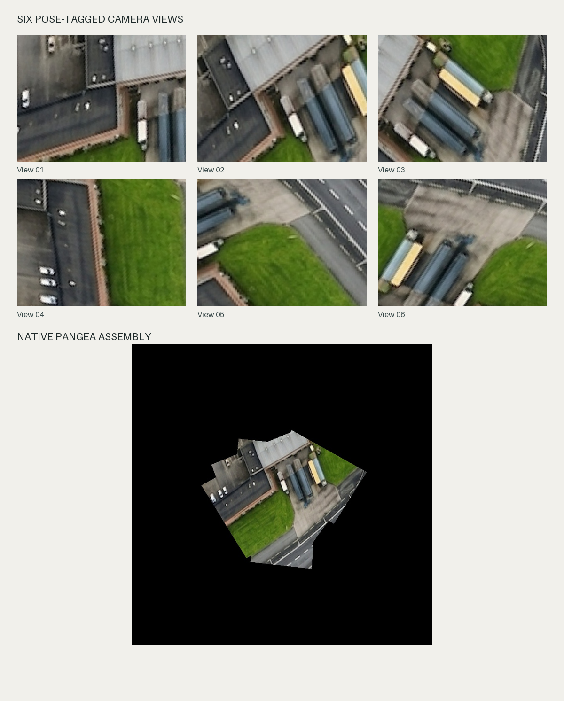

# PANGEA: Make Maps From Photographs

PANGEA combines supported saved photographs into a georeferenced photo map.
Start with the included teaching images, then try photos from a MIMIC flight
or a camera with the required pose and calibration information.

[Mapping terms](../../../docs/glossary.md#pangea) |
[MIMIC flight](../../../docs/mimic.md) |
[GCS map tiles](#create-map-tiles-for-a-gcs)



The map is assembled from the six saved camera views.

## Try It Without A Flight

From the Sensoraia root, build PANGEA and copy the teaching images into your
own example directory:

```sh
make -j32 pangea
mkdir -p "$HOME/Pictures/pangea-example/photos"
cp modules/pangea/docs/images/pangea-photo-*.jpg "$HOME/Pictures/pangea-example/photos/"
bin/pangea --input "$HOME/Pictures/pangea-example/photos" \
  --output "$HOME/Pictures/pangea-example/map-01"
```

Use a new output name for a separate experiment. Wait for the map-published
message, then open `map-01/latest/map.jpg`. The originals are unchanged.
No flight, physical camera or online map connection is needed for this example.

## Make A Map During A MIMIC Flight

The [MIMIC Center session](../../../docs/mimic.md#a-complete-simulated-flight)
starts capture and mapping together and prints a new map directory. PANGEA
uses saved camera views, not direct stitching of the source provider tiles.

For a setup where you manage the other simulation components yourself:

```sh
./usher --local --mock-map --pangea "$HOME/Pictures/pangea-flight-01" --debug
```

Do not run that command beside a session already owning USHER. A missing
map does not necessarily mean capture failed; inspect the saved originals
and the mapper's own diagnostic.

## Use Your Own Camera Photos

For original USHER JPEGs with a matching measured camera profile:

```sh
bin/pangea --input /absolute/path/photos --output /absolute/path/new-map \
  --camera-profile /absolute/path/camera.ini
```

Add `--watch` if the directory will receive more completed photos. Otherwise
the command finishes its backlog and exits. One camera, resolution and
calibration belong together in a map.

The profile declares delivered image dimensions, lens geometry and mounting.
Use the supplied `examples/pangea/aicam-2028.ini` only as an illustrative
starting format, not measured calibration. Generic GPS-only JPEGs may lack
the attitude/height evidence required by this workflow.

### Prepare The Camera Profile

Copy `examples/pangea/aicam-2028.ini` to your own `camera.ini`. Its fields
describe the delivered JPEG, not just the sensor's advertised size:

| Field | What To Supply |
| --- | --- |
| `filename_prefix` | Original camera filename prefix, normally `a`, `c` or `l` |
| `width`, `height` | Actual JPEG dimensions in this mode |
| `fx`, `fy` | Focal lengths in image pixels, not millimetres |
| `cx`, `cy` | Principal point in the delivered image |
| `mount_roll_deg`, `mount_pitch_deg`, `mount_yaw_deg` | Measured mounting relative to the aircraft |

Keep `schema=PANGEA_CAMERA_V1`. The supplied numbers are a nominal example;
substitute measured geometry and mounting for your setup. Changed crop,
resolution or optics can need a different profile. Use original upright
photos, not pre-undistorted, cropped or annotated review copies.

For a live supported camera launcher, choose the actual backend and profile:

```sh
./usher --aicam --pangea /absolute/path/new-map \
  --pangea-camera /absolute/path/camera.ini
```

This is real capture. Review sensor ownership and service selection first.
The visual-return LOOM profile is not this launcher's real-photo mapping mode.

## Completed-Survey Workflow

Use a validated capture manifest or survey CSV with the supplied
`examples/pangea/survey.ini` format. Set input and new output paths for your
survey, then check it before running:

```sh
bin/pangea --check /absolute/path/map.ini
bin/pangea --run /absolute/path/map.ini
```

| Choice | Use It For |
| --- | --- |
| SIMPLE | A simpler reference-plane composite on a desktop |
| GREAT | Seam selection, blending and completed XYZ tile output |
| `runtime.profile=auto` | Let the application select the supported resource profile |

The bounded profile supports GREAT XYZ output; SIMPLE and orthomap exports
use a desktop profile. Do not force a desktop workload onto a small board.
Choose the tile zoom explicitly; higher zoom does not create source detail.

## Incremental GREAT

This workflow publishes provisional XYZ revisions as completed photos arrive,
then produces a final tile pyramid. It is distinct from the ordinary live
photo-map watcher and can run independently of USHER.

Copy `examples/pangea/great-aicam.ini` to your own `session.ini`. Set:

- `input.photo_directory` to the original USHER photo directory.
- `input.camera_profile` to your matching camera profile.
- Start/end latitude/longitude to the region the photos actually cover.
- `mosaic.reference_plane_amsl_m` to ground height in the same vertical
  reference as the admitted camera altitude; do not mix MSL and ellipsoid heights.
- `output.directory` to a new map session.

Keep `runtime.profile=low_memory` for this AI-camera directory workflow,
including when trying it on a desktop. The completed-survey profile choices
above are a different input path.

The example chooses `pose_policy=recorded` for ordinary request-pose metadata.
Choose `exposure` only when native capture provides qualifying observation-
time evidence. Exposure mode rejects missing evidence rather than silently
using a request pose. Neither choice certifies accuracy.

### Follow Completed Photos

Start capture separately, then run mapping in another terminal:

```sh
bin/pangea --follow-great /absolute/path/session.ini
```

This directory mode accepts completed top-level AI-camera `a*.jpg` originals
with suitable metadata, not LOOM references or arbitrary GPS-only exports.
Do not edit published originals while mapping. PANGEA reports rejected files
and resource delays; starting a watcher does not promise an immediate revision.

### Timing Controls

The incremental follower reads these settings from the session INI:

```ini
[live]
update_seconds=30
batch_photos=4
cpu_percent=20
pause_file=mapping.pause
final_file=capture.complete
```

After the initial revision, changed input becomes eligible for another render
when either four photos have accumulated or 30 seconds have elapsed since the
last successful render. These are scheduling thresholds, not completion
deadlines: validation, preparation and rendering still need time to finish.
`cpu_percent` limits average process CPU use relative to one core, not the
percentage of the whole computer. Its accepted range is 1..100.

Marker paths are relative to the INI directory. Create the pause file to defer
processing, then remove it to resume. Create the final file only after capture
and photo publication have finished. Pause and low-memory waits remain
cancellable; a final marker does not override a pause.

The ordinary `--watch` photo-map path instead checks for two seconds of stable
file identity using a monotonic clock, then publishes changed maps on its
ten-second export cadence. A future-dated photo does not postpone admission;
an explicit `--since` cutoff still filters source timestamps.

### Finish Or Resume

Stop capture and let pending tagging/publication finish. Stop the follower
with Ctrl+C, then finalize the unchanged session:

```sh
bin/pangea --finalize-great /absolute/path/session.ini
```

For an interrupted run, repeat `--follow-great` with unchanged inputs/settings.
Stopping PANGEA does not stop USHER. A finalized session is closed; choose
a new output directory for another flight. Directory input uses GREAT's
update/follow/finalize commands, not the completed-manifest `--run` path.

## Create Map Tiles For A GCS

Ground control stations display slippy Web-Mercator (`EPSG:3857`) pyramids of
`256 x 256` tiles addressed as `{z}/{x}/{y}.jpeg`, with `x` increasing eastward
and `y` increasing southward.

The quick `--input ... --output ...` replay command above writes one stitched
`latest/map.jpg` (plus `latest/map.vrt` for GIS tools), not a slippy tile tree.
To generate GCS-ready `{z}/{x}/{y}.jpeg` tiles from a directory of area photos,
use `processing.mode=great` with `output.format=xyz`. PANGEA projects each
admitted photo onto a UTM working grid, selects graph-cut seams, blends
overlapping views across four frequency bands, resamples into Web Mercator, and
writes clean `256 x 256` JPEGs without EXIF or XMP overhead.

### Choose Tile Zoom Levels And Staging Output

One XYZ run builds up to three consecutive zoom levels (`min_zoom` within two
levels below `zoom`), deriving each lower zoom from aligned `2 x 2` child tiles
so seams never jump when zooming in the GCS:

| Zoom | Ground Pixel (Equator) | Ground Pixel (~52°N) | Typical GCS Use |
| --- | --- | --- | --- |
| `17` | ~1.19 m | ~0.74 m | Approach and circuit overview |
| `18` | ~0.60 m | ~0.37 m | Standard flight-plan view; also read by [MIMIC](../../../docs/mimic.md) |
| `19` | ~0.30 m | ~0.18 m | Maximum built-in zoom of standard GCS satellite layers |
| `20` | ~0.15 m | ~0.09 m | Near-native low-altitude detail with a custom local GCS layer |

Pick `zoom` to match your camera's actual ground sample distance rather than
oversampling beyond optical detail. Always set `output.directory` to a **new
staging directory** first—never directly to a populated GCS cache—because
PANGEA refuses to overwrite existing `{z}/{x}/{y}.jpeg` files.

### Example 1: Directory Of Just-Captured USHER Camera Photos

Suppose you have just flown over an area with USHER AIcam and copied the folder
of saved `a*.jpg` originals to `$HOME/Pictures/area-flight-01/photos`, together
with your matching `camera.ini` ([Prepare The Camera Profile](#prepare-the-camera-profile)).

Create `$HOME/Pictures/area-flight-01/gcs-camera-tiles.ini` from
`examples/pangea/great-aicam.ini`:

```ini
[input]
photo_directory=/home/you/Pictures/area-flight-01/photos
camera_profile=/home/you/Pictures/area-flight-01/camera.ini
pose_policy=recorded

[start]
lat=52.0052
lon=4.3574

[end]
lat=52.0034
lon=4.3616

[processing]
mode=great

[runtime]
profile=low_memory

[mosaic]
reference_plane_amsl_m=0.2

[tiles]
zoom=19
min_zoom=17

[output]
directory=/home/you/Pictures/area-flight-01/xyz-session
format=xyz

[live]
cpu_percent=100
```

Key settings for a folder of photos you already captured:

- **`[start]` and `[end]`**: Opposite latitude/longitude corners bounding the
  area your photos cover.
- **`mosaic.reference_plane_amsl_m`**: Ground height of the surveyed field in
  the **same** vertical reference as the flight controller's navigation
  altitude.
- **`runtime.profile=low_memory`**: Required for the AI-camera
  `photo_directory` input path even on a desktop PC. Setting `cpu_percent=100`
  under `[live]` removes the background 20%-of-one-core throttle when running
  post-flight on a workstation.

Because all photos are already in the directory, you do not need to run the
`--follow-great` watcher. Run one of these single-pass commands from the
Sensoraia root:

- **Irregular flight path or partial bounding-box coverage** — publish every
  strictly observed, 100%-covered `256 x 256` tile and omit unphotographed
  corners cleanly without gap invention:

  ```sh
  bin/pangea --update-great "$HOME/Pictures/area-flight-01/gcs-camera-tiles.ini"
  ```

- **Complete lawnmower box coverage** — finalize the session with graph-cut
  seams, multiband blending and source-derived gap completion across the entire
  `[start]`..`[end]` rectangle:

  ```sh
  bin/pangea --finalize-great "$HOME/Pictures/area-flight-01/gcs-camera-tiles.ini"
  ```

Both commands publish the slippy tile pyramid at:

```text
$HOME/Pictures/area-flight-01/xyz-session/latest/xyz/{17,18,19}/{x}/{y}.jpeg
```

### Example 2: Completed Survey Directory With Manifest Or CSV

When your photo directory contains a completed capture manifest
(`*.capture.ini`, which already supplies `[start]`, `[end]` and `source_csv`)
or a validated survey CSV (`*.csv`) beside the JPEGs, use the desktop-capable
survey runner based on `examples/pangea/survey.ini`.

Create `$HOME/Pictures/area-survey-01/gcs-survey-tiles.ini`:

```ini
[input]
capture_manifest=/home/you/Pictures/area-survey-01/photos/photos_session.capture.ini

[processing]
mode=great

[runtime]
profile=auto

[tiles]
zoom=20
min_zoom=18

[output]
directory=/home/you/Pictures/area-survey-01/xyz-staging
format=xyz
jpeg_quality=95
```

If you use `source_csv=/path/to/photos.csv` instead of `capture_manifest`, add
`[start]` and `[end]` corner coordinates; on a desktop PC (`profile=auto` or
`desktop`), you can also add `complete_only=1` under `[tiles]` so flight lines
that miss the corners of your `[start]`..`[end]` box publish all complete tiles
and record omitted edge tiles instead of stopping.

Validate the inputs and tile plan first, then render across your PC's CPU
cores:

```sh
bin/pangea --check "$HOME/Pictures/area-survey-01/gcs-survey-tiles.ini"
bin/pangea --run "$HOME/Pictures/area-survey-01/gcs-survey-tiles.ini"
```

The tile folders (`18/`, `19/`, `20/`) are written directly inside
`xyz-staging/`, and the coverage report (`dataset.json` and `tiles.csv`) is
saved beside it under `pangea_exports/xyz_<session>/`.

### Place And Use The Tiles In Paparazzi GCS (PprzGCS)

**PprzGCS** (`pprzgcs`) stores its local map cache by default under
`~/.local/share/paparazzi/pprzgcs/map` (configured by `map/tiles_path` in
`~/.config/paparazzi/pprzgcs/settings.ini`, or in `pprzgcs --configure` under
**Map → Tiles path**). Inside that directory, each map provider uses:

```text
~/.local/share/paparazzi/pprzgcs/map/<DIR>/{z}/{x}/{y}<format>
```

PprzGCS **always checks the local disk cache before making any HTTP request**:
any `{z}/{x}/{y}.jpeg` file present on disk is displayed immediately, is never
overwritten from the Internet, and works completely offline (`pprzgcs --maps_no_http`).

Choose one of the two cache placements below depending on how you fly.

#### Option A (Recommended): Dedicated Local Layer In PprzGCS

Placing your PANGEA pyramid in its own cache subdirectory (`map/PANGEA/`) is
the cleanest setup:

- Your existing `GOOGLE` satellite cache stays untouched.
- You can toggle **Pangea Survey** on/off and adjust its opacity slider right
  over the satellite base map in PprzGCS's **Layers** panel.
- Setting `addr=""` prevents HTTP requests for unmapped surrounding tiles.
- Setting `zoomMax="20"` (or up to `22`) lets PprzGCS display sharp zoom-20+
  tiles directly, whereas the built-in `Google` layer clamps at `zoomMax="19"`.

1. **Copy only the numeric `{z}/` zoom folders into `map/PANGEA/`** (from
   `xyz-staging/` for `--run`, or from `xyz-session/latest/xyz/` for
   `--update-great` / `--finalize-great`):

   ```sh
   mkdir -p "$HOME/.local/share/paparazzi/pprzgcs/map/PANGEA"
   rsync -av "$HOME/Pictures/area-survey-01/xyz-staging/" \
     "$HOME/.local/share/paparazzi/pprzgcs/map/PANGEA/"
   ```

   *(For Example 1's camera-directory session, replace the source path with
   `"$HOME/Pictures/area-flight-01/xyz-session/latest/xyz/"` — keep the trailing
   slash so `17/`, `18/`, `19/` land directly inside `map/PANGEA/` without
   session metadata files.)*

2. **Register the local layer in your user `tile_sources.xml`**. PprzGCS loads
   `~/.local/share/paparazzi/pprzgcs/tile_sources.xml` ahead of its system
   defaults (you can also open both folders from PprzGCS via **File → Open app
   directory** and **File → Open user directory**). Copy the default
   `tile_sources.xml` into your user directory once if it is not there yet:

   ```sh
   mkdir -p "$HOME/.local/share/paparazzi/pprzgcs"
   cp -n /usr/share/pprzgcs/tile_sources.xml \
     "$HOME/.local/share/paparazzi/pprzgcs/tile_sources.xml"
   ```

   Edit `~/.local/share/paparazzi/pprzgcs/tile_sources.xml` and add your
   `Pangea Survey` `<source>` **at the top** of `<sources>` (PprzGCS assigns
   higher initial Z-order to earlier entries, so placing it above `Google`
   draws your fresh survey tiles on top of the satellite background
   automatically):

   ```xml
   <sources>
   	<source
   		name="Pangea Survey" dir="PANGEA"
   		addr=""
   		zoomMin="18" zoomMax="20"
   		tileSize="256"
   		format=".jpeg"
   	/>
   	<!-- keep existing Google, OpenStreetMap, etc. entries below -->
   ```

   Match `zoomMin` and `zoomMax` to the zoom levels you generated (for example
   `17` and `19`, or `18` and `20`). If you do not add a custom `200 x 100` PNG
   at `~/.local/share/paparazzi/pprzgcs/pictures/map_thumbnails/Pangea Survey.png`,
   PprzGCS uses its default layer thumbnail automatically.

3. **Start PprzGCS and enable the layer**: launch `pprzgcs` (add
   `--maps_no_http` for strictly offline field operation), open the **Layers**
   panel, enable **Pangea Survey** alongside **Google**, and zoom in to your
   surveyed area.

#### Option B: Drop-In Merge Into PprzGCS's `GOOGLE` Cache

PprzGCS's built-in **Google** layer uses `dir="GOOGLE"`, `zoomMin="0"`,
`zoomMax="19"`, `tileSize="256"`, and `format=".jpeg"`—the exact tile geometry
and `.jpeg` extension PANGEA writes. Merging zoom `17..19` tiles into
`map/GOOGLE/` requires zero XML configuration and also feeds zoom `18` directly
into Sensoraia's [MIMIC](../../../docs/mimic.md) simulated camera
(`GOOGLE/18/{x}/{y}.jpeg`).

1. Generate your tiles with `zoom=19` and `min_zoom=17` into a staging folder
   (built-in `Google` does not request zoom `20`+).
2. Optionally back up `~/.local/share/paparazzi/pprzgcs/map/GOOGLE` if you want
   to preserve prior cached satellite imagery over the same coordinates, then
   merge the numeric zoom directories:

   ```sh
   mkdir -p "$HOME/.local/share/paparazzi/pprzgcs/map/GOOGLE"
   rsync -av "$HOME/Pictures/area-flight-01/xyz-session/latest/xyz/" \
     "$HOME/.local/share/paparazzi/pprzgcs/map/GOOGLE/"
   ```

3. **Restart `pprzgcs`** if it was already open (PprzGCS keeps already-loaded
   tiles in memory for the current window session). Outside your photographed
   patch and at coarser zooms (`0..16`), PprzGCS seamlessly surrounds your
   updated survey area with the rest of your `GOOGLE` cache.

## Map Files

Open the printed `latest/map.jpg` for a quick view. Geographic companion
files, coverage information and export reports describe how the map is placed
and which input contributed. Use those records when importing into GIS tools.

For the ordinary live/replay workflow:

| File | Use It For |
| --- | --- |
| `latest/map.jpg` | Quick visual view of the current map |
| `latest/map-mask.pgm` | Distinguish photographed coverage from missing ground |
| `latest/map.vrt` | Open the georeferenced map with transparent gaps in QGIS/GDAL |
| `latest/map.jgw` | JPEG world-file positioning; it does not identify a CRS by itself |
| `latest/map.json` | Geometry, input counts and source/profile information |
| `done/*.json` | Find accepted/rejected source records and their reasons |

Black in the JPEG can mean missing coverage or real black image content;
use the coverage mask or VRT to distinguish them. Map pixel spacing is not
a measurement of geographic accuracy.

XYZ tiles are addressed by zoom/X/Y, not three-dimensional coordinates.
A visually complete export can contain source-derived gap filling; it is
not proof every output pixel was independently photographed. Neither SIMPLE
nor GREAT reconstructs building heights or all terrain relief.

A completed GREAT export is a tile pyramid with a `dataset.json` report;
PANGEA does not currently package it as one GeoTIFF. The ordinary live/replay
map workflow separately provides the `latest/map.vrt` GIS view described
above.
For an interrupted survey, keep inputs and settings unchanged and rerun the
same command to reuse a matching checkpoint. Changed inputs or calibration
need a new job. Do not edit originals midway through a resumed survey.

## Troubleshooting

| Problem | Check |
| --- | --- |
| Photos rejected | Required pose/height information, image orientation and camera profile |
| No published map yet | Wait for export, not just an assembled-photo message |
| Doubled roof edges or seams | Pose timing, calibration, terrain relief and overlap |
| Existing output refused | Use a new directory or resume the matching unchanged job |
| Resource limit reached | Use the appropriate resource profile and inspect the diagnostic |
| Working input changed during checksum | Stop edits or copying into published inputs; resume only with the original unchanged files |
| Cannot hash or publish a working file | Check that storage is available and the input is a regular file, not a pipe or symlink |
| New tiles do not appear in PprzGCS | Confirm numeric `{z}/{x}/{y}.jpeg` folders sit directly under `map/<DIR>/`, check `zoomMin`..`zoomMax`, enable the layer, and restart `pprzgcs` |

Reference-plane maps can misplace elevated objects. Attractive blending and
fine pixel spacing do not demonstrate surveyed geographic accuracy.
