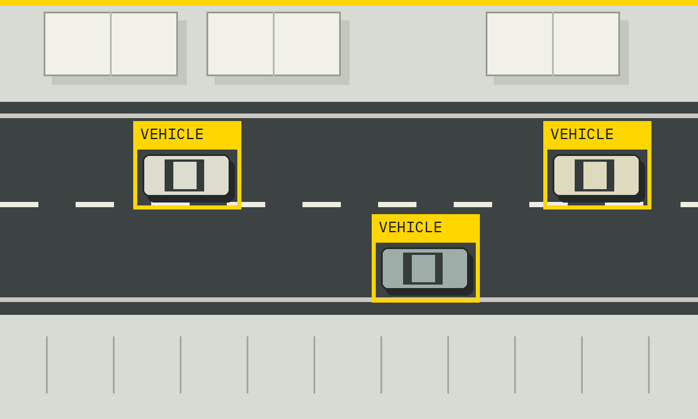
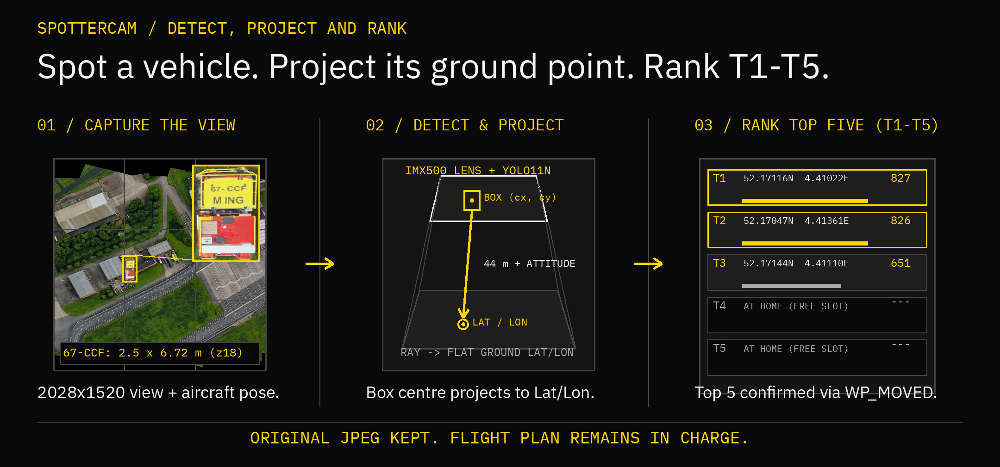
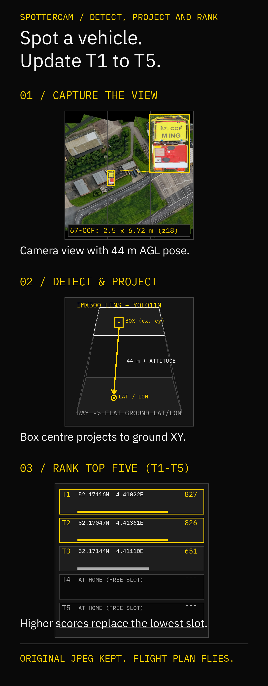
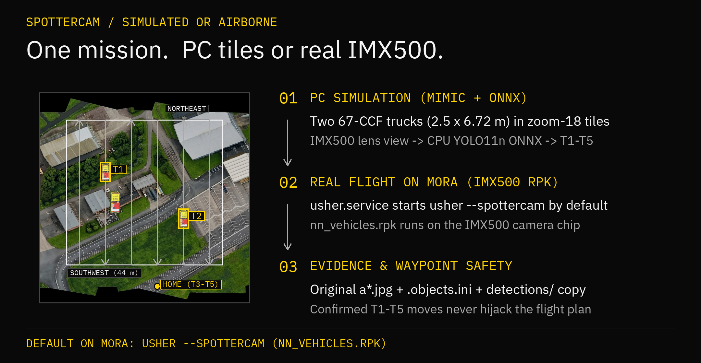
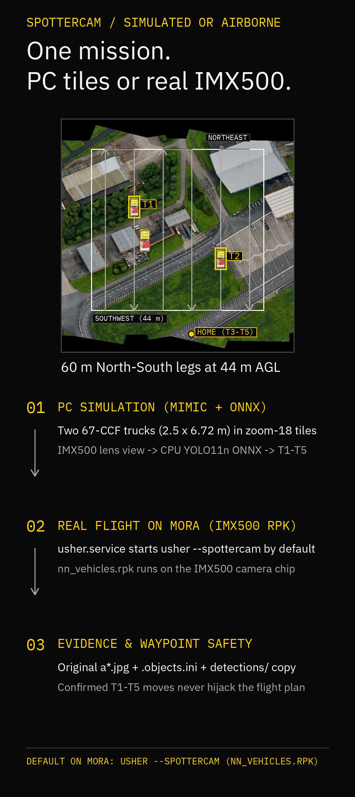

# Spottercam: Look For Vehicles

Spottercam turns your airborne camera into a patient lookout. It inspects each
captured photograph with a vehicle detector, keeps the original image untouched,
and—when combined with aircraft pose and camera geometry—projects spotted
vehicles onto the ground and ranks the five best finds as waypoints **T1** to
**T5**.

You do not need an airfield or a borrowed firetruck to try it. Start with a
single saved picture or the interactive PC flight simulation, where two French
67-CCF firetrucks are parked on the map for your aircraft to discover, and move
to MORA and the physical IMX500 AI Camera when you are ready to fly.

[Detection terms](../../../docs/glossary.md#spottercam) |
[AI Camera setup](../../ai_cam/docs/raspberry-pi-ai-camera.md) |
[Paparazzi setup](../../../examples/paparazzi/README.md)



## Live Vehicle Search: Detect And Respond

Think of airborne vehicle search as three calm, well-separated jobs:

1. **Capture a clear view** along with where the aircraft was and how it was
   tilted at that moment.
2. **Detect vehicles in the image** and record their bounding boxes, subpixel
   centres and confidence scores in a sidecar file (`*.objects.ini`) without
   scribbling over the original photograph.
3. **Project and rank the top five targets (`T1..T5`)** on the ground while
   leaving the flight plan in complete charge of where the aircraft actually
   flies.

A bounding box in a photograph is an observation, not a steering command. Even
when Spottercam spots a bright red firetruck with high confidence, your flight
plan keeps flying its survey rather than diving uninvited toward the truck.

{ .field-guide-wide loading=lazy decoding=async }

{ .field-guide-tall loading=lazy decoding=async }

## Automatic Model Selection

One settings file—`modules/spotter_cam/spottercam_settings.ini`—serves both
real flights on MORA and simulated flights on your PC:

```ini
inference_backend=auto
input_source=live
model=models/nn_vehicles.rpk
score_threshold=0.6
class_index=0
max_detections=5
onnx_threads=1
inference_timeout_ms=2000
```

Why point to `.rpk` when your laptop does not have an IMX500 sensor wired to its
motherboard? Because `inference_backend=auto` knows the difference:

- **On MORA with the physical IMX500 AI Camera**, Spottercam uploads
  `models/nn_vehicles.rpk` directly into the camera's onboard neural processor.
- **On a PC in simulation or saved-picture analysis**, Spottercam automatically
  checks `modules/spotter_cam/models/` for the matching ONNX exports
  (`vehicle_yolo11n_int8.onnx` first, then `vehicle_yolo11n_fp32.onnx`) with
  their `.ini` descriptors and runs whichever ONNX model the CPU runtime
  supports.

Paths inside the INI are relative to the INI file itself. See
[choose a model](../../../docs/onnxruntime.md#choose-a-model) before
substituting another export.

| Setting | Purpose |
| --- | --- |
| `inference_backend=auto` | Use IMX500 on hardware for `.rpk`, or probe the sibling CPU `.onnx` models on PC |
| `input_source=live` | Capture new images from the camera rather than analyse a single fixed file |
| `model` | Select the primary model file; ONNX exports also pair with a same-name `.ini` descriptor |
| `score_threshold`, `class_index`, `max_detections` | Set the minimum confidence (`0.6`), class (`0`) and box cap (`5`) for CPU ONNX detection |
| `onnx_threads`, `inference_timeout_ms` | Control CPU inference threads and the per-photo timeout in milliseconds |

The supplied IMX500 RPK decoder uses class 0 (`vehicle`), a `0.6` confidence
threshold and at most five boxes per image. Model choice and detector settings
are ignored when you run in photo-only mode.

| PC Demo Assignment | What Happens |
| --- | --- |
| Compatible ONNX export present (direct or sibling of `.rpk`) | Real neural inference on every simulated camera photograph |
| Unset/missing graph without a sibling ONNX export | Explicitly labelled seeded random spotting |
| Present but corrupt/incompatible graph or descriptor | Clear startup error—never silent random substitution |
| Valid inference with no vehicles in view | Zero detections (`count=0`), recorded cleanly as an empty frame |

Random spotting only exists as a fallback when no ONNX model is installed. The
normal runtime never invents imaginary vehicles to cover up a broken model.

{ .field-guide-wide loading=lazy decoding=async }

{ .field-guide-tall loading=lazy decoding=async }

## Try A Single Saved Picture First

Want to verify that the detector works on your PC in ten seconds flat, before
starting a flight simulator? Run:

```sh
make -j32 spottercam
bin/spottercam --check-model --settings modules/spotter_cam/spottercam_settings.ini
```

To analyse any `.jpg` photograph on disk (using a fresh copy so no old `.objects.ini`
sidecar is in the way):

```sh
cp resources/mock_image_01.jpg /tmp/test-spotter.jpg
rm -f /tmp/test-spotter.objects.ini
bin/spottercam --analyze /tmp/test-spotter.jpg \
  --settings modules/spotter_cam/spottercam_settings.ini --sequence 1
cat /tmp/test-spotter.objects.ini
```

This runs real CPU ONNX inference without needing a camera attached. Your input
JPEG is never re-encoded, and its SHA-256 hash is recorded inside
`/tmp/test-spotter.objects.ini` so detections can never be mixed up with another
picture. Build with `CAMERA_CAPTURE=0` only on machines where you intentionally
skip camera support.

## Five-Target Mock Survey

In the local simulation, your aircraft flies the survey in
`examples/paparazzi/conf/flight_plans/SENSORAIA/sensoraia_spotter_cam_demo.xml`
using the **IMX500 camera lens profile** (`examples/pangea/aicam-2028.ini`) and
native C USHER (`--spottercam --spottercam-targets`). On each wings-level shot,
USHER captures a mock vehicle scene (`resources/mock_aicam_01.jpg`), runs the
native YOLO11n ONNX detector in `bin/spottercam`, projects detected vehicles
onto the ground from the aircraft's pose, and sends ranked target updates for
waypoints **T1..T5** directly over the simulated UART (`digital_cam_point`).

Follow these steps to fly the mission manually from takeoff to landing in
Paparazzi Center—no physical camera, MORA board, or Python helper is needed:

### 1. Build Native PC Binaries And Install Paparazzi Links

From the Sensoraia root (with Paparazzi installed in `~/paparazzi`):

```sh
make usher soda spottercam
./kickstart.sh
```

### 2. Launch Paparazzi Center, Build NPS, And Execute The Session

Start Paparazzi Center from your Paparazzi directory:

```sh
cd ~/paparazzi
MORA_UART_DEVICE="" ./paparazzi
```

*(Setting `MORA_UART_DEVICE=""` forces PC-only simulation even if an FTDI cable
is plugged in.)*

In **Paparazzi Center**:

1. Set **Config** to `userconf/SENSORAIA/sensoraia_demo_conf.xml` and
   **Control panel** to `userconf/SENSORAIA/sensoraia_demo_control_panel.xml`
   (`./kickstart.sh` selects both by default).
2. Select aircraft **`Easystar_3_SPOTTERCAM`** and target **`nps`**, then click
   **Build**.
3. Open the **Session** tab, choose **`Sensoraia Spottercam NPS`**, and click
   **Execute** (starting `Sensoraia USHER`, `Sensoraia NPS`, `Data Link`,
   `Server`, and `GCS Classic`).

### 3. Take Off, Watch T1–T5 Update, And Land

In **GCS Classic**:

1. Wait a few seconds until the aircraft icon appears and GPS shows a valid 3D
   fix (`Wait GPS` switches to `Holding point`).
2. Click **Takeoff** in the GCS strip.
3. The aircraft climbs, spirals down at `SOUTHWEST` to the $44\text{ m}$ AGL
   survey height, and enters **Survey** (you can also click **Find vehicle** at
   any time from Standby).
4. Every three seconds on wings-level survey legs (bank angle within 12°), the
   autopilot triggers a shot. USHER runs native YOLO11n ONNX detection in
   `bin/spottercam`, ranks confidence (`0..1000`) across the five target slots
   (once all five slots are full, a strictly higher score replaces the lowest
   one), and transmits correlated `USHER_CAM_POINT_UPDATE` messages over the
   simulated UART so the flight plan moves **T1..T5** onto the projected
   coordinates using the ordinary GCS waypoint-update mechanism (`WP_MOVED`).
5. After the 160-second survey completes, the aircraft automatically flies its
   baseleg, final glide, and flare to touchdown. Stop all session programs in
   Center when finished.

### 4. Inspect Your Saved Photos And Detections

Check `~/Pictures/sensoraia/` after the flight:

| Saved File Or Folder | What You Will Find Inside |
| --- | --- |
| `~/Pictures/sensoraia/ma*.jpg` | Saved mock camera JPEGs tagged with EXIF flight pose and Spottercam detection summary |
| `~/Pictures/sensoraia/ma*.objects.ini` | Validated `USHER_OBJECTS_V2` sidecars with bounding boxes, centres, scores, and SHA-256 bindings |
| `~/Pictures/sensoraia/detections/` | Convenience copies of photographs containing accepted vehicle detections |

Locating real image boxes requires pose and camera projection. The supplied
projection profile is illustrative, not a measured calibration. Unusable
geometry (such as a steep bank during a U-turn) does not authorize moving a
waypoint, and a valid model can find fewer than five objects or none.

## Use A Physical Camera

When you move from your desk to the airfield with a real vehicle on the ground,
Spottercam runs on **MORA** with the **Raspberry Pi AI Camera (IMX500)** and
executes `modules/spotter_cam/models/nn_vehicles.rpk` directly on the camera's
neural chip.

### 1. Check The Camera And Model Selection On Your PC

Spottercam is already the **default camera** (`CAMERA = spottercam` in
`camera.conf`), which configures MORA's `usher.service` with:

```ini
ExecStart=/home/air/sensoraia/usher --spottercam
```

And `modules/spotter_cam/spottercam_settings.ini` already selects
`model=models/nn_vehicles.rpk` with `inference_backend=auto`.

Whenever you want MORA to boot with a different sensor instead of Spottercam,
edit `CAMERA` in `camera.conf` (or pass `CAMERA=<name>` to `make mora-deploy`—no
service-file editing required):

| Desired MORA Startup Mode | `camera.conf` / `make mora-deploy` Setting |
| --- | --- |
| **Spottercam** *(default: IMX500 + `nn_vehicles.rpk`)* | `CAMERA=spottercam` |
| **AIcam** (IMX500 native photos, no model) | `CAMERA=aicam` |
| **LWIRcam** (Tiny1-C / TDK USB thermal camera) | `CAMERA=lwircam` |
| **CHDKbridge** (Canon USB camera with CHDK) | `CAMERA=chdk` |
| **EARcam** (USB microphone acoustic search) | `CAMERA=earcam` |
| **LOOMcam** (visual homing framework on IMX500) | `CAMERA=loomcam` |
| **Diplacam** (native GP/diffusion field planner) | `CAMERA=diplacam` |

Spottercam, AIcam and LOOMcam are alternative owners of the same physical
IMX500 ribbon camera—pick one at a time. To package a custom Spottercam
settings file and its model, pass
`MORA_SPOTTERCAM_SETTINGS=/absolute/path/spottercam_settings.ini` to
`make mora-deploy`. See
[deploy and select a profile](../../ai_cam/docs/raspberry-pi-ai-camera.md#deploy-and-select-a-profile)
and [model selection](../../../docs/onnxruntime.md#choose-a-model).

### 2. Build And Deploy To MORA

Prepare the [AI Camera hardware](../../ai_cam/docs/raspberry-pi-ai-camera.md)
(connect the ribbon cable with power off). Then, from the Sensoraia root on
your PC, build and deploy the release to MORA:

```sh
make all
make mora-deploy MORA_SSH_TARGET=air@theatre.local MORA_INSTALL_DIR=/home/air/sensoraia
```

Confirm that `usher.service` is active and running `--spottercam`:

```sh
ssh air@theatre.local 'systemctl --no-pager --full status usher.service'
ssh air@theatre.local 'journalctl -u usher.service -n 50 --no-pager'
```

### 3. Perform A Bench Or Flight-Line Check Before Takeoff

Before launching the aircraft, verify that the IMX500 camera and
`nn_vehicles.rpk` capture and analyse a real frame cleanly (discovering a lens
cap on the bench is much nicer than discovering it at $44\text{ m}$).

Either trigger a single camera-2 shot from your connected flight controller (or
[FTDI desk setup](../../../docs/desk-test.md)), or run a standalone check on
MORA by stopping the service briefly, taking one test photo, and starting the
service again:

```sh
bin/spottercam --probe /home/air/sensoraia/models/ai_cam/nn_vehicles.rpk
bin/spottercam --capture /home/air/sensoraia/models/ai_cam/nn_vehicles.rpk /home/air/Pictures/bench-check.jpg
```

Initial RPK upload to the IMX500 takes a few seconds longer than subsequent
shots. Always use a new output filename and restart `usher.service` after a
standalone test so USHER owns the camera for flight.

### 4. Fly The Real Survey And Inspect Captured Evidence

1. Flash or configure your autopilot with `digital_cam_uart` and the survey
   flight plan (`sensoraia_spotter_cam_demo.xml`, adjusted for your airfield's
   coordinates and safe altitude).
2. Connect the flight-controller UART to MORA (`/dev/serial0`, 115200 baud,
   3.3 V logic, crossed TX/RX and common ground) and power the system.
3. After takeoff, enter **Find vehicle** (`Start demo` $\rightarrow$ `Survey`).
   On each periodic trigger, USHER captures a $2028 \times 1520$ JPEG and
   on-sensor `nn_vehicles.rpk` detections, writes synchronized flight EXIF
   (`SENSOR02` frame timing, GPS, attitude, and detection summary), and copies
   any photograph with a vehicle hit into `~/Pictures/sensoraia/detections/`
   while SODA writes annotated review crops.
4. After landing, retrieve the original `a*.jpg` photos, `a*.objects.ini`
   sidecars, and `detections/` copies from `/home/air/Pictures/sensoraia/`.

### Optional: Native Photo-Only Mode On MORA

If you want fast native IMX500 photographs without loading a model or running
detection, simply deploy with `CAMERA=aicam` (`make mora-deploy CAMERA=aicam`),
or run `--spottercam --native-photo` in a standalone session.

Repackage and deploy after changing the line. `--native-photo` needs no model,
cannot be combined with `--spottercam-settings`, and saves a $2028 \times 1520$
quality-90 JPEG with sensor timing evidence but no detection metadata or SODA
analysis. For a standalone photo-only check on MORA from `/home/air/sensoraia`
(with `usher.service` stopped):

```sh
bin/spottercam --photo-only --probe
bin/spottercam --photo-only --capture /home/air/Pictures/spotter-photo.jpg
```

Restore `usher.service` afterward. See
[native photographs](../../ai_cam/docs/raspberry-pi-ai-camera.md#native-photographs)
and the [camera speed test](../../../docs/camera-speedtest.md) for timing and
throughput options.

## Use LWIR Photos (Future & Multi-Sensor Option)

LWIRcam can remain the sole Tiny1C camera owner while a separate persistent
Spottercam CPU worker analyses each completed thermal JPEG. Its assignment is
independent of the AI Camera assignment. Supply an ONNX detector trained and
independently evaluated on representative Tiny1C imagery, plus its matching
`spotter_boxes_xyxy_v1` descriptor. The supplied
`modules/spotter_cam/spottercam_lwir_settings.ini` is a template, not a trained
thermal model. Keep the inference image rendering consistent with training.
This includes JPEG quality, which normal LWIR captures now default to 95.
Legends are rejected and missing real temperature/frame evidence is an error.

```sh
make usher spottercam CAMERA_CAPTURE=0
bin/spottercam --check-model --settings /absolute/lwir-detector.ini
./usher --lwircam --lwir-spotter-settings /absolute/lwir-detector.ini
```

Capture and flight EXIF complete before inference enters the existing bounded
saved-file queue. One warm detector retains the model; source images and
temperature planes are never rewritten. Overflow retains originals for offline
analysis. Detector errors never discard a photo or reuse an earlier detection.
SODA retries do not repeat object inference. This is asynchronous per-photo
analysis, not a promise to analyse every camera stream frame.

Each accepted result has an `.objects.ini` model record and an additional
`.lwir-objects.ini` record binding the photo number, frame/boot identity, source
and model hashes, native subpixel centres and nearest-pixel temperatures.
Invalid endpoint temperature codes are reported unavailable, not converted to
Celsius. A valid zero-detection result is different from failed analysis.
Results are local evidence; this option does not move aircraft waypoints or add
new flight-controller messages. Existing SODA AI-camera EXIF summaries are not
automatically written into these unchanged LWIR originals.

To enable geographic estimates, additionally supply a measured native 256x192
`PANGEA_CAMERA_V1` profile with the `l` prefix, correct intrinsics and mounting:

```sh
./usher --lwircam --lwir-spotter-settings /absolute/lwir-detector.ini \
  --lwir-spotter-profile /absolute/measured-lwir-camera.ini \
  --lwir-spotter-limits 5000,1
```

The limits are maximum exposure-interval width in microseconds and maximum
pose uncertainty in metres. Defaults are 5000 us and 1 m, not measured accuracy.
Projection requires an exposure-qualified aligned pose belonging to the exact
frame. Frame arrival alone, missing pose/calibration, broad timing or excessive
uncertainty leaves detections and temperatures usable but omits target latitude
and longitude. Use the existing clock alignment and measured
`--lwir-latency-ms MIN,MAX` facilities where applicable; never guess latency or
relax limits merely to obtain coordinates. All three aircraft attitude axes and
camera mounting rotations are applied through shared geometry. Detector centres
retain subpixel precision; only temperature sampling rounds to a native pixel.
Ground projection assumes a local flat surface and a calibrated pinhole camera.
Lens distortion, terrain, target elevation and physical timing/calibration errors
still require independent field validation; extra decimal places do not prove
pinpoint accuracy. Temperatures remain device-reported and uncalibrated.

An opt-in package includes the detector and chosen model without changing the
ordinary LWIR-only default:

```sh
make mora-package MORA_PROFILE=lwircam \
  MORA_LWIR_SPOTTER_SETTINGS=/absolute/lwir-detector.ini
```

The package enables saved-photo detection but does not invent a projection
calibration. Deploy separately only when the selected trained model is ready.
Measure latency and total shared 512 MB board headroom with the real model.

## Keep The Evidence

USHER stores the selected detection summary with the original JPEG's flight
metadata. SODA may make annotated/cropped review copies and a detection log.
The original flight photo remains undecorated.

A bounding box is an image result, not automatically a geographic target.
Where a valid target is integrated, the flight plan still decides whether to
visit it. Confidence, target freshness and geographic accuracy are different
questions.

## Supply A Different Vehicle Model

An arbitrary YOLO export or unrelated RPK is not automatically compatible.
Keep the class mapping, preprocessing and output contract with the export.
If using a **Vehicles dataset**, retain its exact source/version, permitted
use and independent evaluation. The filename does not identify the dataset release
or establish detector accuracy.

MIMIC views or saved photos may support external evaluation where imagery
rights permit. Choose views representative of the camera, add independent
labels and separate evaluation data. A north-up map or annotated SODA crop
is not automatically a ready-made training dataset.

## Troubleshooting

| Symptom | What To Check First |
| --- | --- |
| `local mode is already running` or `/tmp/usher-sim` busy | Stop the previous Center session or remove `/tmp/usher-sim` after confirming no USHER is running |
| Want hardware-in-the-loop over FTDI instead of PC USHER | Select the **Sensoraia MORA desk NPS** session in Paparazzi Center (see the [desk-test guide](../../../docs/desk-test.md)) |
| `--mock-map needs zoom-18 XYZ JPEGs` | Pan over the survey area at zoom 18 in `PprzGCS` so `~/.local/share/paparazzi/pprzgcs/map/GOOGLE/18` is populated |
| Photos saved (`ma*.jpg`), but `T1..T5` stay at `HOME` | Check the USHER console and `*.objects.ini` sidecars; shots during steep turns (bank angle 12° or more) are skipped by the flight plan |
| Real MORA camera busy | Ensure only one IMX500 owner (`--spottercam`, `--aicam`, or `--loomcam`) is running; stop `usher.service` before standalone `--probe` or `--capture` |

Model errors stop fresh target publication; existing points are not proof of
new observations. Check the selected assignment and worker log before
restarting. A successful image with zero detections is not an analysis failure.
For hardware problems, check camera ownership, cabling and runtime packages.
Validate camera geometry, timing and loaded MORA resources separately before
relying on real-flight locations.
